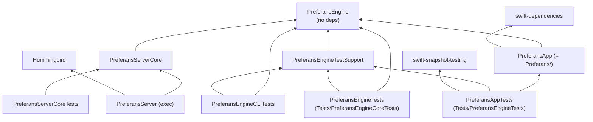
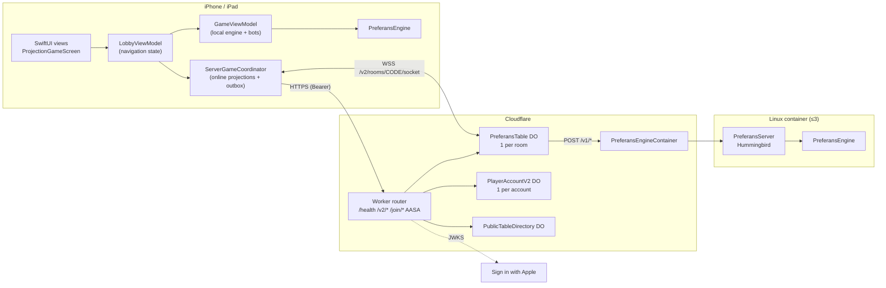
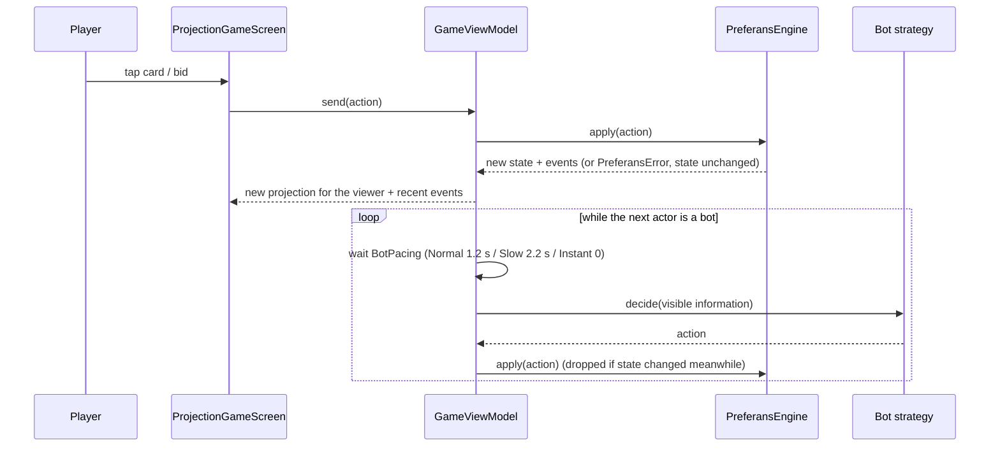

# Implementation Plan (as-built): Preferans — System Architecture

**Spec**: [spec.md](spec.md) · **Verified against**: `store/1.0.3-localized-keywords` @ `cd78828`

## Summary

The system has three tiers that share one Swift rules engine:

1. **iOS app** (`Preferans/`, SwiftUI). It runs local matches in-process through `GameViewModel`, which owns a `PreferansEngine` value and drives bots. Online, it is a *projection consumer*: it renders `PlayerGameProjection`s pushed by the server and submits commands through a durable outbox.
2. **Cloudflare Worker** (`workers/room-worker/`, TypeScript). It hosts the HTTP/WebSocket API and four Durable Object classes. `PreferansTable` (one per room) owns state, membership, ordering and exactly-once receipts. `PlayerAccountV2` holds accounts and sessions. `PublicTableDirectory` holds public listings. `PreferansEngineContainer` holds the container lifecycle.
3. **Engine container** (`Sources/PreferansServer`, Swift + Hummingbird). It is stateless: every request carries the opaque private state, and the response returns the new state plus per-viewer projections. It is the only place online rules run.

## Technical Context

| Item | As built |
|---|---|
| **Language/Version** | Swift 6 (`swift-tools-version: 6.0`, `SWIFT_VERSION = 6.0`); TypeScript `^6.0.3` (ES2022) |
| **Primary Dependencies** | App: SwiftUI, `swift-dependencies` 1.17.1 (clock/UUID only), AuthenticationServices, Security. Tests: `swift-snapshot-testing` 1.19.4. Server: Hummingbird 2.26.0 (resolved; `from: 2.22.0`). Worker: `@cloudflare/containers ^0.3.7`, `wrangler ^4.127.1`, `vitest ^4.1.0` |
| **Storage** | Durable Object SQLite-backed storage only (no KV/D1/R2). Device: Keychain (session token), UserDefaults (15 settings keys, account record, seat-token cache), Application Support (command outbox). Local matches are not persisted |
| **Testing** | Swift Testing + XCTest (about 579 SwiftPM cases), 9 text snapshot baselines, 63 XCUITest instances, worker `node --test` (52) + workerd `vitest` (14), Bun network scripts, 3 Python tooling tests. See [006](../006-testing-and-release/plan.md) |
| **Target Platform** | iOS 17.0+ app target, iPhone + iPad (`TARGETED_DEVICE_FAMILY = "1,2"`), Mac Catalyst enabled (`SUPPORTS_MACCATALYST = YES`). The package also declares iOS 16 / macOS 14 / tvOS 16 / watchOS 9 for the libraries. Linux (`swift:6.3.2-jammy`, linux/amd64) for the engine container. Cloudflare Workers runtime (`compatibility_date = "2026-04-07"`) |
| **Project Type** | Mobile app + edge API + containerized stateless rules service, in one repository |
| **Performance Goals** | 4-player all-bot match to pool 6 in well under 1 min with no delays. Server bot cadence 500 ms per move. Engine HTTP timeout 8 s |
| **Constraints** | No hidden information on clients. Exactly-once command application. Wire schema 4 is a clean break. Engine free of third-party dependencies |
| **Scale/Scope** | 3–4 seats per table. Container pool `max_instances = 3`. Up to 5 sessions per account. Production load has not been measured |

## Project Structure

```text
preferans/
├── Package.swift                 # SwiftPM graph with 3 lanes (default | PREFERANS_ENGINE_TESTS_ONLY=1 | PREFERANS_SERVER_ONLY=1)
├── Preferans.xcodeproj           # app target "Preferans" (compiles Preferans/ directly, links PreferansEngine + Dependencies
│                                 #   from the local package "."), UI-test target "PreferansUITests", one shared scheme
├── Sources/
│   ├── PreferansEngine/          # ★ rules, scoring, bots, projections, wire schema (no 3rd-party deps)        → 001 002 003 004
│   │   ├── Bot/                  #   strategies, hand evaluation, deal sampling, card-play planner             → 003
│   │   ├── Projection/           #   per-viewer redaction (PlayerGameProjection)                               → 004
│   │   └── Online/               #   GameWireMessage, PreferansWireSchema.current = 4                          → 004
│   ├── PreferansServerCore/      # AuthoritativeGameService: create / apply / advanceBot / project            → 004
│   └── PreferansServer/          # Hummingbird executable: GET /health, POST /v1/games|commands|bots          → 004
├── Preferans/                    # iOS app (also the SwiftPM target "PreferansApp" for unit tests)              → 005
│   ├── PreferansApp.swift        #   @main entry
│   ├── GameViewModel.swift       #   local match driver (engine + bots + pacing)
│   ├── UI/                       #   lobby, table, action bar, sheets, themes, settings (≈39 files)
│   ├── Online/                   #   ServerGameCoordinator, CloudflareRoomTransport, outbox, credentials       → 004
│   ├── Support/                  #   BotPacing, Localized, AppIdentifiers, TestHarness (launch flags)
│   └── Resources/Localizable.xcstrings   # en / ru / uk
├── workers/room-worker/          # Cloudflare Worker + Durable Objects + container binding                     → 004
├── Dockerfile.server             # 2-stage build of PreferansServer (PORT 8080)
├── Tests/                        # SwiftPM test targets (note: dir names ≠ target names, see 006)              → 006
├── PreferansUITests/             # XCUITest robots/drivers, full-match scripts, screenshots                    → 006
├── bin/                          # dev scripts: test-engine, test-ui, sim, screens, screens-latest, dev-online → 006
├── .github/workflows/            # multiplayer.yml (worker + engine lane), owner-server-build.yml (image, no deploy)
├── AppStore/                     # store metadata (24 locales), keywords, media, release evidence, ASC scripts → 006
├── fastlane/                     # legacy lanes (stale, see 006)
├── docs/                         # GitHub Pages: support, privacy, terms + older engineering notes
├── specs/                        # ← these specifications
└── .specify/memory/constitution.md
```

### SwiftPM module graph (default lane)



`PREFERANS_ENGINE_TESTS_ONLY=1` keeps only Engine, TestSupport and CLITests (no dependencies, Linux-friendly). `PREFERANS_SERVER_ONLY=1` keeps Engine, ServerCore and Server (used by `Dockerfile.server`).

## Architecture

### Runtime topology



**Who is authoritative for what**

| Concern | Local game | Online game |
|---|---|---|
| Rules and legality | `PreferansEngine` in `GameViewModel` | `PreferansEngine` in the container (stateless) |
| Game state | `GameViewModel.engine` (memory only) | `PreferansTable` DO (opaque private-state JSON) |
| Hidden cards | Device (the human only sees their projection; "View as" can show a bot's hand) | Server only. Clients get projections |
| Ordering and idempotency | Single-threaded main actor | Per-table mutation queue + command receipts |
| Bots | `GameViewModel` with `BotPacing` delays | `PreferansTable` alarm, one move per 500 ms |
| Identity | None | `PlayerAccountV2` (guest or Sign in with Apple) + per-seat tokens |

### Key flow 1 – a local move



After a completed trick, or when another seat wins the auction, the table **freezes until the player taps** (tap-to-advance; a hint appears after 4 s). See [005](../005-ios-app/spec.md).

### Key flow 2 – an online move

```mermaid
sequenceDiagram
  participant App as App (ServerGameCoordinator)
  participant O as Outbox (disk)
  participant T as PreferansTable DO
  participant C as Engine container
  App->>O: write command {id, payload}
  App->>T: command over the WebSocket (no HTTP command route)
  T->>T: enqueue (one queue per table); dedupe by id + payload fingerprint
  T->>C: POST /v1/commands {state, sender, actor, action, clientNonce, baseSequence}
  C-->>T: new privateState + projections per seat + status
  T->>T: persist state + receipt + checkpoint atomically
  T-->>App: receipt + projection (each seat gets only its own)
  App->>O: delete command
  Note over App,T: no receipt → resend the same id every 2–8 s
```

Details, every endpoint and message, and the reconnect and host-recovery flows: [004 plan](../004-online-multiplayer/plan.md) and [contracts](../004-online-multiplayer/contracts/).

## Cross-cutting concerns

| Concern | How it is handled | Where |
|---|---|---|
| Correctness | Full invariant validation after every engine action; generative seeded walks; canonical match scripts replayed in engine and UI | [001](../001-game-rules/data-model.md), [006](../006-testing-and-release/spec.md) |
| Privacy | Projections + per-viewer event redaction; public rooms mask account IDs | [004 data-model](../004-online-multiplayer/data-model.md) |
| Security | Bearer sessions (Keychain), 24-char seat tokens rotated on re-join, Sign in with Apple JWT verified against Apple JWKS, request rate limit binding, 128 KiB message cap, `client_authority_removed` for any client-authored state | [004 spec](../004-online-multiplayer/spec.md) |
| Resilience | Write-ahead outbox, exactly-once receipts, reconnect with backoff, lobby-manager re-election, alarm-driven retries (bots, library, directory) capped at 60 s | [004 plan](../004-online-multiplayer/plan.md) |
| Localization | `Localizable.xcstrings`: en/ru/uk, 480 strings. Ukrainian is forced on first launch. Changing language needs a restart. Store metadata in 24 locales | [005](../005-ios-app/spec.md), [006](../006-testing-and-release/spec.md) |
| Accessibility | Single identifier contract `UIIdentifiers.swift`; accessibility-size Dynamic Type layouts (settings, waiting room, onboarding); theme contrast ≥ 4.5:1 tested | [005](../005-ios-app/spec.md) |
| Configuration | Worker URL and storage suffix in `Preferans/Support/AppIdentifiers.swift`. Wrangler configs `wrangler.toml` / `wrangler.owner.toml` / `wrangler.local.toml`. Secrets only via environment | [004 quickstart](../004-online-multiplayer/quickstart.md) |
| Observability | The app logs online-flow steps with `os.Logger` (subsystem `com.mixandmatch.preferans`, category `online-flow`). Test loops print per-phase progress. There is no third-party analytics or crash-reporting SDK in the code base | [006](../006-testing-and-release/spec.md) |

## Complexity notes

- **Two online coordinators.** `ServerGameCoordinator` is the production path. The older client-hosted `RoomOnlineGameCoordinator` + `HostGameActor`, with its liveness, recovery and durability runners, is kept only for the in-memory DEBUG/UI-test room, but it carries the largest test file (`RoomOnlineGameCoordinatorTests`, about 2,000 lines). Prefer the server path for new work.
- **Directory names ≠ target names** in `Tests/` (`Tests/PreferansEngineTests` holds the target `PreferansAppTests`). See [006](../006-testing-and-release/spec.md).
- **Variant naming has three layers** (display name, stored ID, classical rule set). See the [glossary](glossary.md#rule-variants).
- **The app compiles twice**: once by Xcode (app target) and once by SwiftPM (`PreferansApp` library) so view models can be unit-tested on the command line.
