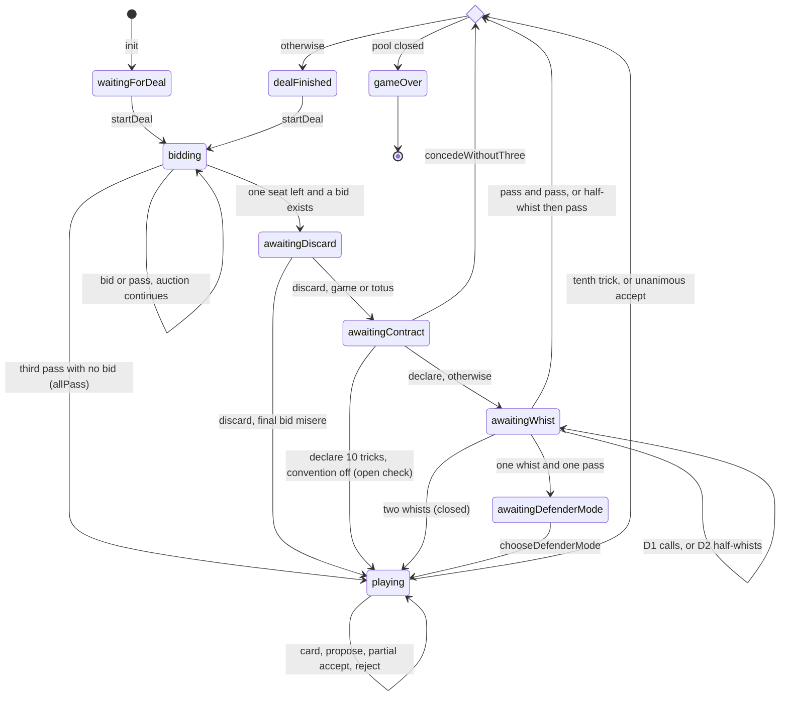
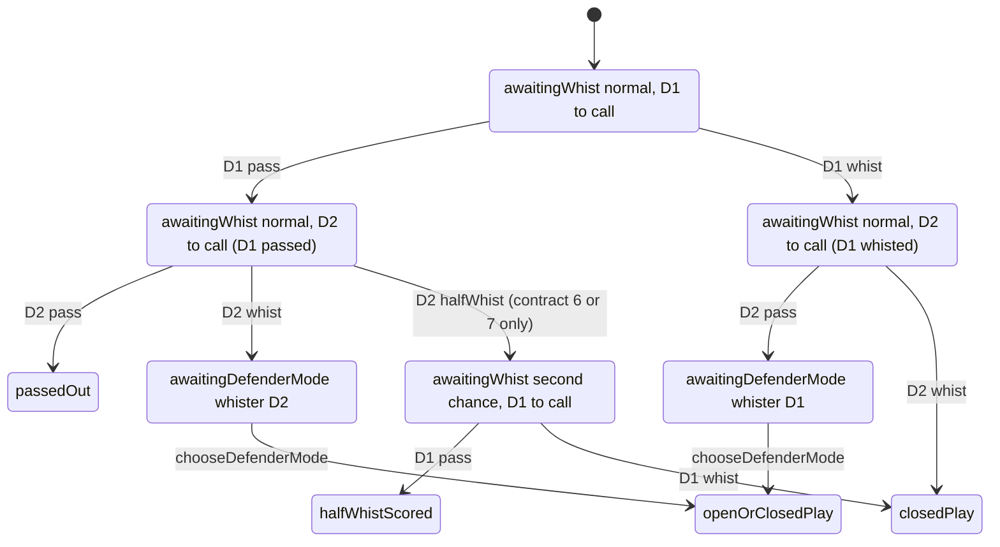
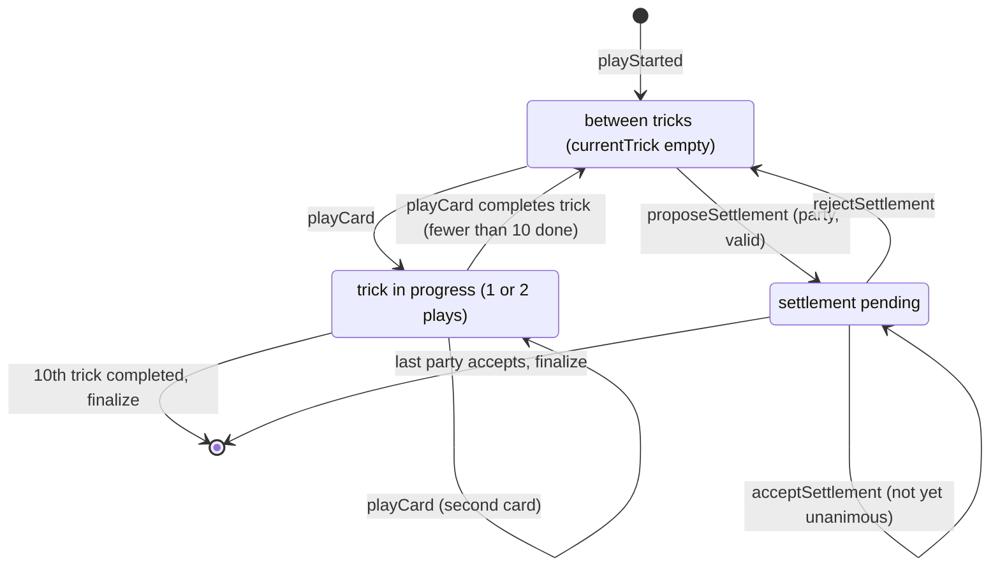

# Data Model: Preferans Rules Engine

**Status**: Implemented (as-built) · **Verified against**: `store/1.0.3-localized-keywords` @ `cd78828` · **Primary code**: `Sources/PreferansEngine/{Domain,State,Rules,MatchSettings,PreferansEngine,PreferansEngine+*,DealSource,DealDeckLayout,PreferansError,EngineTransition,PlayerIdentity}.swift`

Behavioural requirements are in [spec.md](./spec.md). Score types (`ScoreSheet`, `ScoreDelta`) and all scoring arithmetic are documented in [002](../002-scoring-and-variants/). Projection types are documented in [004](../004-online-multiplayer/).

All types are `Sendable` value types (structs or enums) unless noted. Almost all are `Codable` and `Equatable`/`Hashable`.

---

## 1. Ownership overview

```mermaid
classDiagram
    class PreferansEngine {
      +players: Array~PlayerID~
      +rules: PreferansRules
      +match: MatchSettings
      +state: DealState
      +score: ScoreSheet
      +nextDealer: PlayerID
      +dealsPlayed: Int
      +consecutiveAllPassDeals: Int
      +snapshot: PreferansSnapshot
      +apply(action) Array~PreferansEvent~
    }
    class PreferansSnapshot
    class DealState {
      <<enum>>
      waitingForDeal
      bidding(BiddingState)
      awaitingDiscard(ExchangeState)
      awaitingContract(ContractDeclarationState)
      awaitingWhist(WhistState)
      awaitingDefenderMode(DefenderModeState)
      playing(PlayingState)
      dealFinished(DealResult)
      gameOver(MatchSummary)
    }
    PreferansEngine --> PreferansRules
    PreferansEngine --> MatchSettings
    PreferansEngine --> DealState
    PreferansEngine --> ScoreSheet
    PreferansEngine ..> PreferansSnapshot : snapshot / init(snapshot:)
    DealState --> BiddingState
    DealState --> ExchangeState
    DealState --> ContractDeclarationState
    DealState --> WhistState
    DealState --> DefenderModeState
    DealState --> PlayingState
    DealState --> DealResult
    DealState --> MatchSummary
    PlayingState --> PlayKind
    PlayingState --> Trick
    PlayingState --> TrickSettlementProposal
    MatchSummary --> DealResult
    DealResult --> DealResultKind
    DealResult --> TrickSettlement
```

Data flows in one direction through the phases. Each phase struct is created from the previous one by a reducer and copies the fields it needs forward (`dealer`, `activePlayers`, `hands`, `talon`, and later `discard`, `declarer`, contract information and so on). No phase struct holds a reference to another.

---

## 2. Domain values (`Sources/PreferansEngine/Domain.swift`)

### PlayerID
| Field | Type | Meaning / validation |
|---|---|---|
| `rawValue` | `String` | Opaque seat identifier (for example `"north"`, or a seat ID chosen by the host). It must be non-empty: `precondition` in `init`, `DecodingError` when decoding. Literal `"north"` works through `ExpressibleByStringLiteral`. |

Helpers:
- `Array<PlayerID>.cyclicNext(after:)` returns the next element cyclically, or `self[0]` when the player is absent. It traps on an empty array.
- `Sequence.dictionary(filledWith:)` maps every element to the same value. It is used to seed zero trick counts and empty hands.

### Suit (`Int` raw, `Comparable`)
`spades = 0`, `clubs = 1`, `diamonds = 2`, `hearts = 3`. Symbols ♠ ♣ ♦ ♥. The order is also the bidding order of suit strains.

### Rank (`Int` raw, `Comparable`)
`seven = 7`, `eight = 8`, `nine = 9`, `ten = 10`, `jack = 11`, `queen = 12`, `king = 13`, `ace = 14`. Symbols 7 8 9 10 J Q K A.

### Card
| Field | Type | Meaning |
|---|---|---|
| `suit` | `Suit` | |
| `rank` | `Rank` | |

`Comparable` orders by suit first, then rank (canonical hand layout). There are alternative comparators `Card.byRankAscending` and `Card.byRankDescending`, which order by rank and then suit. `description` gives text such as `"A♠"`.

### Deck
`Deck.standard32: [Card]` holds all 32 cards in canonical order (♠7 … ♠A, ♣7 … ♣A, ♦7 … ♦A, ♥7 … ♥A). `Deck.shuffled(seed:)` is defined in `DealSource.swift` (§9).

### Strain (`Comparable`)
`.suit(Suit)` or `.noTrump`. `bidOrder`: a suit uses its raw value (0–3) and NT is 4. `Strain.allStandard = [♠, ♣, ♦, ♥, NT]`. `suit` returns the trump suit, or `nil` for NT.

### GameContract (`Comparable`)
| Field | Type | Validation |
|---|---|---|
| `tricks` | `Int` | 6…10. `init(tricks:strain:) throws` gives `invalidContract`; `init(_:_:)` uses a `precondition`; decoding gives a `DecodingError`. |
| `strain` | `Strain` | |

Derived values:
- `bidOrder = (tricks−6)·5 + strain.bidOrder + (tricks ≥ 9 ? 2 : 0)`. The +2 gap leaves room for misère (15) and totus (16).
- `value = (tricks−5)·2`, giving 2/4/6/8/10.
- `allStandard` holds the 25 contracts in ladder order.

### ContractBid (`Comparable`)
`.game(GameContract)` | `.misere` | `.totus`. `order` is `bidOrder` for a game, 15 for misère and 16 for totus. `value` is the contract value for a game and 10 for both misère and totus. `allStandard` holds 27 bids: the 25 games plus misère and totus, sorted. See [spec Appendix A](./spec.md#appendix-a--bidding-ladder).

### BidCall
`.pass` | `.bid(ContractBid)`.

### WhistCall
`.pass` | `.whist` | `.halfWhist`.

### DefenderPlayMode
`.closed` | `.open`.

### AuctionCall / WhistCallRecord / CardPlay
Each is a record pairing a `player: PlayerID` with `call: BidCall`, `call: WhistCall` or `card: Card`.

### Trick
| Field | Type | Meaning |
|---|---|---|
| `leader` | `PlayerID` | Seat that led. For classic 4-seat raspasy tricks 1–2 this is the sitting-out dealer. |
| `leadSuit` | `Suit` | Required suit. For talon-led raspasy tricks 1–2 this is `talon[i].suit`; otherwise it is the suit of the first play. |
| `talonLead` | `CardPlay?` | The dealer's talon card in classic 4-seat raspasy tricks 1–2. It is *not* repeated in `plays` and it competes for the trick. `nil` otherwise. |
| `plays` | `[CardPlay]` | Exactly one play per active seat, in play order. |
| `winner` | `PlayerID` | Must be the computed winner of `tablePlays`. |

Derived: `tablePlays = [talonLead] + plays`.

---

## 3. Configuration

### 3.1 PreferansRules (`Sources/PreferansEngine/Rules.swift`)

Per-deal rule and scoring options. All properties are `public var`, which is why validation lives in `configurationError` and not only in `init`.

| Field | Type | Default (`.sochi`) | Consumed by | Effect |
|---|---|---|---|---|
| `allowSeniorHandHoldBid` | `Bool` | `true` | auction | Senior hand may repeat an equal game bid when two bidders remain (spec FR-018) |
| `requireWhistOnTenTrickContracts` | `Bool` | `false` | exchange, whist, scoring | Sends a declared 10-trick contract through the ordinary whist decision instead of an open check. The name is historical: it does **not** force whist. |
| `forceWhistOnSixSpades` | `Bool` | `false` | whist | Stalingrad: both defenders must whist 6♠, which means closed play |
| `singleWhistScoring` | `.greedy` / `.ownHandOnly` / `.gentleman` | `.greedy` | play control, scoring | `.greedy` with open mode lets the whister play the passer's cards |
| `failedDeclarerConsolation` | `.none` / `.eachDefender` | `.eachDefender` | scoring | see 002 |
| `whistResponsibility` | `.responsible` / `.semiResponsible` / `.directWhists(pointsPerMountainPoint:)` / `.none` | `.responsible` | scoring | see 002 |
| `declarerRemisePolicy` | `.mountainAndConsolation` / `.directWhistsPerDefender(whistsPerUndertrick:)` | `.mountainAndConsolation` | scoring | see 002 |
| `allPassTalonPolicy` | `.ignored` / `.classic` / `.leadSuitOnly` | `.classic` | raspasy play | spec FR-049, Appendix C |
| `allPassPenaltyPolicy` | `.perTrick(multiplier:amnesty:)` / `.directWhistsToLowest(pointsPerTrick:)` | `.perTrick(1, false)` | scoring | |
| `zeroTricksAllPassPoolBonus` | `Int` ≥ 0 | 1 | scoring | |
| `dealerTalonCompensation` | `.none` / `.classic` | `.classic` | scoring (4 seats) | |
| `poolValueMultiplier` | `Int` > 0 | 1 | scoring | |
| `mountainValueMultiplier` | `Int` > 0 | 1 | scoring, without-three | |
| `whistValueMultiplier` | `Int` > 0 | 1 | scoring | |
| `whistValueDivisor` | `Int` > 0, must divide 2, 4, 6, 8 and 10 | 1 | scoring | |
| `poolPointWhistValue` | `Int` > 0 | 10 | closure, balances | |
| `mountainPointWhistValue` | `Int` > 0 | 10 | balances | |

Derived methods:
- `whistRequirement(for:)` returns 4 / 2 / 1 / 1 for 6 / 7 / 8 / 9 tricks, and for 10 tricks returns 1 if `requireWhistOnTenTrickContracts`, else 0.
- `recordedWhistValue(for:) = value × whistValueMultiplier / whistValueDivisor`.

Named profiles (static constants):

| Field | `sochi` | `stalingrad` | `rostov` | `leningrad` |
|---|---|---|---|---|
| allowSeniorHandHoldBid | true | true | true | true |
| requireWhistOnTenTrickContracts | false | false | false | **true** |
| forceWhistOnSixSpades | false | **true** | false | false |
| singleWhistScoring | greedy | greedy | gentleman | gentleman |
| failedDeclarerConsolation | eachDefender | eachDefender | none | eachDefender |
| whistResponsibility | responsible | responsible | semiResponsible | semiResponsible |
| declarerRemisePolicy | mountainAndConsolation | = | directWhistsPerDefender(10) | mountainAndConsolation |
| allPassTalonPolicy | classic | classic | **ignored** | classic |
| allPassPenaltyPolicy | perTrick(1, false) | = | directWhistsToLowest(5) | perTrick(2, false) |
| zeroTricksAllPassPoolBonus | 1 | 1 | 1 | 1 |
| dealerTalonCompensation | classic | classic | classic | classic |
| pool / mountain / whist multipliers | 1/1/1 | 1/1/1 | 1/1/1 | 1/2/2 |
| whistValueDivisor | 1 | 1 | 1 | 1 |
| pool / mountain point whist value | 10/10 | 10/10 | 10/10 | 20/10 |

`sochiWithTalonLedAllPass` is an alias of `.sochi`, kept for older fixtures.

Validation (`configurationError`, which decoding and engine construction use instead of trapping):
- the all-pass multiplier and points must be > 0;
- the direct-whist values must be > 0;
- the zero-trick bonus must be ≥ 0;
- the six scale values must be > 0;
- the divisor must divide every contract value.

`init` checks the same conditions with `precondition`.

### 3.2 MatchSettings (`Sources/PreferansEngine/MatchSettings.swift`)

| Field | Type | Default (`init()` / `.unbounded`) | Meaning |
|---|---|---|---|
| `poolTarget` | `Int` | `Int.max` (unbounded) | Total pulka target. The UI stores per-player length × player count, so a 3-seat pulka of 11 is stored as 33. |
| `poolClosure` | `PoolClosurePolicy` | `.individualWithAmericanAid` | `.individualWithAmericanAid`: every player must reach `poolTarget / n`. `.tableTotal`: the sum of pools must reach `poolTarget`. |
| `raspasy` | `RaspasyPolicy` | `.sochi` = `.progressive(penalties: .arithmetic, exit: .strict)` | All-pass price and exit progression |
| `totus` | `TotusPolicy` | `.asTenTrickGame(requireWhist: false)` | Totus model |

Validation: `poolTarget` must be > 0 unless it is `Int.max`; a dedicated totus `bonusPool` must be ≥ 0; under individual closure `poolTarget` must be divisible by the player count (`configurationError(playerCount:)`).

`isPoolClosed(_ score:)` is the only definition of "closed". It is used by `finalize` and the snapshot invariants (the scorer itself does not call it).

`RaspasyPolicy`:
- `.singleShot` (legacy): the multiplier is always 1 and the minimum level is always 6.
- `.progressive(penalties:exit:)`.
- Named policies: `.sochi` and `.leningrad` are both `(arithmetic, strict)`; `.rostov` is `(flat, simple)`.

For a stage *s* = `max(0, precedingDeals)`:

| `RaspasyPenaltyProgression` | `scoreMultiplier(precededBy: s)` |
|---|---|
| `flat` | 1 |
| `arithmetic` | `min(s, 2) + 1` → 1, 2, 3, 3… |
| `cappedDouble` | `min(s, 1) + 1` → 1, 2, 2… |
| `geometric` | `[1, 2, 4][min(s, 2)]` → 1, 2, 4, 4… |

| `RaspasyExitProgression` | `minimumGameTricks(after: s)` |
|---|---|
| `simple` | 6 |
| `constrained` | 6 if s == 0, else 7 |
| `strict` | `6 + min(s, 2)` → 6, 7, 8, 8… |

`TotusPolicy`:
- `.asTenTrickGame(requireWhist: Bool)`
- `.dedicatedContract(requireWhist: Bool, bonusPool: Int)`

Derived: `isDedicated`; `bonusPool` (0 unless dedicated); `requireWhistOnTenTricks` (the `requireWhist` value of either case).

### 3.3 MatchSummary

| Field | Type | Meaning |
|---|---|---|
| `finalScore` | `ScoreSheet` | Score at closure (see 002) |
| `dealsPlayed` | `Int` | Equals `engine.dealsPlayed` |
| `lastDeal` | `DealResult` | The deal that closed the pool |
| `standings` | `[Standing]` | One entry per player, sorted by `balance` descending, then by seat order |

`Standing` holds `player`, `balance: Double` (normalized from `poolPointWhistValue` and `mountainPointWhistValue`), `pool: Int` and `mountain: Int`.

Derived: `leadingPlayers` (every player sharing the top balance); `soleWinner` (non-nil only when exactly one player leads); `rank(of:)` (competition ranking: 1 + the index of the first standing with an equal balance, `nil` for an unknown player).

---

## 4. Engine aggregate (`Sources/PreferansEngine/PreferansEngine.swift`)

| Field | Type | Mutability | Meaning |
|---|---|---|---|
| `players` | `[PlayerID]` | `let` | 3 or 4 unique seats in clockwise order |
| `rules` | `PreferansRules` | `let` | |
| `match` | `MatchSettings` | `let` | |
| `state` | `DealState` | `private(set)` | Current phase |
| `score` | `ScoreSheet` | `private(set)` | Cumulative pulka (002) |
| `nextDealer` | `PlayerID` | `private(set)` | Dealer of the next `startDeal` when none is supplied |
| `dealsPlayed` | `Int` | `private(set)` | Number of scored deals (every `finalize`) |
| `consecutiveAllPassDeals` | `Int` | `private(set)` | Length of the current raspasy streak. It drives the raspasy price and the minimum bid level. |

Internal derived value: `requiresWhistOnTenTricks = rules.requireWhistOnTenTrickContracts || match.totus.requireWhistOnTenTricks`.

Public API:

| Member | Returns / effect |
|---|---|
| `init(players:rules:match:firstDealer:) throws` | Defaults: `.sochi`, `.unbounded`, `players[0]`. Validates the inputs (spec FR-001 to FR-006). |
| `init(snapshot:) throws` | Validates players, rules, match, `nextDealer` and every invariant |
| `snapshot` | A `PreferansSnapshot` of every field |
| `apply(_:) throws -> [PreferansEvent]` | Reduces the action, then runs `assertInvariants()` |
| `startDeal(dealer:deck:) throws -> [PreferansEvent]` | Same as `apply(.startDeal(...))`; `@discardableResult` |
| `canStartDeal` | `true` in `waitingForDeal` and `dealFinished` |
| `legalBidCalls(for:)` | `[.pass] + legal bids`, or `[]` |
| `legalWhistCalls(for:)` | See spec Appendix B, or `[]` |
| `legalContractDeclarations(for:)` | Contracts ≥ the final game bid; the five 10-trick contracts for totus; `[]` for misère or a non-declarer |
| `legalCards(for:)` | Legal cards of the current seat if the caller is that seat's controller and no settlement is pending, else `[]` |
| `controllingActor(of:)` / `controlledSeat(by:)` | Open single-whist control resolution |
| `legalSettlements(for:)` | Anchor offers (spec FR-055) |
| `canAcceptSettlement(player:)` / `canRejectSettlement(player:)` | Settlement affordances |
| `activePlayers(forDealer:)` | The active rotation, or `[]` for an unknown dealer |

Internal members used by other modules: `applyRolloutCard(player:card:)` (bots; skips invariants), `forcedSettlement(in:knownTo:)`, `forcedSettlement(in:)`, `isLegal(card:by:in:)`, `trickWinner`, `static compare(_:_:leadSuit:trump:)`, `static validateInvariants(_:)` (two overloads).

Reducer layout (one file per phase; all reducers return `EngineTransition`):

| Action | Reducer | File |
|---|---|---|
| `startDeal` | `reduceStartDeal` | `PreferansEngine.swift` |
| `bid` | `reduceBid` | `PreferansEngine+BiddingReducer.swift` |
| `discard`, `declareContract`, `concedeWithoutThree` | `reduceDiscard`, `reduceDeclareContract`, `reduceConcedeWithoutThree` | `PreferansEngine+ExchangeReducer.swift` |
| `whist`, `chooseDefenderMode` | `reduceWhist`, `reduceChooseDefenderMode` | `PreferansEngine+WhistReducer.swift` |
| `playCard` | `reducePlayCard` | `PreferansEngine+PlayReducer.swift` |
| `proposeSettlement`, `acceptSettlement`, `rejectSettlement` | `reduceProposeSettlement`, `reduceAcceptSettlement`, `reduceRejectSettlement` | `PreferansEngine+SettlementReducer.swift` |

`EngineTransition` (`EngineTransition.swift`, internal) is `{ state: DealState, events: [PreferansEvent] }`. `dispatch` assigns `state` only after `reduce` returns. The reducers that change match-level fields are marked `mutating`: `reduceStartDeal` (`nextDealer`), and through `finalize`: `reduceConcedeWithoutThree`, `reduceWhist`, `reducePlayCard` and `reduceAcceptSettlement`.

---

## 5. Deal state payloads (`Sources/PreferansEngine/State.swift`)

### 5.1 DealState
| Case | Payload | `description` | `currentActor` | `declarer` |
|---|---|---|---|---|
| `waitingForDeal` | — | `waitingForDeal` | nil | nil |
| `bidding` | `BiddingState` | `bidding` | `currentPlayer` | nil |
| `awaitingDiscard` | `ExchangeState` | `awaitingDiscard` | declarer | declarer |
| `awaitingContract` | `ContractDeclarationState` | `awaitingContract` | declarer | declarer |
| `awaitingWhist` | `WhistState` | `awaitingWhist` | `currentPlayer` | declarer |
| `awaitingDefenderMode` | `DefenderModeState` | `awaitingDefenderMode` | whister | declarer |
| `playing` | `PlayingState` | `playing` | first unaccepted settlement party in seat order, else `currentPlayer` | declarer for game and misère; nil for all-pass |
| `dealFinished` | `DealResult` | `dealFinished` | nil | nil |
| `gameOver` | `MatchSummary` | `gameOver` | nil | nil |

### 5.2 BiddingState
| Field | Type | Meaning |
|---|---|---|
| `dealer` | `PlayerID` (let) | |
| `activePlayers` | `[PlayerID]` (let) | Rotation; index 0 is the forehand |
| `hands` | `[PlayerID: [Card]]` | 10 sorted cards per active seat |
| `talon` | `[Card]` (let) | 2 cards |
| `currentPlayer` | `PlayerID` | Seat to call; never a seat that passed |
| `passed` | `Set<PlayerID>` | Seats that passed (permanent) |
| `highestBid` | `ContractBid?` | Last accepted bid |
| `highestBidder` | `PlayerID?` | Its bidder |
| `calls` | `[AuctionCall]` | Full ordered history, passes included |
| `significantBidByPlayer` | `[PlayerID: ContractBid]` | Latest bid per seat. It enforces "misère only as the first bid" and "nothing after misère". |

The invariants require `passed`, `significantBidByPlayer`, `highestBid` and `highestBidder` to be exactly derivable from `calls`.

### 5.3 ExchangeState (`awaitingDiscard`)
`dealer`, `activePlayers`, `hands` (still the 10 dealt cards), `talon` (2), `declarer`, `finalBid: ContractBid`, `auction: [AuctionCall]`.

### 5.4 ContractDeclarationState (`awaitingContract`)
`dealer`, `activePlayers`, `hands` (the declarer now holds the 10 kept cards), `talon` (the original 2, kept for history), `discard` (2), `declarer`, `finalBid`, `auction`.

### 5.5 WhistState (`awaitingWhist`)
| Field | Type | Meaning |
|---|---|---|
| `dealer`, `activePlayers`, `hands`, `talon`, `discard` | | as above |
| `declarer` | `PlayerID` | |
| `contract` | `GameContract` | Declared contract |
| `defenders` | `[PlayerID]` | Exactly 2, in cyclic order after the declarer |
| `currentPlayer` | `PlayerID` | Defender to call |
| `calls` | `[WhistCallRecord]` | 0, 1 or 2 records (see the invariants) |
| `flow` | `HalfWhistFlow` | `.normal` or `.firstDefenderSecondChance(halfWhister:)` |
| `bonusPoolOnSuccess` | `Int` (let) | The dedicated totus bonus, else 0 |

### 5.6 DefenderModeState (`awaitingDefenderMode`)
The `WhistState` fields minus `currentPlayer` and `flow`, plus `whister: PlayerID` and `whistCalls: [WhistCallRecord]` (exactly 2: one whist and one pass).

### 5.7 PlayingState (`playing`)
| Field | Type | Meaning |
|---|---|---|
| `dealer` | `PlayerID` (let) | |
| `activePlayers` | `[PlayerID]` (let) | |
| `hands` | `[PlayerID: [Card]]` | Remaining cards per active seat |
| `talon` | `[Card]` (let) | Always 2. In all-pass it may lead tricks 1–2. |
| `discard` | `[Card]` | 2 for game and misère; empty for all-pass |
| `leader` | `PlayerID` | Leader of the current trick (it may be the sitting-out dealer in classic 4-seat raspasy tricks 1–2) |
| `currentPlayer` | `PlayerID` | Seat whose card is next |
| `currentTrick` | `[CardPlay]` | 0 to 2 plays (a full trick is completed at once) |
| `completedTricks` | `[Trick]` | 0 to 9 while live |
| `trickCounts` | `[PlayerID: Int]` | Keys = `trickTakingPlayers`. Defaults to zeros. |
| `kind` | `PlayKind` (let) | `.game(GamePlayContext)` / `.misere(MiserePlayContext)` / `.allPass(AllPassPlayContext)` |
| `pendingSettlement` | `TrickSettlementProposal?` | Open claim |

Computed properties (not encoded):
- `trickTakingPlayers`: `activePlayers`, plus the dealer in classic 4-seat raspasy.
- `isClassicFourPlayerAllPass`: dealer not active, all-pass, `.classic` policy.
- `usesTalonLeads`: all-pass with `.classic` or `.leadSuitOnly`.
- `requiredSuit`: `talon[completed].suit` for the first 2 tricks when talon-led, else the suit of the first card in `currentTrick`.
- `currentTalonLead`: `CardPlay(dealer, talon[i])` in classic 4-seat raspasy tricks 1–2.
- `misereDefendersAreOpen`.
- `settlementParties`.
- `controllingActor(of:rules:)`.
- `isComplete`: `completedTricks.count == 10`.

`PlayKind.trumpSuit`: the contract suit for `.game`, `nil` otherwise.

`GamePlayContext`:

| Field | Type | Meaning |
|---|---|---|
| `declarer` | `PlayerID` | |
| `contract` | `GameContract` | |
| `defenders` | `[PlayerID]` | 2 seats |
| `whisters` | `[PlayerID]` | `[]` for an open ten-check; `[w]` for a single whister; `[D1, D2]` for two whisters (a half-whist overruled into play gives `[D1, D2]` too) |
| `defenderPlayMode` | `DefenderPlayMode` | `.open` for an open check or an open single whist; `.closed` for two whisters or a closed single whist |
| `whistCalls` | `[WhistCallRecord]` | The whist history (empty for an open check) |
| `bonusPoolOnSuccess` | `Int` | |

`MiserePlayContext` is `{declarer}`. `AllPassPlayContext` is `{talonPolicy: PreferansRules.AllPassTalonPolicy}`, a copy of the rules value made when play starts.

### 5.8 TrickSettlement / TrickSettlementProposal
| Field | Type | Meaning |
|---|---|---|
| `target` | `PlayerID` | Headline seat (UI: "target takes N"). It must be active; it is not required to be the declarer. |
| `targetTricks` | `Int` | Must equal `finalTrickCounts[target]` |
| `finalTrickCounts` | `[PlayerID: Int]` | Keys = active seats; sum 10; each ≥ tricks already won and ≤ 10 |
| `proposer` | `PlayerID` | Proposal only |
| `acceptedBy` | `Set<PlayerID>` | Proposal only. Starts as `{proposer}`, and play settles when it is ⊇ `settlementParties`. |

### 5.9 DealResult / DealResultKind
| Field | Type | Meaning |
|---|---|---|
| `kind` | `DealResultKind` | see below |
| `activePlayers` | `[PlayerID]` | 3 seats |
| `trickCounts` | `[PlayerID: Int]` | Zeros for unplayed kinds. In classic 4-seat raspasy the dealer is included. With a settlement, these are the agreed counts. |
| `completedTricks` | `[Trick]` | Tricks really played (fewer than 10 after a settlement) |
| `scoreDelta` | `ScoreDelta` | The delta *as applied* after pool closure (002) |
| `initialHands` | `[PlayerID: [Card]]?` | The dealt 10-card hands before the exchange; `nil` in old archives |
| `settlement` | `TrickSettlement?` | Present when play was settled |

`DealResultKind`:

| Case | When |
|---|---|
| `passedOut` | Both defenders passed |
| `withoutThree(declarer:bid:)` | The declarer conceded |
| `halfWhist(declarer:contract:halfWhister:)` | The first defender passed again after a half-whist |
| `game(declarer:contract:whisters:)` | A contract was played (or settled) |
| `misere(declarer:)` | A misère was played (or settled) |
| `allPass` | A raspasy was played |

`DealResult.unplayed(...)` builds the three unplayed kinds with zero counts.

### 5.10 PreferansSnapshot
| Field | Type | Decode default when missing |
|---|---|---|
| `players` | `[PlayerID]` | required |
| `rules` | `PreferansRules` | required |
| `match` | `MatchSettings` | `.unbounded` |
| `state` | `DealState` | required |
| `score` | `ScoreSheet` | required |
| `nextDealer` | `PlayerID` | required |
| `dealsPlayed` | `Int` | 0 |
| `consecutiveAllPassDeals` | `Int` | 0 |

The snapshot holds full information: every hand, the talon and the discard. It must never be sent to clients.

---

## 6. Actions and events

### PreferansAction
| Case | `actor` | Payload |
|---|---|---|
| `startDeal(dealer: PlayerID?, deck: [Card]?)` | `nil` | Optional dealer and 32-card deck. **Must be overwritten by the host.** |
| `bid(player:call:)` | player | `BidCall` |
| `discard(player:cards:)` | player | exactly 2 cards |
| `declareContract(player:contract:)` | player | `GameContract` |
| `concedeWithoutThree(player:)` | player | |
| `whist(player:call:)` | player | `WhistCall` |
| `chooseDefenderMode(player:mode:)` | player | `DefenderPlayMode` |
| `playCard(player:card:)` | player | `player` is the seat whose card is played, even when the whister controls it |
| `proposeSettlement(player:settlement:)` | player | `TrickSettlement` |
| `acceptSettlement(player:)` | player | |
| `rejectSettlement(player:)` | player | |

### PreferansEvent
| Case | Emitted when |
|---|---|
| `dealStarted(dealer:activePlayers:)` | startDeal |
| `bidAccepted(AuctionCall)` | every accepted bid or pass |
| `auctionWon(declarer:bid:)` | the auction ends with a declarer |
| `allPassed` | three passes |
| `talonExchanged(declarer:talon:discard:)` | discard |
| `contractDeclared(declarer:contract:)` | declareContract |
| `contractConcededWithoutThree(declarer:bid:)` | concedeWithoutThree |
| `whistAccepted(WhistCallRecord)` | every whist call |
| `defenderModeChosen(whister:mode:)` | chooseDefenderMode |
| `playStarted(PlayKind)` | entering `playing` |
| `cardPlayed(CardPlay)` | every card |
| `trickCompleted(Trick)` | every third card |
| `settlementProposed(TrickSettlementProposal)` | propose |
| `settlementAccepted(player:)` | every acceptance |
| `settlementRejected(player:)` | reject |
| `playSettled(TrickSettlement)` | unanimous acceptance |
| `dealScored(DealResult)` | every finalize |
| `matchEnded(MatchSummary)` | the pool closes |

Ordering per action is listed in [spec Appendix D](./spec.md#appendix-d--action-legality-by-phase).

---

## 7. Errors (`Sources/PreferansEngine/PreferansError.swift`)

`PreferansError` (`Error`, `Equatable`, `LocalizedError`) has the cases `invalidPlayer(PlayerID)`, `invalidPlayers(String)`, `invalidRules(String)`, `invalidMatch(String)`, `invalidDeck(String)`, `invalidContract(String)`, `invalidState(expected:actual:)`, `notPlayersTurn(expected:actual:)`, `illegalBid(String)`, `illegalWhist(String)`, `illegalSettlement(String)`, `illegalCardPlay(String)`, `cardNotInHand(player:card:)` and `duplicateCards([Card])`.

`errorDescription` returns:
- the message itself for the String cases;
- `"Invalid player: X."`;
- `"Invalid state. Expected E, got A."`;
- `"Expected E, got A."` (turn);
- `"C is not in P's hand."`;
- `"Duplicate cards: a, b."`.

`InvariantViolation(message:)` is a separate `Error` type for engine bugs and corrupted snapshots. The full catalogue by action is in [spec Appendix E](./spec.md#appendix-e--error-catalogue).

---

## 8. PlayerIdentity (`Sources/PreferansEngine/PlayerIdentity.swift`)
`{ playerID: PlayerID, gamePlayerID: String, displayName: String }`, `Identifiable` by `playerID`. It is used by the app and online layers to label seats. The engine does not use it.

---

## 9. Deal supply

### SeededRandomNumberGenerator (`DealSource.swift`, `final class`, `RandomNumberGenerator`)
- An xoshiro256** generator with state `(UInt64 × 4)`, seeded by four SplitMix64 outputs from `mixer = seed`. Seed 0 is replaced by `0x9E3779B97F4A7C15`.
- `next()`: `result = rotl(s1·5, 7)·9`; `t = s1 << 17`; `s2 ^= s0`; `s3 ^= s1`; `s1 ^= s2`; `s0 ^= s3`; `s2 ^= t`; `s3 = rotl(s3, 45)`.
- It is a reference type, so copies share one sequence.
- `Deck.shuffled(seed:)` returns `standard32.shuffled(using: &SeededRandomNumberGenerator(seed))`.

### DealSource (protocol, `AnyObject & Sendable`)
`func nextDeck() -> [Card]`.

| Implementation | Behaviour | Concurrency |
|---|---|---|
| `RandomDealSource` | `Deck.standard32.shuffled()` (system RNG) | stateless |
| `SeededDealSource(seed:)` | Successive shuffles from one seeded RNG | `NSLock`, `@unchecked Sendable` |
| `ScriptedDealSource(decks:)` | `decks[i % count]`, with `i` incremented on every call. A non-empty list is required (`precondition`). | `NSLock`, `@unchecked Sendable` |

The engine itself never holds a `DealSource`. Hosts call `nextDeck()` and pass the deck through `startDeal`.

### DealDeckLayout (`DealDeckLayout.swift`)
- Constants: `handSize = 10`, `talonSize = 2`, `packetCount = 5` (private), and 2 cards per packet per seat (private).
- `deal(deck:activePlayers:) -> Deal{hands, talon}`: for each of the 5 packets, each seat in order takes 2 cards, and after packet 0 the talon takes 2. Hands are then sorted.
- `deck(hands:talon:activePlayers:)` is the inverse. It requires 3 unique seats, 10-card hands and a 2-card talon, and produces a full 32-card permutation (`precondition`s).
- `deck(north:east:south:talon:)` is a fixture shortcut with active order `[north, east, south]`.

---

## 10. State machine

### 10.1 Phase diagram



`scored` is not a `DealState`. It stands for `finalize(_:)`, which applies the score, updates the counters and then picks `gameOver` or `dealFinished` in the same transition.

### 10.2 Whist sub-machine



Under Stalingrad 6♠ only the path W0 → W1w → closedPlay is possible.

### 10.3 Playing sub-states



The proposal guards check for an empty current trick and an unfinished deal, and the party check is never satisfied for a closed game or an all-pass deal.

### 10.4 Transition table

| From | Action (actor) | Guard | To | Side effects |
|---|---|---|---|---|
| waitingForDeal, dealFinished | startDeal (any) | dealer seated, deck valid | bidding | `nextDealer` ← next after dealer |
| bidding | bid pass (current) | no bid and all 3 passed | playing(allPass) | — |
| bidding | bid any (current) | a bid exists and 1 seat has not passed | awaitingDiscard | — |
| bidding | bid any (current) | otherwise | bidding (next non-passed seat) | — |
| awaitingDiscard | discard (declarer) | final bid misère | playing(misère) | hands updated |
| awaitingDiscard | discard (declarer) | game or totus | awaitingContract | hands updated |
| awaitingContract | declareContract (declarer) | 10 tricks and `!requiresWhistOnTenTricks` | playing(game, open check) | — |
| awaitingContract | declareContract (declarer) | otherwise | awaitingWhist (D1) | — |
| awaitingContract | concedeWithoutThree (declarer) | not misère | dealFinished or gameOver | finalize |
| awaitingWhist | whist (D1, normal) | any legal call | awaitingWhist (D2) | — |
| awaitingWhist | whist (D2) | D1 pass, D2 pass | dealFinished or gameOver (`passedOut`) | finalize |
| awaitingWhist | whist (D2) | D1 pass, D2 whist | awaitingDefenderMode (D2) | — |
| awaitingWhist | whist (D2) | D1 pass, D2 halfWhist | awaitingWhist (D1, second chance) | — |
| awaitingWhist | whist (D2) | D1 whist, D2 pass | awaitingDefenderMode (D1) | — |
| awaitingWhist | whist (D2) | D1 whist, D2 whist | playing(game, closed, [D1, D2]) | — |
| awaitingWhist | whist (D1, second chance) | pass | dealFinished or gameOver (`halfWhist`) | finalize |
| awaitingWhist | whist (D1, second chance) | whist | playing(game, closed, [D1, D2]) | — |
| awaitingDefenderMode | chooseDefenderMode (whister) | — | playing(game, mode, [whister]) | — |
| playing | playCard (current; controller enforced by host) | no pending proposal, legal card | playing, or finalize at trick 10 | trick completion |
| playing | proposeSettlement (party) | between tricks, valid | playing (pending) | — |
| playing | acceptSettlement (party) | pending, not yet accepted | playing, or finalize if unanimous | — |
| playing | rejectSettlement (party) | pending | playing | proposal cleared |
| gameOver | anything | — | error | — |

---

## Invariants

Source: `Sources/PreferansEngine/PreferansEngine+Invariants.swift`. `validateInvariants(_ state:)` (state-local) and `validateInvariants(_ snapshot:)` (state-local plus match-level) throw `InvariantViolation(message)`. `assertInvariants()` runs the snapshot form after every `apply` and traps on failure. `init(snapshot:)` runs the snapshot form and propagates the error.

Test column: methods in `PreferansEngineCoreTests/InvariantValidatorTests.swift` unless another file is named. "—" means the check has no dedicated negative test.

### Shared checks (helpers)

| ID | Helper | Rule | Message fragment | Negative test |
|---|---|---|---|---|
| INV-H01 | `checkActiveSeats` | `activePlayers.count == 3` | "active seats must be 3" | `testValidatorRejectsBiddingWithFourActiveSeats` |
| INV-H02 | `checkActiveSeats` | active seats unique | "duplicate seat in activePlayers" | `testValidatorRejectsBiddingWithDuplicateActiveSeat` |
| INV-H03 | `checkHands` | hand keys == seats | "keys … ≠ seats" | `testValidatorRejectsBiddingWithMissingHandKey` |
| INV-H04 | `checkHands` | every hand has `expected` cards (10 before play) | "expected 10" | `testValidatorRejectsBiddingWithWrongHandSize` |
| INV-H05 | `checkHands` / playing | no duplicate card within a hand | "holds duplicate cards" | `testValidatorRejectsBiddingWithDuplicateCardsInHand` |
| INV-H06 | `checkFullDeck` | the listed cards number 32 | "has N cards, expected 32" | — |
| INV-H07 | `checkFullDeck` | no duplicate across the listed cards | "contains duplicate cards" | — |
| INV-H08 | `checkFullDeck` | the set equals `Deck.standard32` | "must contain the standard Preferans deck" | — |
| INV-H09 | `checkExchangedTalon` | talon has 2 unique cards | "exchanged talon must contain 2 cards" / "…contains duplicate cards" | — |
| INV-H10 | `checkExchangedTalon` | talon ⊆ declarer hand ∪ discard ∪ played cards | "exchanged talon must remain with declarer hand, discard, or played cards" | `testSnapshotRejectsExchangedTalonNotHeldByDeclarer` |
| INV-H11 | `checkDefendingSide` | declarer ∈ active | "declarer … ∉ activePlayers" | — |
| INV-H12 | `checkDefendingSide` | declarer ∉ defenders | "declarer … ∈ defenders" | `testValidatorRejectsAwaitingWhistWithDeclarerInDefenders` |
| INV-H13 | `checkDefendingSide` | `defenders.count == 2` | "defenders must be 2" | `testValidatorRejectsAwaitingWhistSnapshotWithSingleDefender`, `testValidatorRejectsAwaitingDefenderModeWithSingleDefender` |
| INV-H14 | `checkDefendingSide` | defenders == active seats in cyclic order after the declarer | "ordered active seats excluding declarer" | `testValidatorRejectsAwaitingWhistWithDuplicateDefenders`, `testValidatorRejectsAwaitingWhistWithDefendersOutOfTurnOrder` |

### Bidding

| ID | Rule | Message fragment | Negative test |
|---|---|---|---|
| INV-B01 | INV-H01/H02, hands 10 (H03–H05) | | see helpers |
| INV-B02 | talon.count == 2 | "bidding talon must be 2 cards" | `testValidatorRejectsBiddingWithBadTalonSize` |
| INV-B03 | hands + talon = full deck (H06–H08) | "bidding cards …" | — |
| INV-B04 | currentPlayer ∈ active | "bidding currentPlayer … ∉ activePlayers" | `testValidatorRejectsBiddingWithCurrentPlayerNotInActivePlayers` |
| INV-B05 | passed ⊆ active | "bidding passed … ⊄ activePlayers" | `testValidatorRejectsBiddingWithPassedNotSubsetOfActivePlayers` |
| INV-B06 | currentPlayer ∉ passed | "currentPlayer cannot already have passed" | `testValidatorRejectsBiddingWhenCurrentPlayerAlreadyPassed` |
| INV-B07 | every call's player ∈ active | "auction call player … ∉ activePlayers" | — |
| INV-B08 | no call by a seat after its pass | "auction contains a call by … after passing" | — |
| INV-B09 | `passed` == seats with a pass in `calls` | "passed set does not match auction calls" | `testValidatorRejectsBiddingWhenPassedSetDisagreesWithCalls` |
| INV-B10 | `significantBidByPlayer` == latest bid per seat from `calls` | "significant bid ledger does not match auction calls" | `testValidatorRejectsBiddingWhenSignificantBidLedgerForgetsARealBid`, `testSnapshotRehydrationRejectsAuctionLedgerThatWouldReopenMisere` |
| INV-B11 | (`highestBid`, `highestBidder`) == last bid in `calls`, or both nil when there are no bids | "highest bid must match the last auction bid" / "…cannot carry a highest bid or bidder" | `testValidatorRejectsBiddingWhenHighestBidDisagreesWithLastBid` |

### Exchange, declaration, whist and defender mode

| ID | State | Rule | Message fragment | Negative test |
|---|---|---|---|---|
| INV-E01 | awaitingDiscard | H01–H05, talon 2, hands + talon = deck, declarer ∈ active | "awaitingDiscard …" | — |
| INV-E02 | awaitingContract | H01–H05, talon 2, **discard 2**, hands + discard = deck, H09–H10, declarer ∈ active | "awaitingContract discard must be 2 cards" | `testValidatorRejectsAwaitingContractWithBadDiscardSize` |
| INV-W01 | awaitingWhist | H01–H05, talon 2, discard 2, hands + discard = deck, H09–H10, declarer ∈ active, currentPlayer ∈ active, H11–H14 | | see helpers |
| INV-W02 | awaitingWhist | currentPlayer ∈ defenders | "awaitingWhist currentPlayer must be a defender" | `testValidatorRejectsAwaitingWhistWhenDeclarerIsCurrentPlayer` |
| INV-W03 | awaitingWhist | bonusPoolOnSuccess ≥ 0 | "bonusPoolOnSuccess cannot be negative" | `testValidatorRejectsNegativeTotusBonusInWhistPhase` |
| INV-W04 | whist flow `.normal`, 0 calls | currentPlayer == D1 | "initial whist call must belong to first defender" | — |
| INV-W05 | `.normal`, 1 call | the call is by D1 | "first call must come from first defender" | `testValidatorRejectsAwaitingWhistCallFromSecondDefenderFirst` |
| INV-W06 | `.normal`, 1 call | the call is not halfWhist | "first defender cannot open with half-whist" | — |
| INV-W07 | `.normal`, 1 call | currentPlayer == D2 | "second whist call must belong to second defender" | — |
| INV-W08 | `.normal` | at most 1 call | "normal whist flow may contain at most one completed call" | — |
| INV-W09 | `.firstDefenderSecondChance(h)` | h == D2 | "half-whister must be second defender" | `testValidatorRejectsForgedHalfWhistSecondChanceOwner` |
| INV-W10 | second chance | currentPlayer == D1 | "half-whist response must return to first defender" | — |
| INV-W11 | second chance | calls == [D1 pass, D2 halfWhist] | "requires first pass followed by second defender half-whist" | — |
| INV-M01 | awaitingDefenderMode | H01–H05, talon 2, discard 2, deck, H09–H14, bonus ≥ 0 | "awaitingDefenderMode …" | — |
| INV-M02 | awaitingDefenderMode | whister ∈ defenders | "whister must be a defender" | `testValidatorRejectsDefenderModeWhisterOutsideDefendingSide` |
| INV-M03 | awaitingDefenderMode | exactly 2 whist calls, by [D1, D2] in that order | "requires exactly two whist calls" / "must follow defender order" | — |
| INV-M04 | awaitingDefenderMode | calls are [whist, pass] (whister D1) or [pass, whist] (whister D2) | "requires exactly one whist and one pass" | `testValidatorRejectsDefenderModeWithoutExactlyOneWhister` |
| INV-M05 | awaitingDefenderMode | whister matches the calls | "whister does not match whist calls" | — |

### Playing

| ID | Rule | Message fragment | Negative test |
|---|---|---|---|
| INV-P01 | H01/H02; talon.count == 2 | "playing talon must be 2 cards" | — |
| INV-P02 | hand keys == active seats | "playing hand keys" | — |
| INV-P03 | trickCounts keys == `trickTakingPlayers` | "playing trickCounts keys" | `testValidatorRejectsPlayingWithMismatchedTrickCountsKeys` |
| INV-P04 | currentPlayer ∈ active | "playing currentPlayer … ∉ activePlayers" | — |
| INV-P05 | leader ∈ active, or (classic 4-seat raspasy and completed < 2 and leader == dealer) | "neither active nor the opening raspasy dealer" | `testValidatorRejectsPlayingWithLeaderNotInActivePlayers` |
| INV-P06 | for each hand: size + (1 if the seat is in the current trick) == 10 − completed | "hand … + inFlight … ≠ expected" | `testValidatorRejectsPlayingWithHandSizeNotMatchingProgress` |
| INV-P07 | no duplicates in a hand | "holds duplicate cards" | — |
| INV-P08 | trickCounts == the recount of completed winners, starting from zero for each trick taker (this also rejects negative counts) | "trickCounts must match completed-trick winners" | `testValidatorRejectsPlayingWithCountsNotMatchingCompletedWinners`, `testValidatorRejectsNegativePlayingCountsEvenWhenTheirSumMatches`, `testSnapshotRehydrationRejectsNegativePlayingCounts` |
| INV-P09 | every completed winner is a trick taker | "completed trick winner must be a trick-taking player" | — |
| INV-P10 | game: discard 2; hands + played + discard = deck; H09–H10 (with played cards) | "playing discard must be 2 cards" / "playing cards …" | — |
| INV-P11 | game: whisters ⊆ defenders | "playing whisters … ⊄ defenders" | `testValidatorRejectsPlayingWithWhistersOutsideDefenders` |
| INV-P12 | game: declarer ∉ defenders | "playing declarer … ∈ defenders" | `testValidatorRejectsPlayingWithDeclarerInDefenders` |
| INV-P13 | game with 1 whister and 2 defenders: the whister ∈ defenders | "single whister … ∉ defenders" | — |
| INV-P14 | misère: discard 2; deck; H09–H10 | "playing discard must be 2 cards" | — |
| INV-P15 | all-pass: discard empty; hands + played + talon = deck | "all-pass playing discard must be empty" / "all-pass playing cards" | — |
| INV-P16 | pending settlement ⇒ current trick empty | "pending settlement requires an empty current trick" | — |
| INV-P17 | proposer ∈ active; acceptedBy ⊆ active; proposer ∈ acceptedBy | "settlement proposer …" / "settlement acceptedBy …" / "proposer must auto-accept" | — |
| INV-P18 | the pending settlement satisfies `checkSettlement` with minimum = current trickCounts | "pending settlement …" | `testValidatorRejectsNegativePendingSettlementCounts` |

### Played-history replay (`checkPlayedHistory`, playing only)

| ID | Rule | Message fragment | Negative test |
|---|---|---|---|
| INV-R01 | completed < 10 (a finished deal cannot still be `playing`) | "fewer than 10 completed tricks" | `testValidatorRejectsCompletedDealStillMarkedPlaying` |
| INV-R02 | current trick count < active count | "playing current trick must be incomplete" | — |
| INV-R03 | every recorded play is by an active seat | "card played by a non-active seat" | — |
| INV-R04 | hands + replayed plays rebuild a 10-card opening hand per active seat | "must reconstruct a 10-card opening hand" | — |
| INV-R05 | trick i has `talonLead` == (dealer, talon[i]) for classic 4-seat raspasy with i < 2, else nil | "has an invalid talon lead" | — |
| INV-R06 | trick leader == expected (start: dealer for classic 4-seat raspasy, else forehand; then forehand after talon tricks, else the previous winner) | "leader does not follow play history" | `testValidatorRejectsCompletedTrickWithForgedLeader` |
| INV-R07 | each trick has exactly one play per active seat | "must contain one play per active seat" | — |
| INV-R08 | play order follows seating from the expected first player | "play order does not follow seating order" | `testValidatorRejectsCompletedTrickWithForgedPlayOrder` |
| INV-R09 | `leadSuit` == talon[i].suit (talon-led, i < 2), else the first play's suit | "records the wrong lead suit" | `testValidatorRejectsCompletedTrickWithForgedLeadSuit` |
| INV-R10 | every play was legal (follow suit; trump when void) against the reconstructed hand | "illegal revoke" / "requires … to play trump" | `testValidatorRejectsHistoricalRevoke` |
| INV-R11 | every played card was in the reconstructed hand | "is absent from …'s reconstructed hand" | — |
| INV-R12 | the recorded winner == the computed winner of `talonLead + plays` | "winner does not match its cards" | `testValidatorRejectsCompletedTrickWithForgedWinner` |
| INV-R13 | `playing.leader` == the expected leader after the history | "playing leader does not follow completed-trick history" | — |
| INV-R14 | the current trick follows seating order and is legal | "current trick play order …" / revoke messages | — |
| INV-R15 | `currentPlayer` == the seat after the last current play, or the expected first player | "currentPlayer does not follow card-play history" | `testSnapshotRehydrationRejectsForgedNextActor` |
| INV-R16 | the replayed hands == `hands` | "playing hands do not match the recorded card-play history" | — |

### Finished deals (`checkResult`, for `dealFinished` and `gameOver.lastDeal`)

| ID | Rule | Message fragment | Negative test |
|---|---|---|---|
| INV-D01 | H01/H02 on `result.activePlayers` | | — |
| INV-D02 | trickCounts keys == active, or (all-pass with 4 score players and exactly one extra key that is in the score) | "trickCounts keys … do not match the deal's trick takers" | `testValidatorRejectsDealFinishedWithBadTrickCountsKeys` |
| INV-D03 | every count in 0…10 | "trick counts must stay between 0 and 10" | `testValidatorRejectsNegativeFinishedCountsEvenWhenTheyTotalTen` |
| INV-D04 | total = 10 for game, misère and all-pass; 0 for passedOut, withoutThree and halfWhist | "played trick total" / "unplayed trick total" | — |
| INV-D05 | with no settlement: trickCounts == the recount of completedTricks | "trick counts must match completed-trick winners" | `testValidatorRejectsFinishedCountsWithoutCompletedTricks` |
| INV-D06 | initialHands, if present: keys == active, 10 unique cards each | "initialHands keys" | `testValidatorRejectsDealFinishedWithBadInitialHandsKeys` |
| INV-D07 | settlement, if present: `checkSettlement` (minimum = recount) and `finalTrickCounts == trickCounts` | "settlement counts must match result trickCounts" | — |

### Settlement payload (`checkSettlement`)

| ID | Rule | Message fragment |
|---|---|---|
| INV-S01 | target ∈ active | "target … ∉ activePlayers" |
| INV-S02 | final keys == active | "final trick-count keys" |
| INV-S03 | each final count in 0…10 | "final trick counts must stay between 0 and 10" |
| INV-S04 | finalTrickCounts[target] == targetTricks | "targetTricks does not match final trick counts" |
| INV-S05 | total == 10 | "final trick counts total" |
| INV-S06 | final ≥ minimum (tricks already won) | "final tricks for … < already won" |

### Snapshot / match level (`validateInvariants(_ snapshot:)`)

| ID | Rule | Message fragment | Negative test |
|---|---|---|---|
| INV-X01 | all state-local invariants above | | |
| INV-X02 | nextDealer ∈ players | "nextDealer … is not in players" | — |
| INV-X03 | dealsPlayed ≥ 0 | "dealsPlayed cannot be negative" | `testSnapshotValidatorRejectsNegativeDealCount` |
| INV-X04 | consecutiveAllPassDeals ≥ 0 | "consecutiveAllPassDeals cannot be negative" | `testSnapshotValidatorRejectsNegativeRaspasySeries` |
| INV-X05 | consecutiveAllPassDeals ≤ dealsPlayed | "cannot exceed dealsPlayed" | `testSnapshotValidatorRejectsRaspasySeriesLongerThanDealHistory` |
| INV-X06 | dealFinished or gameOver with a non-all-pass last result ⇒ consecutiveAllPassDeals == 0 | "non-raspasy result must reset consecutiveAllPassDeals" | `testSnapshotValidatorRejectsRaspasySeriesAfterNonRaspasyResult` |
| INV-X07 | `rules.configurationError == nil` | "invalid rules" | `testSnapshotValidatorRejectsMutatedRuleConfiguration` |
| INV-X08 | `match.configurationError(playerCount:) == nil` | "invalid match" | `testSnapshotValidatorRejectsNegativeDedicatedTotusBonus` |
| INV-X09 | ten-trick whist state: awaitingWhist or awaitingDefenderMode with 10 tricks requires the convention; no halfWhist in the calls | "ten-trick whist state requires the whist convention" / "cannot contain half-whist on a ten-trick contract" | `testSnapshotRejectsTenTrickWhistPhaseWhenConventionIsDisabled`, `testSnapshotRejectsHalfWhistInTenTrickDecisionHistory` |
| INV-X10 | ten-trick play: no halfWhist; an open check (no whisters, no calls) requires the convention **off** and mode `.open`; whist play requires it **on** | "open ten-trick check conflicts with enabled whist decisions" / "unwhisted ten-trick check must expose all hands" / "ten-trick whist play requires the whist convention" | `testSnapshotRejectsHiddenUnwhistedTenTrickCheck` |
| INV-X11 | ten-trick finished game: empty whisters ⇒ convention off; non-empty ⇒ on | "cannot record an open ten-trick check …" / "cannot record ten-trick whisters …" | — |
| INV-X12 | `score.validate(players:)` (see 002) | "score players" / "score pool keys" / "pool entries cannot be negative" … | `testSnapshotValidatorRejectsScorePlayerMismatch` and `testScore*` (8 tests) |
| INV-X13 | individual closure with a finite target: no player's pool > target / n | "individual pool entry exceeds its target" | `testSnapshotValidatorRejectsIndividualPoolOvershoot` |
| INV-X14 | every seat referenced in state (dealer, active, passed, declarer, defenders, whister, leader, current, result active, standings) ∈ players | "… is not in players" / "contains unknown players" | — |
| INV-X15 | dealFinished ⇒ pool not closed, and `scoreDelta.validate` passes | "dealFinished score must remain below the pool-closing target" | — |
| INV-X16 | gameOver ⇒ pool closed | "gameOver score must satisfy the pool-closing policy" | `testSnapshotValidatorRejectsGameOverBeforeSharedPoolTarget` |
| INV-X17 | gameOver summary: finalScore == score; dealsPlayed equal; lastDeal is valid (D-series); delta valid; standings players == players and unique; each standing's pool, mountain and balance (±1e-6) match the score | "gameOver finalScore must match" / "gameOver dealsPlayed must match" / "standings …" | `testSnapshotValidatorRejectsGameOverSummaryMismatch` |
| INV-X18 | any other state ⇒ pool not closed | "an open deal state cannot carry a closed pulka" | `testSnapshotValidatorRejectsOpenStateWithClosedIndividualPulka` |

---

## Serialization format

All encoding uses Swift `Codable`, through `JSONEncoder` in the app, server and tests. Enums without raw values use Swift's *synthesized* shape: `{"caseName": {…associated values…}}`, where unlabeled values are keyed `_0` and an empty case is `{}`. The Cloudflare worker builds the same shapes by hand (`workers/room-worker/src/public-tables.ts`), so these shapes are a **wire contract**.

| Type | Example JSON |
|---|---|
| `PlayerID` | `{"rawValue":"east"}` |
| `Suit` / `Rank` | `0` … `3` / `7` … `14` |
| `Card` | `{"suit":0,"rank":14}` (A♠) |
| `Strain` | `{"suit":{"_0":1}}` (♣), `{"noTrump":{}}` |
| `GameContract` | `{"tricks":6,"strain":{"suit":{"_0":1}}}` (custom coder; `tricks` is validated) |
| `ContractBid` | `{"game":{"_0":{…GameContract…}}}`, `{"misere":{}}`, `{"totus":{}}` |
| `BidCall` | `{"pass":{}}`, `{"bid":{"_0":{…ContractBid…}}}` |
| `WhistCall` / `DefenderPlayMode` | `{"halfWhist":{}}` / `{"open":{}}` |
| `PreferansAction` | `{"playCard":{"player":{"rawValue":"east"},"card":{"suit":3,"rank":12}}}`; a host-side `startDeal` with no payload is `{"startDeal":{}}` |
| `DealState` | `{"waitingForDeal":{}}`, `{"bidding":{"_0":{…BiddingState…}}}` |
| `WhistState.HalfWhistFlow` | `{"normal":{}}`, `{"firstDefenderSecondChance":{"halfWhister":{"rawValue":"south"}}}` |
| `[PlayerID: T]` (hands, trickCounts, significantBidByPlayer, …) | a **flat array alternating key and value**: `[{"rawValue":"east"},[…],{"rawValue":"south"},[…]]`. `PlayerID` is neither `String`/`Int` nor `CodingKeyRepresentable`. The order follows dictionary iteration and is not stable across processes, so compare decoded values, not bytes. |
| `Set<PlayerID>` | an array, in unspecified order |
| `MatchSettings` | `{"poolClosure":"tableTotal","raspasy":{"progressive":{"penalties":"arithmetic","exit":"strict"}},"totus":{"asTenTrickGame":{"requireWhist":false}}}`. `poolTarget` is **omitted** when it is `Int.max`. |
| `TotusPolicy` | `{"dedicatedContract":{"requireWhist":true,"bonusPool":5}}` |
| `RaspasyPolicy` | `{"singleShot":{}}`, `{"progressive":{"penalties":"geometric","exit":"constrained"}}` |
| `PreferansRules.WhistResponsibility` | `"responsible"` / `"semiResponsible"` / `"none"` / `{"directWhists":{"pointsPerMountainPoint":N}}` (custom, to keep the pre-Rostov format) |
| `AllPassTalonPolicy` | `{"classic":{}}` |
| `AllPassPenaltyPolicy` | `{"perTrick":{"multiplier":1,"amnesty":false}}`, `{"directWhistsToLowest":{"pointsPerTrick":5}}` |
| `SingleWhistScoring`, `FailedDeclarerConsolation`, `DealerTalonCompensation`, `PoolClosurePolicy`, `Raspasy*Progression` | String raw values, for example `"greedy"` |

### PreferansRules encoding (compact)

- **Always encoded**: `allowSeniorHandHoldBid`, `requireWhistOnTenTrickContracts`, `singleWhistScoring`, `failedDeclarerConsolation`, `whistResponsibility`, `allPassTalonPolicy`, `allPassPenaltyPolicy`, `zeroTricksAllPassPoolBonus`.
- **Encoded only when not the default**: `forceWhistOnSixSpades` (only when true), `declarerRemisePolicy` (≠ `mountainAndConsolation`), `dealerTalonCompensation` (≠ `classic`), `poolValueMultiplier` / `mountainValueMultiplier` / `whistValueMultiplier` / `whistValueDivisor` (≠ 1), `poolPointWhistValue` / `mountainPointWhistValue` (≠ 10).
- **When decoding**, missing optional keys take those defaults. The legacy key `scoringMultiplier` supplies all three multipliers when they are absent. The decoded configuration is validated through `configurationError`, so a bad value raises a `DecodingError` and never traps (`PreferansEngineTests.swift::testRulesDecoderRejectsUnsafeScoringValuesWithoutTrapping`).

### Backward-compatibility rules

| Missing key | Decoded as |
|---|---|
| `PreferansSnapshot.match` | `.unbounded` (whose raspasy is `.sochi`) |
| `PreferansSnapshot.dealsPlayed`, `consecutiveAllPassDeals` | 0 |
| `MatchSettings.poolTarget` | `Int.max` |
| `MatchSettings.poolClosure` | `.individualWithAmericanAid` |
| `MatchSettings.raspasy` | `.singleShot` (legacy) |
| `MatchSettings.totus` | `.asTenTrickGame(requireWhist: false)` |
| `Trick.talonLead`, `DealResult.initialHands`, `DealResult.settlement`, `PlayingState.pendingSettlement` | `nil` (synthesized optional decoding) |
| `PreferansRules.forceWhistOnSixSpades` | `false` |
