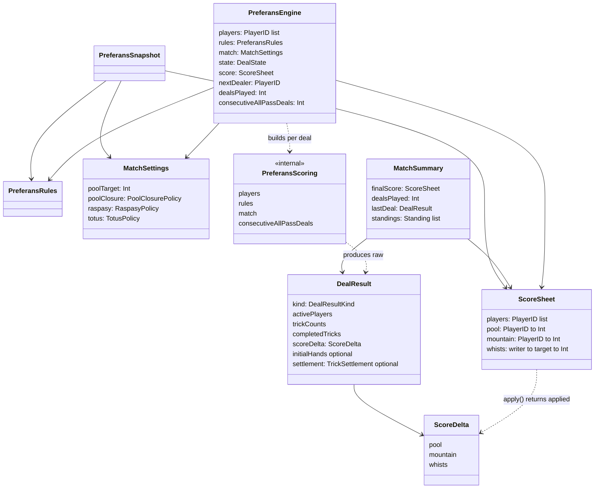
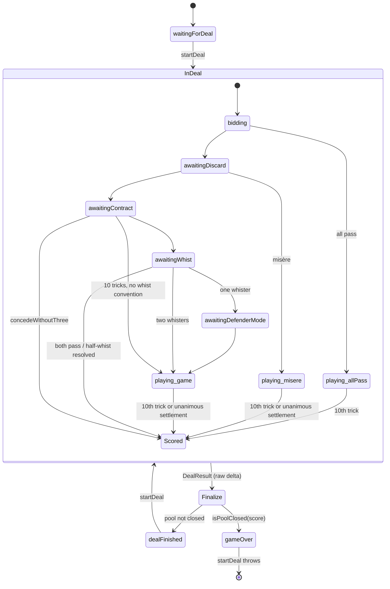
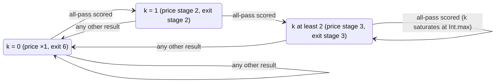
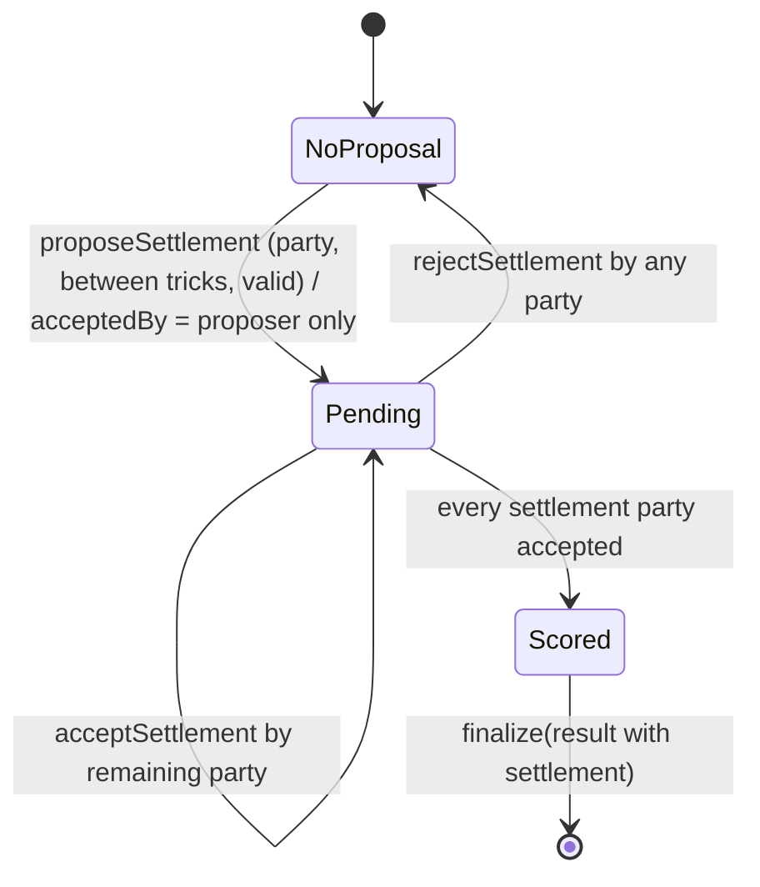
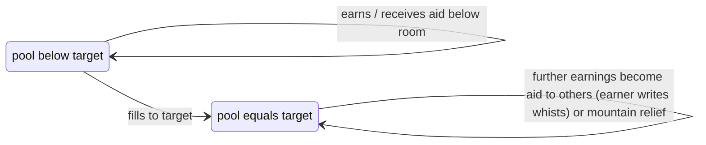

# Data Model: Scoring, Rule Variants, and Match Settlement

**Status**: Implemented (as-built) · **Verified against**: `store/1.0.3-localized-keywords` @ `cd78828`

All types live in the `PreferansEngine` Swift package target unless marked *(app)*. All engine types are value types, `Codable`, `Sendable`, and `Equatable`/`Hashable`. Behavioural rules are specified in [`spec.md`](./spec.md); game-phase states (`BiddingState`, `WhistState`, …) are owned by [`../001-game-rules`](../001-game-rules/) and appear here only for their scoring-relevant fields.

## Entity overview



## 1. ScoreSheet (`Score.swift`)

Cumulative match ledger.

| Field | Type | Meaning |
| --- | --- | --- |
| `players` | `[PlayerID]` | Seat order; must equal the engine's `players` (3 or 4, unique). Also the tie-break order for American aid, standings and splits. |
| `pool` | `[PlayerID: Int]` | Пуля. Keys = exactly `players`. Entries ≥ 0. Under individual closure, entries ≤ `poolTarget / N`. |
| `mountain` | `[PlayerID: Int]` | Гора. Keys = exactly `players`. May be negative (surplus pool after everyone is closed reduces the earner's mountain). |
| `whists` | `[PlayerID: [PlayerID: Int]]` | `whists[writer][target]` = whists `writer` has written on `target`. Outer keys = exactly `players`; inner keys ⊆ players; values ≥ 0; no `whists[p][p]` other than 0. Inner dictionaries are sparse (absent = 0). |

Operations:

- `init(players:)` — all zeros, empty inner whist maps.
- `apply(_ delta:, closingAtPoolTarget:, poolClosure: = .individualWithAmericanAid, poolPointWhistValue: = 10) -> ScoreDelta` — the only public mutator (spec FR-027/FR-028). Preconditions: `poolPointWhistValue > 0`; delta valid for `players`; individual target divisible (else `preconditionFailure`).
- `whistsWritten(by:on:) -> Int`.
- `normalizedBalances(poolPointValue: = 10, mountainPointValue: = 10) -> [PlayerID: Double]` — spec FR-033; both values must be > 0.
- `validate(players:) throws` — throws `InvariantViolation`.
- Decoding validates and converts violations into `DecodingError.dataCorrupted`.

## 2. ScoreDelta (`Score.swift`)

Per-deal change set with the same three columns as `ScoreSheet` (no `players` array; the key set defines the players).

| Field | Type | Invariants |
| --- | --- | --- |
| `pool` | `[PlayerID: Int]` | keys = all match players (incl. a sitting-out dealer); values ≥ 0 |
| `mountain` | `[PlayerID: Int]` | keys = all players; any sign (applied deltas carry negative relief) |
| `whists` | `[PlayerID: [PlayerID: Int]]` | outer keys = all players; values ≥ 0; no self-writes |

Mutators `addPool`, `addMountain`, `addWhists(_:writer:on:)` precondition that the player(s) are known and ignore zero amounts (and self-writes). `isZero` is true when every entry is 0.

Two flavours exist at runtime: the **raw** delta built by `PreferansScoring`, and the **applied** delta returned by `ScoreSheet.apply` (after caps/aid/relief). `DealResult.scoreDelta` in emitted events, `.dealFinished` and `MatchSummary.lastDeal` always holds the **applied** delta (`DealResult.replacingScoreDelta`).

## 3. DealResult and DealResultKind (`State.swift`)

| Field | Type | Meaning |
| --- | --- | --- |
| `kind` | `DealResultKind` | see below |
| `activePlayers` | `[PlayerID]` | the three seats that played the deal |
| `trickCounts` | `[PlayerID: Int]` | final counts used for scoring (agreed counts when settled). Keys = active seats, or active + dealer for classic four-player raspasy. All zeros for unplayed kinds. Each 0…10; total 10 for played kinds. |
| `completedTricks` | `[Trick]` | tricks physically played (empty for unplayed kinds; partial when settled) |
| `scoreDelta` | `ScoreDelta` | applied delta |
| `initialHands` | `[PlayerID: [Card]]?` | each active seat's original 10 cards (declarer's restored from talon/discard); `nil` if unavailable |
| `settlement` | `TrickSettlement?` | set only when play ended by agreement |

`DealResultKind` cases: `passedOut`, `withoutThree(declarer:bid:)`, `halfWhist(declarer:contract:halfWhister:)`, `game(declarer:contract:whisters:)`, `misere(declarer:)`, `allPass`.

| Kind | Produced by | Played? |
| --- | --- | --- |
| `passedOut` | `PreferansScoring.passedOut(_ WhistState)` | no |
| `halfWhist` | `PreferansScoring.halfWhist(_:halfWhister:)` | no |
| `withoutThree` | `PreferansScoring.withoutThree(_ ContractDeclarationState)` | no |
| `game` / `misere` / `allPass` | `PreferansScoring.completedPlay(_ PlayingState, settlement:)` | yes (or settled) |

## 4. PreferansRules — scoring fields (`Rules.swift`)

| Field | Type | Default (`.sochi`) | Effect |
| --- | --- | --- | --- |
| `allowSeniorHandHoldBid` | `Bool` | `true` | auction only (see 001) |
| `requireWhistOnTenTrickContracts` | `Bool` | `false` | 10-trick contracts go through whist; `R(10) = 1` |
| `forceWhistOnSixSpades` | `Bool` | `false` | Stalingrad: both defenders' only legal call on 6♠ is whist |
| `singleWhistScoring` | `SingleWhistScoring` = `greedy` \| `ownHandOnly` \| `gentleman` | `greedy` | trick-whist attribution (spec FR-008); `greedy` also enables open-dummy control transfer |
| `failedDeclarerConsolation` | `FailedDeclarerConsolation` = `none` \| `eachDefender` | `eachDefender` | `W × u` per defender on declarer failure (mountain policy only) |
| `whistResponsibility` | `WhistResponsibility` = `responsible` \| `semiResponsible` \| `directWhists(pointsPerMountainPoint:)` \| `none` | `responsible` | quota penalty (FR-009/FR-010) |
| `declarerRemisePolicy` | `DeclarerRemisePolicy` = `mountainAndConsolation` \| `directWhistsPerDefender(whistsPerUndertrick:)` | `mountainAndConsolation` | declarer failure recording (FR-006/FR-007) |
| `allPassTalonPolicy` | `AllPassTalonPolicy` = `ignored` \| `classic` \| `leadSuitOnly` | `classic` | raspasy talon leads; `classic` at 4 seats makes the dealer a trick taker |
| `allPassPenaltyPolicy` | `AllPassPenaltyPolicy` = `perTrick(multiplier:amnesty:)` \| `directWhistsToLowest(pointsPerTrick:)` | `perTrick(1, false)` | raspasy scoring (FR-021/FR-022) |
| `zeroTricksAllPassPoolBonus` | `Int` ≥ 0 | `1` | clean-exit pool credit |
| `dealerTalonCompensation` | `DealerTalonCompensation` = `none` \| `classic` | `classic` | 4-seat dealer whists (FR-019/FR-020) |
| `poolValueMultiplier` | `Int` > 0 | 1 | `P = v × Pm`; misère pool `10 × Pm` |
| `mountainValueMultiplier` | `Int` > 0 | 1 | `M = v × Mm`; misère, without-three |
| `whistValueMultiplier` | `Int` > 0 | 1 | `W = v × Wm / Wd`; misère dealer compensation |
| `whistValueDivisor` | `Int` > 0, divides 2,4,6,8,10 | 1 | see above |
| `poolPointWhistValue` | `Int` > 0 | 10 | final conversion of a pool point; American-aid whists per aid point |
| `mountainPointWhistValue` | `Int` > 0 | 10 | final conversion of a mountain point |

Derived: `whistRequirement(for:)` (6→4, 7→2, 8/9→1, 10→0 or 1), `recordedWhistValue(for:)`. Validation: initializer `precondition`s for source mistakes; `configurationError: String?` for engine construction and snapshots; decoding throws `DecodingError` (never traps).

Named profiles: `.sochi` (= `PreferansRules()`), `.sochiWithTalonLedAllPass` (= `.sochi`), `.stalingrad`, `.leningrad`, `.rostov` — full value table in spec "Variant comparison".

## 5. MatchSettings and policies (`MatchSettings.swift`)

| Field | Type | Init default | Decode default (key absent) | Validation |
| --- | --- | --- | --- | --- |
| `poolTarget` | `Int` | `Int.max` (unbounded) | `Int.max` | `> 0` or `Int.max`; with individual closure divisible by player count |
| `poolClosure` | `PoolClosurePolicy` = `individualWithAmericanAid` \| `tableTotal` | `individualWithAmericanAid` | `individualWithAmericanAid` | — |
| `raspasy` | `RaspasyPolicy` | `.sochi` | **`.singleShot`** | — |
| `totus` | `TotusPolicy` | `.asTenTrickGame(requireWhist: false)` | same | `dedicatedContract.bonusPool ≥ 0` |

- `MatchSettings.unbounded` = `MatchSettings()`.
- `RaspasyPolicy` = `singleShot` | `progressive(penalties: RaspasyPenaltyProgression, exit: RaspasyExitProgression)`. Statics: `.sochi` = `.leningrad` = progressive(arithmetic, strict); `.rostov` = progressive(flat, simple).
- `RaspasyPenaltyProgression` (`String` raw) = `flat` (1,1,1) | `arithmetic` (1,2,3) | `cappedDouble` (1,2,2) | `geometric` (1,2,4); stage = `min(precedingDeals, 2)`.
- `RaspasyExitProgression` (`String` raw) = `simple` (6,6,6) | `constrained` (6,7,7) | `strict` (6,7,8).
- `TotusPolicy` = `asTenTrickGame(requireWhist: Bool)` | `dedicatedContract(requireWhist: Bool, bonusPool: Int)`; helpers `isDedicated`, `bonusPool` (0 unless dedicated), `requireWhistOnTenTricks`.
- `isPoolClosed(_ ScoreSheet) -> Bool` — spec FR-029.

## 6. MatchSummary and Standing (`MatchSettings.swift`)

| Field | Type | Meaning |
| --- | --- | --- |
| `finalScore` | `ScoreSheet` | equals the engine score at closure |
| `dealsPlayed` | `Int` | equals `engine.dealsPlayed` |
| `lastDeal` | `DealResult` | the closing deal (applied delta); never also emitted as `.dealFinished` |
| `standings` | `[Standing]` | sorted by `balance` desc, ties in seat order |
| `Standing.player/balance/pool/mountain` | `PlayerID`, `Double`, `Int`, `Int` | normalized balance and raw columns |

Computed: `leadingPlayers`, `soleWinner`, `rank(of:)` (1-based, equal balances share rank, `nil` for unknown players).

## 7. Engine match counters and snapshot (`PreferansEngine.swift`, `State.swift`)

| Field | Type | Meaning / invariant |
| --- | --- | --- |
| `score` | `ScoreSheet` | cumulative ledger |
| `dealsPlayed` | `Int` ≥ 0 | incremented by every `finalize` |
| `consecutiveAllPassDeals` | `Int`, `0 … dealsPlayed` | raspasy streak; 0 after any non-raspasy result |
| `PreferansSnapshot` | struct | `players, rules, match, state, score, nextDealer, dealsPlayed, consecutiveAllPassDeals`; decode defaults: `match` → `.unbounded`, `dealsPlayed` → 0, `consecutiveAllPassDeals` → 0. Contains every hidden card — never sent to clients raw. |

## 8. Scoring inputs carried by deal states (`State.swift`)

| Type.field | Used for |
| --- | --- |
| `GamePlayContext.declarer / contract / defenders / whisters / defenderPlayMode / whistCalls / bonusPoolOnSuccess` | `scoreGame`; `defenders` = both non-declarer active seats in seat order after the declarer; `whisters` = `[]`, `[x]`, or `[defenders[0], defenders[1]]` |
| `WhistState.bonusPoolOnSuccess`, `DefenderModeState.bonusPoolOnSuccess` | dedicated-totus bonus threaded to passed-out / play |
| `PlayingState.trickCounts` | counts per trick taker |
| `PlayingState.trickTakingPlayers` | active seats (+ dealer in classic 4-seat raspasy) |
| `PlayingState.settlementParties` | spec FR-036 |
| `PlayingState.pendingSettlement` | `TrickSettlementProposal?` |
| `PlayingState.dealer / talon / discard` | dealer talon compensation; opening-hand reconstruction |

## 9. TrickSettlement and TrickSettlementProposal (`State.swift`)

| Field | Type | Invariant |
| --- | --- | --- |
| `TrickSettlement.target` | `PlayerID` | an active seat (declarer for game/misère) |
| `.targetTricks` | `Int` | `== finalTrickCounts[target]` |
| `.finalTrickCounts` | `[PlayerID: Int]` | keys = active seats; total 10; each ≥ tricks already won |
| `TrickSettlementProposal.proposer` | `PlayerID` | a settlement party |
| `.settlement` | `TrickSettlement` | validated at proposal and again at scoring |
| `.acceptedBy` | `Set<PlayerID>` | starts as `{proposer}` |

## 10. Rulebook examples (`ScoringEngine.swift`)

`PreferansRulebook.examples(rules:match:) -> PreferansRulebookExamples` — computed with players `["declarer", "left", "right"]`, dealer `right`, a ♠ contract, both defenders whisting closed.

| Type | Fields | How computed |
| --- | --- | --- |
| `ContractRuleExample` (levels 6…10) | `tricks`, `madePool`, `failedByOneMountain`, `failedByOneDirectWhists`, `whistPerDefenderTrick` | made = tricks/(10−tricks)/0; failed = (tricks−1)/(11−tricks)/0; direct whists = `whistsPerUndertrick × 2` for the Rostov policy else 0 |
| `MisereRuleExample` | `madePool`, `failedOneTrickMountain` | 0/5/5 and 1/5/4 |
| `RaspasyRuleExample` (stages 1…3) | `stage`, `trickPrice`, `cleanExitPool`, `minimumGameTricks`, `mountainForZeroFourSix`, `directWhistsForZeroFourSix` | 0/4/6 split with `consecutiveAllPassDeals = stage − 1`; `trickPrice = multiplier × progression` (perTrick) or `pointsPerTrick` |

## 11. App-side configuration *(app)* (`Preferans/UI/LobbyModels.swift`, `LobbyViewModel.swift`, `Preferans/Support/AppIdentifiers.swift`)

| Type / key | Values | Meaning |
| --- | --- | --- |
| `PreferansVariant` (`String` raw, persisted) | `odesa`, `wien`, `thessaloniki`, `kruty`; `publicCases = [odesa, wien, thessaloniki]` | `.rules`, `.poolClosure`, `.raspasy` (canonical), localized `title`, `standardName`, `summary` |
| `PulkaLimit` (`String` raw) | `"11"` short, `"21"` standard, `"custom"` | per-player length; custom per player 1…999 (default 21); custom table total 1…3996 (default 63) |
| `UserDefaults` keys | `settings.onlineVariant` (default `odesa`), `settings.pulkaLimit`, `settings.customPulkaPerPlayer`, `settings.customPulkaTableTotal`, `settings.raspasyPenaltyProgression` (default `arithmetic`), `settings.raspasyExitProgression` (default `strict`) | lobby selections that build `MatchSettings` |

## State machines

### Match scoring lifecycle



`Finalize` = `score.apply` → `dealsPlayed += 1` → update `consecutiveAllPassDeals` → emit `dealScored` (+ `matchEnded`).

### Raspasy series counter



### Settlement proposal



### Individual pool (per player, `.individualWithAmericanAid`)



## Serialization format

Swift `JSONEncoder`/`JSONDecoder` with synthesized coding unless noted. The same JSON crosses the Cloudflare worker (`workers/room-worker`) and the Linux engine (`Sources/PreferansServerCore`).

- `PlayerID` → `{"rawValue": "north"}`; empty strings rejected.
- Dictionaries keyed by `PlayerID` (non-`String` keys) → flat arrays alternating key and value, e.g. `"pool": [{"rawValue":"east"},0,{"rawValue":"north"},2,…]`; nested whists: `"whists": [{"rawValue":"east"},[{"rawValue":"north"},4], …]` (see `Tests/PreferansEngineTests/__Snapshots__/ProjectionSnapshotTests/*.txt`).
- Enums with associated values → single-key objects: `{"progressive":{"penalties":"arithmetic","exit":"strict"}}`, `{"singleShot":{}}`, `{"asTenTrickGame":{"requireWhist":false}}`, `{"dedicatedContract":{"requireWhist":true,"bonusPool":5}}`, `{"perTrick":{"multiplier":1,"amnesty":false}}`, `{"directWhistsToLowest":{"pointsPerTrick":5}}`, `{"classic":{}}`, `{"directWhistsPerDefender":{"whistsPerUndertrick":10}}`, `{"game":{"declarer":…,"contract":…,"whisters":[…]}}`, `{"passedOut":{}}`.
- `String`-raw enums → strings: `PoolClosurePolicy`, `RaspasyPenaltyProgression`, `RaspasyExitProgression`, `SingleWhistScoring`, `FailedDeclarerConsolation`, `DealerTalonCompensation`.
- `WhistResponsibility` (custom): `"responsible"`, `"semiResponsible"`, `"none"`, or `{"directWhists":{"pointsPerMountainPoint":n}}`.
- `MatchSettings` (custom): `poolTarget` omitted when `Int.max` (not representable in JavaScript); `poolClosure`, `raspasy`, `totus` always written.
- `PreferansRules` (custom, compact): always writes `allowSeniorHandHoldBid`, `requireWhistOnTenTrickContracts`, `singleWhistScoring`, `failedDeclarerConsolation`, `whistResponsibility`, `allPassTalonPolicy`, `allPassPenaltyPolicy`, `zeroTricksAllPassPoolBonus`; writes `forceWhistOnSixSpades` only when true, `declarerRemisePolicy` only when not `mountainAndConsolation`, `dealerTalonCompensation` only when not `classic`, and each multiplier/divisor/point value only when it differs from 1/1/10. Decoding accepts a legacy `scoringMultiplier` applied to all three value multipliers. Example (Leningrad, as stored in `workers/room-worker/fixtures/public-rules.json`):

```json
{
  "allowSeniorHandHoldBid": true,
  "requireWhistOnTenTrickContracts": true,
  "singleWhistScoring": "gentleman",
  "failedDeclarerConsolation": "eachDefender",
  "whistResponsibility": "semiResponsible",
  "allPassTalonPolicy": { "classic": {} },
  "allPassPenaltyPolicy": { "perTrick": { "multiplier": 2, "amnesty": false } },
  "zeroTricksAllPassPoolBonus": 1,
  "mountainValueMultiplier": 2,
  "whistValueMultiplier": 2,
  "poolPointWhistValue": 20
}
```

- `PreferansSnapshot` (custom decode for legacy defaults) — keys `players, rules, match, state, score, nextDealer, dealsPlayed, consecutiveAllPassDeals`.
- `MatchSummary.Standing.balance` is a JSON number (Double).
- Validation on decode: `ScoreSheet`/`ScoreDelta` storage rules, `PreferansRules.configurationError`, `MatchSettings.intrinsicConfigurationError`, `GameContract` 6…10 — all surface as `DecodingError.dataCorrupted`.
