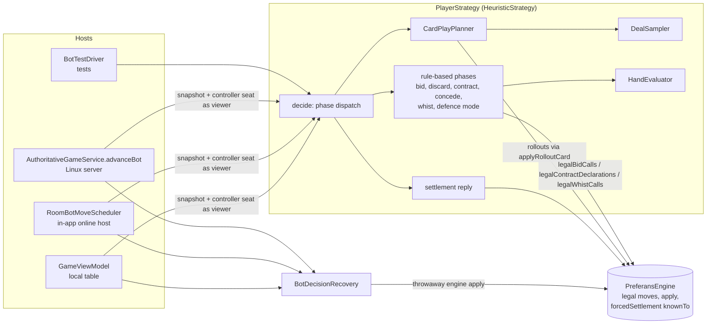
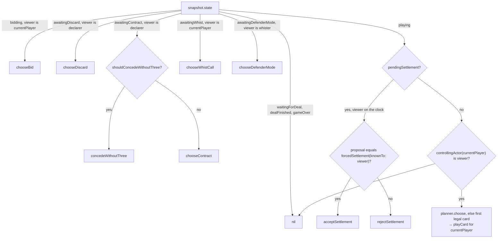
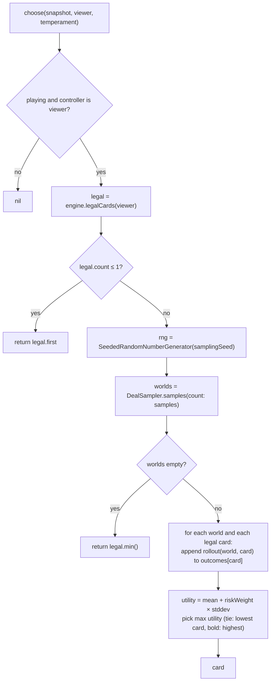

# Implementation Plan (as-built): Computer Players (Bots)

**Status**: Implemented (as-built) · **Verified against**: `store/1.0.3-localized-keywords` @ `cd78828` · **Spec**: [`spec.md`](./spec.md)

## Summary

`HeuristicStrategy` is a hybrid bot. Fast, deterministic rule-based decisions cover the auction, exchange, contract declaration, "without three" concession, whist and defence mode; they are driven by `HandEvaluator`, which turns a hand into fractional trick estimates. Card play uses a perfect-information Monte Carlo (PIMC) planner: `DealSampler` generates complete deals that are indistinguishable from the real one from the bot's seat, `CardPlayPlanner` rolls every legal card out to the end of the deal in every sampled world with a greedy policy for all seats, scores each world with the production match balance, and chooses the card with the best risk-adjusted mean. A `BotProfile` (difficulty × temperament) shifts thresholds and sampling depth. Three hosts (local view model, in-app online host, server-authoritative engine) drive the same strategy and gate its output with `BotDecisionRecovery`.

## Technical Context

| Item | Value |
| --- | --- |
| **Language/Version** | Swift 6 (`swift-tools-version: 6.0`), strict concurrency; all bot types are `Sendable` value types |
| **Primary Dependencies** | Foundation only inside `PreferansEngine`; the app adds SwiftUI and `swift-dependencies`; the server adds Hummingbird. No GameplayKit — randomness is a pure-Swift xoshiro256** (`SeededRandomNumberGenerator`, `Sources/PreferansEngine/DealSource.swift`) so the same bots run on iOS and Linux |
| **Storage** | None owned by bots. `BotProfile` is `Codable`; it is stored per lobby seat in memory and per bot seat in `AuthoritativeGameState.botProfiles` (server); explanations live in bounded in-memory/state windows |
| **Testing** | XCTest and Swift Testing. Target `PreferansEngineTests` (= `Tests/PreferansEngineCoreTests`: `BotTests`, `BotInformationTests`, `BotSimulationReportTests`, `SettlementInformationTests`), `PreferansEngineCLITests` (`BotDeterminismTests`, `BotTestDriverDiagnosticsTests`; the only engine lane under `PREFERANS_ENGINE_TESTS_ONLY=1`, used by `bin/test-engine`), `PreferansAppTests` (= `Tests/PreferansEngineTests`: `SettlementTests`, `SingleWhistControlTests`, `RoomBotMoveSchedulerTests`, `OnlineBotSeatTests`). `PREF_SIM_FULL=1` enables the full simulation. Shared driver: `BotTestDriver` in `Tests/PreferansEngineTestSupport/EngineTestSupport.swift` |
| **Target Platform** | iOS 17.0+ app target (the package declares iOS 16, macOS 14, tvOS 16, watchOS 9 for the libraries); Linux `PreferansServer` for server-authoritative rooms |
| **Project Type** | Library module (`Sources/PreferansEngine/Bot`) consumed by the SwiftUI app and the server |
| **Performance Goals** | AGENTS.md: a 4-player all-bot match to pool 6 completes "well under a minute" with animations and bot delay disabled; simulation cap 30 s per match (4-sample planner); interactive pacing ≥ 500 ms dominates perceived latency |
| **Constraints** | Never read hidden cards; decisions must be pure functions of (snapshot, viewer, profile, planner config); every emitted action must pass the engine's validation; stale decisions must be dropped |
| **Scale/Scope** | 3–4 seats, 32 cards, ≤ 10 legal cards per decision, ≤ 32 samples, 9 profiles, 15 rationale codes |

## Project Structure

```text
Sources/PreferansEngine/
├── Bot/
│   ├── PlayerStrategy.swift      # protocol, StrategyDecision, BotDecisionExplanation/Rationale/Category, BotDecisionRecovery
│   ├── BotProfile.swift          # BotDifficulty, BotTemperament, BotProfile (+ all numeric knobs)
│   ├── HeuristicStrategy.swift   # phase dispatch, bidding, discard, contract, concession, whist, defence mode, settlement reply
│   ├── HandEvaluator.swift       # declarer / defender / misère / all-pass trick estimators
│   ├── CardPlayPlanner.swift     # PIMC: sample → rollout → risk-adjusted selection; greedy rollout policy
│   └── DealSampler.swift         # information-set world generation, void inference
├── DealSource.swift              # SeededRandomNumberGenerator (xoshiro256** + SplitMix64)
├── PreferansEngine.swift         # legal-move APIs, controllingActor, applyRolloutCard, forcedSettlement(in:knownTo:)
└── State.swift                   # DealState.currentActor, PlayingState.controllingActor / misereDefendersAreOpen
Sources/PreferansServerCore/
└── AuthoritativeGameService.swift  # advanceBot / advanceBots (server-side bot seats)
Preferans/
├── GameViewModel.swift           # botStrategies map, scheduleBotIfNeeded (local tables)
├── Online/RoomBotMoveScheduler.swift  # in-app online host bot pacing/validation
├── Online/HostGameActor.swift    # nextBotDecisionPlan, stillAwaiting
├── Support/BotPacing.swift       # pacing constants (see ../005-ios-app)
└── UI/LobbyModels.swift          # BotMoveSpeed, stock bot profiles, labels, rationale → localized key
workers/room-worker/src/authoritative-engine.ts  # botProfiles(): every bot seat = seasoned/adaptive (see ../004-online-multiplayer)
Tests/PreferansEngineCoreTests/{BotTests,BotInformationTests,BotSimulationReportTests,SettlementInformationTests}.swift
Tests/PreferansEngineCLITests/{BotDeterminismTests,BotTestDriverDiagnosticsTests}.swift
Tests/PreferansEngineTests/{SettlementTests,SingleWhistControlTests,RoomBotMoveSchedulerTests}.swift
Tests/PreferansEngineTestSupport/EngineTestSupport.swift  # BotTestDriver, BotDriveResult, BotDriveStopReason
```

## Architecture

### Components



### Decision dispatch (`HeuristicStrategy.decide`)



Any mismatch between the viewer and the expected seat returns `nil`.

### Card play (PIMC)



### Local bot turn (sequence)

```mermaid
sequenceDiagram
    participant VM as GameViewModel (MainActor)
    participant T as Task
    participant S as HeuristicStrategy
    participant R as BotDecisionRecovery
    VM->>VM: state changed → scheduleBotIfNeeded (cancel previous task)
    VM->>VM: actor = currentActor; decider = controllingActor(actor); strategy = botStrategies[decider]
    VM->>T: start with snap = engine.snapshot
    T->>T: sleep(botMoveDelay)
    T->>S: decision(snapshot: snap, viewer: decider)
    S-->>T: StrategyDecision?
    T->>R: recover(candidate, snap, decider)
    R-->>T: legal decision
    T->>VM: MainActor.run: if engine.snapshot == snap → append insight (≤ 24) → send(action)
```

## Key flows (pseudocode)

### 1. Hand evaluation (`HandEvaluator`)

All functions group the hand by suit, sort each suit high → low, and sum per-suit values.

```text
declarerSuit(cards, isTrump, trumpSuit):           # expectedDeclarerTricks
  t = 0; L = len; A,K,Q,J = presence
  if A: t += 1
  if A and K: t += 1            elif K and L >= 2: t += 0.5
  if A and K and Q: t += 1      elif K and Q: t += 0.5      elif Q and L >= 3: t += 0.25
  if J and L >= 4 and Q: t += 0.25
  if isTrump:
      if L >= 4: t += (L - 3) * 0.75
      if L >= 5: t += 0.5
      if L >= 4 and (A or K): t += 0.25
  elif trumpSuit == nil (no-trump):
      if L >= 4 and A: t += (L - 3) * 0.4
  return t

defenderSuit(cards, isTrump):                      # expectedDefenderTricks
  t = A ? 1 : 0
  if isTrump: t += (K ? 0.6 : 0) + (Q ? 0.3 : 0) + (L >= 4 ? 0.4 : 0)
  else:       t += (K and L >= 2) ? 0.4 : 0

misereSuit(cards):                                 # expectedMisereTricks (lower = safer)
  ranks ascending (7..14); if lowest > 7: return 1.0
  forced = 0; expected = 7
  for r in ranks: if r == expected: expected += 1 else: forced += 0.5; expected = r + 1
  return forced

allPassSuit(cards):  # defined, unused by HeuristicStrategy
  A +1; K +0.4 with A else +0.5; Q with L <= 2 +0.3; L >= 5 +0.4
```

Worked values (from the `BotTests` corpora):

| Hand | Evaluation |
| --- | --- |
| ♠AKQJ10987 ♣A ♥A, trump ♠ | ♠: 1+1+1+0.25 + (8−3)·0.75 + 0.5 + 0.25 = 7.75; ♣ 1; ♥ 1 → **9.75** (NT: 3.25 + 5·0.4 + 1 + 1 = 7.25) |
| ♠AK ♣A98 ♦K7 ♥J109 (borderline), any strain | 2 + 1 + 0.5 + 0 = **3.5** |
| ♠789 ♣78 ♦78 ♥789 | misère **0** (every suit contiguous from 7) |
| ♠9 10 J ♣9 10 J ♦9 10 ♥9 10 | misère 4 × 1.0 = **4.0**; declarer 0 |
| defender ♠A87 ♦A7 ♣KQJ7 ♥7 vs ♣ trump | 1 + 1 + (0.6 + 0.3 + 0.4) + 0 = **3.3** |
| defender ♠A87 ♦A87 ♣87 ♥87 vs ♣ trump | **2.0** |

### 2. Auction (`chooseBid`, `bidIsAffordable`)

```text
legal = engine.legalBidCalls(viewer)            # includes raspasy exit minimum, hold-bid, misère rules
adj = temperament.bidMarginAdjustment + difficulty.bidMarginAdjustment
affordable(game c) = expectedDeclarerTricks(hand, c.strain) + 2.0 >= c.tricks - margin[c.tricks] - adj
     margin = {6: 0.5, 7: 0.5, 8: 0.75, 9: 1.0, 10: 1.5}
misereTol = 1.5 + temperament.misereAdj + difficulty.misereAdj
affordable(misère) = expectedMisereTricks(hand) <= misereTol
affordable(totus)  = max_strain expectedDeclarerTricks + 2.0 >= 9.0
if affordable misère in legal: return misère
if affordable totus in legal:  return totus
games = affordable game bids in legal
if games: lvl = min tricks; return argmax_strain expectedDeclarerTricks among games at lvl (first on tie)
return pass
```

The +2.0 approximates the talon pickup and discard ("~2 tricks", code comment). Opening at the *lowest* affordable level is deliberate: commit `d9cca36` attributes a ~91 % all-pass rate to three causes — a too-small 0.75-trick talon bonus, weak trump-length credit, and opening at the *highest* affordable bid — and reports ~14 % after fixing all three.

Minimum raw estimate (before +2) needed for each level:

| Profile adj (temp + diff) | 6 | 7 | 8 | 9 | 10 |
| --- | --- | --- | --- | --- | --- |
| −0.60 (casual careful) | 4.10 | 5.10 | 5.85 | 6.60 | 7.10 |
| −0.25 (casual adaptive) | 3.75 | 4.75 | 5.50 | 6.25 | 6.75 |
| 0 (seasoned adaptive) | 3.50 | 4.50 | 5.25 | 6.00 | 6.50 |
| +0.35 (seasoned bold) | 3.15 | 4.15 | 4.90 | 5.65 | 6.15 |
| +0.60 (expert bold) | 2.90 | 3.90 | 4.65 | 5.40 | 5.90 |

Misère tolerance ranges from 1.10 (casual careful) to 1.90 (expert bold).

### 3. Discard (`chooseDiscard`)

```text
cards = hand(10, sorted) + talon(2)
for i < j in 0..<12:                       # 66 pairs
   kept = cards without i, j
   score = misère ? expectedMisereTricks(kept)
         : game c ? expectedDeclarerTricks(kept, c.strain)    # tied to the auction's strain (commit 4406145)
         : totus  ? max_strain expectedDeclarerTricks(kept)
return misère ? first pair with min score : first pair with max score
```

### 4. Contract declaration and concession

```text
shouldConcede:
  target = game c ? c.tricks : totus ? 10 : (misère → false)
  if target < 8: false
  best = max over legalContractDeclarations: expectedDeclarerTricks(hand10, strain)
  safety = 0.75 + (difficulty.contractFailurePenalty - 4) * 0.2 - temperament.rolloutRiskWeight * 0.25
  return best + safety < target

chooseContract:
  for c in legalContractDeclarations (ladder order):
     e = expectedDeclarerTricks(hand10, c.strain); d = e - c.tricks
     w = d >= 0 ? c.value + d : d * difficulty.contractFailurePenalty
  return first argmax w
```

Concession safety margins:

| | careful | adaptive | bold |
| --- | --- | --- | --- |
| casual | 1.2375 | 1.15 | 1.0625 |
| seasoned | 1.0375 | 0.95 | 0.8625 |
| expert | 0.8375 | 0.75 | 0.6625 |

Because `value` grows by 2 per level while slack shrinks by 1, the weight favours the highest contract the evaluator thinks makes: the 9.75-trick ♠ hand above, holding an 8♠ auction win, declares 9♠ (weight 8.75) rather than 8♠ (7.75) or 10♠ (−0.25 × penalty).

### 5. Whist and defence mode

```text
chooseWhistCall:
  legal = engine.legalWhistCalls(viewer)
  est = expectedDefenderTricks(hand, contract.strain.suit)
  share = max(1.0, rules.whistRequirement(contract) / 2)      # 6→2, 7/8/9/10→1
  firstCall = calls[defenders[0]]
  thr = share + (firstCall == whist && viewer != defenders[0] ? 1 : 0) + temperament.whistThresholdAdjustment
  if whist ∈ legal and est >= thr: whist
  elif halfWhist ∈ legal and est >= share - 0.75 + temperament.whistThresholdAdjustment: halfWhist
  elif pass ∈ legal: pass
  else legal[0]                                                # Stalingrad: forced whist

chooseDefenderMode (first match wins):
  difficulty == expert or temperament == careful → open
  seasoned & adaptive → contract.tricks <= 7 ? open : closed
  casual or bold → closed
```

Defence-mode matrix:

| | careful | adaptive | bold |
| --- | --- | --- | --- |
| casual | open | closed | closed |
| seasoned | open | open (6–7) / closed (8+) | closed |
| expert | open | open | open |

### 6. Settlement reply

```text
if pendingSettlement and currentActor == viewer:
   forced = engine.forcedSettlement(in: playing, knownTo: viewer)   # nil unless provable
   return forced == proposal.settlement ? accept : reject
```

`forcedSettlement(knownTo:)` only fires at an empty 10th trick; the declarer (who sees exposed defenders and their own discard) uses the exact forced line; a defender enumerates every allocation of the three unknown cards (declarer's last card + 2-card discard) that passes snapshot validation and requires all to give the same split. Spec: [`../002-scoring-and-variants/spec.md`](../002-scoring-and-variants/spec.md) FR-039.

### 7. Deal sampling (`DealSampler.samples`)

```text
visible = {viewer} ∪ seats viewer controls (open greedy single-whist dummy)
if game & defenderPlayMode == open: visible ∪= defenders
if game & tricks == 10 & no whisters & no whist calls: visible ∪= all active
if misère & misereDefendersAreOpen: visible ∪= non-declarer active seats
voids = inferredVoids(playing)     # from completed tricks and the current trick

sampleOnce:
  revealedTalon = allPass & usesTalonLeads ? min(2, completedTricks + 1) : 0
  hidden = deck − hands[visible] − played − revealed talon(allPass)
           − discard   (if viewer is declarer, or allPass)
  slots  = for each non-visible active seat with cards:
              Slot(size = hand count, allowed suits = all − voids[seat],
                   forbidden = seat != declarer ? exchanged talon : ∅)
         + discard slot (size 2) if discard unknown
         + talon slot (2 − revealed) if allPass and talon not fully revealed
  require |hidden| == Σ slot sizes, else fail
  sort slots by (fewest acceptable hidden cards, larger size, insertion order)
  pool = hidden.sorted()                       # canonical order before randomness
  repeat ≤ 32 times:
     pool.shuffle(using: rng)
     greedily give each slot the first `size` acceptable cards of the remaining pool
     if every slot filled: build new PlayingState (same history, counts, kind, pending settlement) → success
  fail (sample dropped)
```

The real hidden cards contribute only their *count*; equal public information therefore yields equal worlds (`testHiddenTalonWorldsAndDecisionsIgnoreTheRealHiddenCards`).

### 8. Rollout and scoring (`CardPlayPlanner.rollout`, `greedyChoice`, `score`)

```text
rollout(world, viewer, actingFor, firstCard):
  engine = PreferansEngine(snapshot: world)           # validated once
  engine.applyRolloutCard(actingFor, firstCard)      # skips per-move invariant replay (commit ff414f5); illegal → −1000
  while engine.state is playing:
     actor = currentPlayer; ctrl = controllingActor(actor)
     legal = engine.legalCards(ctrl); if empty: break
     engine.applyRolloutCard(actor, greedyChoice(legal, playing, actor))
  if dealFinished or gameOver: return normalizedBalances(poolPointWhistValue, mountainPointWhistValue)[viewer]
  else (bail-out): game → declarer ? tricks − contract : own tricks; misère → −2·own; all-pass → −own

greedyChoice(legal, playing, actor):
  wants = game ? true : misère ? actor != declarer : false
  if no required suit or (no talon lead and trick empty): lead
     wants and a non-trump ace → lowest such ace (Card order)
     else lowest by (non-trump first, rank, suit)
  best = trick winner so far (incl. dealer talon lead)
  teammate = game: both actor and winner are defenders; misère: both non-declarer; all-pass: never
  wants and teammate → min card;  wants → cheapest beating card ?? min card;  else → highest non-beating card ?? max card
```

The score is the *whole-match* normalized balance after the deal is scored (pulka closing, variant conversion rates and raspasy progression included). The pre-deal balance is a constant offset for all candidates in a world, so only the deal's marginal value differentiates them.

### 9. Selection

```text
utility(outcomes) = mean + temperament.rolloutRiskWeight * sqrt(population variance)   # weight 0 → mean
pick argmax utility over legal (iteration in legal order);
on exact tie: careful/adaptive prefer the lower card, bold the higher card (Card order: suit ♠<♣<♦<♥, then rank)
```

### 10. Recovery and hosts

```text
BotDecisionRecovery.recover(candidate, snapshot, viewer):
  if candidate.actor == snapshot.currentActor
     and engine.controllingActor(candidate.actor) == viewer
     and throwaway engine.apply(candidate) succeeds: return candidate
  return fallback:
    bidding → first legal call (pass); discard → first 2 of hand+talon; contract → first legal declaration;
    whist → first legal call; defender mode → closed;
    playing → pending settlement ? (canAccept ? accept : reject) : first legal card (for currentPlayer)
```

| Host | Profile source | Pacing | Stale check | Notes |
| --- | --- | --- | --- | --- |
| `GameViewModel.scheduleBotIfNeeded` | `botStrategies[seat] = HeuristicStrategy(profile:)` built by `LobbyViewModel` from lobby seats | `botMoveDelay` before deciding (`BotPacing`) | `engine.snapshot == snap` on MainActor | one pending task; insights ≤ 24; waits while `pendingAdvance` (tap-to-advance) is set |
| `RoomBotMoveScheduler` (+ `HostGameActor.nextBotDecisionPlan`) | default `HeuristicStrategy()` = seasoned/adaptive | `delay` after taking the plan | generation ticket + `hostActor.stillAwaiting(plan.snapshot)` | emits a `ClientActionEnvelope` sent by the decider; see [`../004-online-multiplayer`](../004-online-multiplayer/) |
| `AuthoritativeGameService.advanceBot` | `state.botProfiles[controller]` (worker: always seasoned/adaptive) | one action per call; durable room alarm continues | input revision (retry evaluates the same state) | throws `botStalled`; insights ≤ 20; guard 512 actions/command |
| `BotTestDriver.drive` | test-provided strategy | none | n/a | `stepLimit` default 96; diagnoses refusal, rejection, limit |

## Randomness and determinism

- The only randomness is in card play. `CardPlayPlanner.samplingSeed` defaults to `0x5052_4546_4552_414E` (ASCII "PREFERAN"); the generator is recreated for **every** decision, so the same position always draws the same sample stream regardless of earlier decisions or host.
- `SeededRandomNumberGenerator`: SplitMix64 expands the seed (seed 0 is replaced by `0x9E37_79B9_7F4A_7C15`) into xoshiro256** state; it is a reference type so copies share state.
- `DealSampler` sorts the hidden `Set<Card>` before shuffling ("Set iteration order is intentionally unspecified") so samples are equal across launches and platforms.
- All rule-based decisions are deterministic functions of the viewer's cards and public state; ties are broken by fixed orders (bid ladder, pair enumeration, legal-card order, `Card` order).
- Residual dependency: Swift's `shuffle(using:)` implementation.

## Performance and complexity

| Decision | Cost |
| --- | --- |
| Bid | ≤ 27 legal calls × O(10) evaluator work |
| Discard | 66 pairs × O(10) |
| Contract / concession | ≤ 25 declarations × O(10) |
| Whist / mode / settlement reply | O(10); defender settlement proof: ≤ 3 candidate worlds, each validated and played out (≤ 3 cards) |
| Card play | `S` samples × `L` legal cards rollouts; each rollout = 1 snapshot validation + ≤ 29 greedy card applications. Worst case at the first lead (`L` ≤ 10): casual 60, seasoned 160, expert 320 rollouts (up to ≈ 1.8k / 4.8k / 9.6k card applications). Plus ≤ 32 shuffle attempts per sample |

Optimisations in place: rollouts use `applyRolloutCard` (no `assertInvariants` per card, `ff414f5`); a single legal card skips sampling; discard scoring reuses a buffer. The simulation lane uses 4-sample planners to keep each full match under 30 s.

## Complexity notes and known quirks

- The rule-based phases intentionally ignore opponents' likely holdings, the score and the raspasy price; only the legal-move list reflects auction context (e.g. raspasy exit minimum, senior-hand hold).
- The greedy rollout policy is the same for every seat; PIMC therefore inherits "strategy fusion" (it assumes perfect information in each world) — standard for PIMC; no information-set search is attempted.
- `followCard` uses suit-first `Card` ordering for min/max/cheapest choices (see spec Known Gap 6).
- `chooseBid` contains an unreachable final misère branch.
- `HandEvaluator.expectedAllPassTricks` is unused; raspasy play relies entirely on rollouts.
- Strategies receive the full snapshot; information discipline is enforced by code and tests, not by types (spec Known Gap 1).
