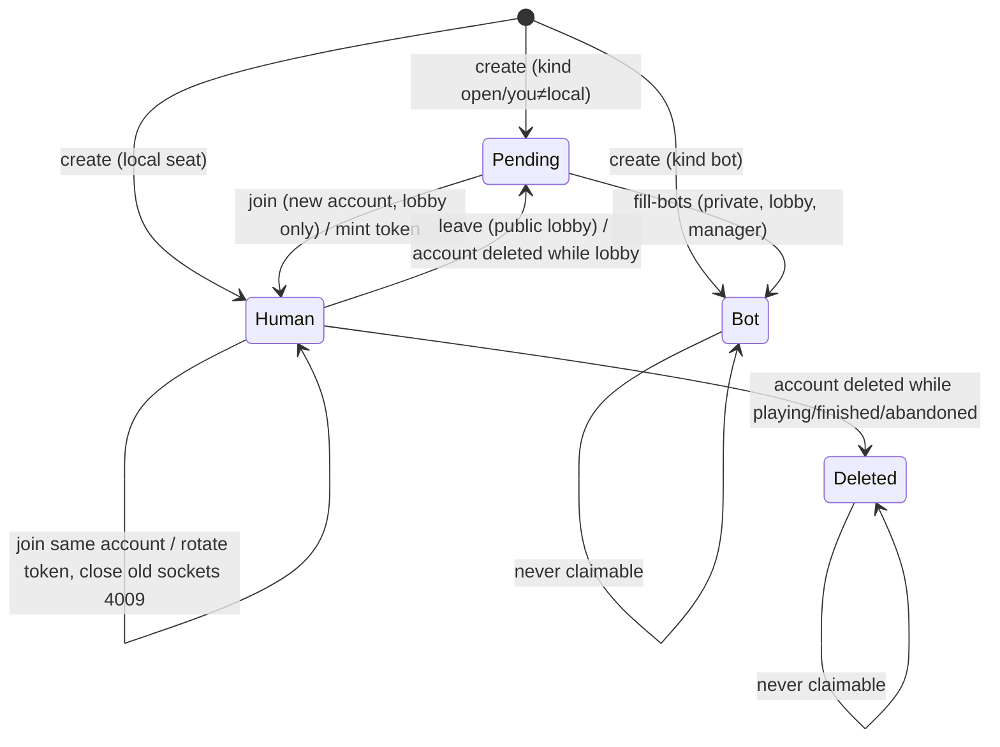
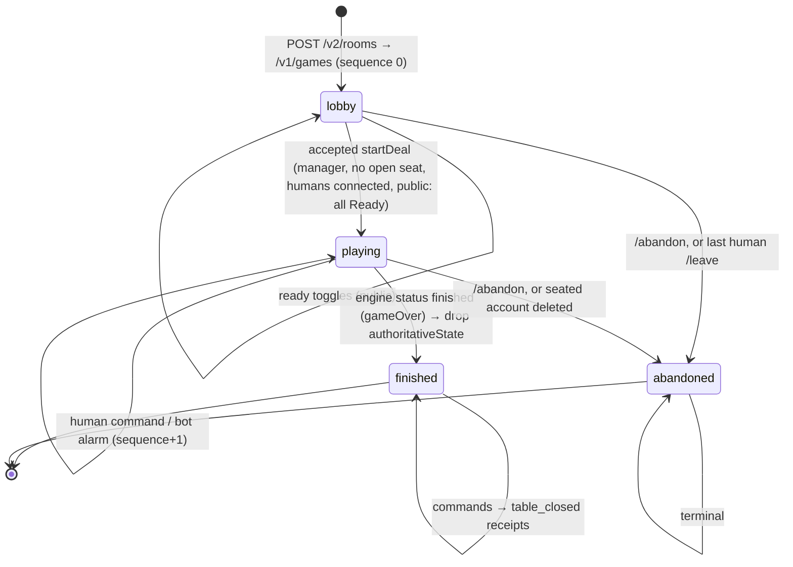
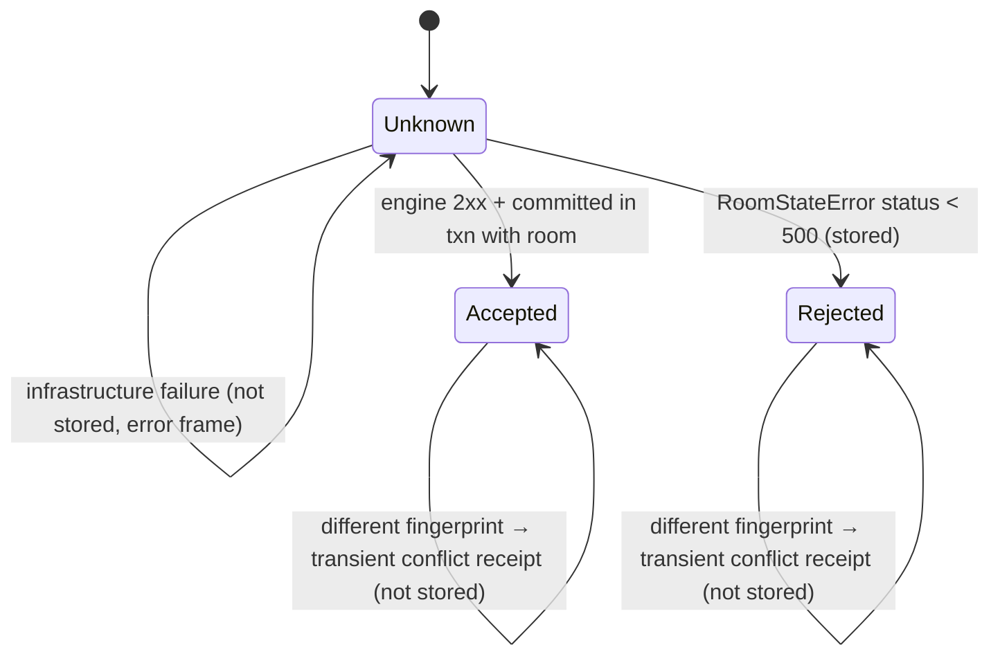
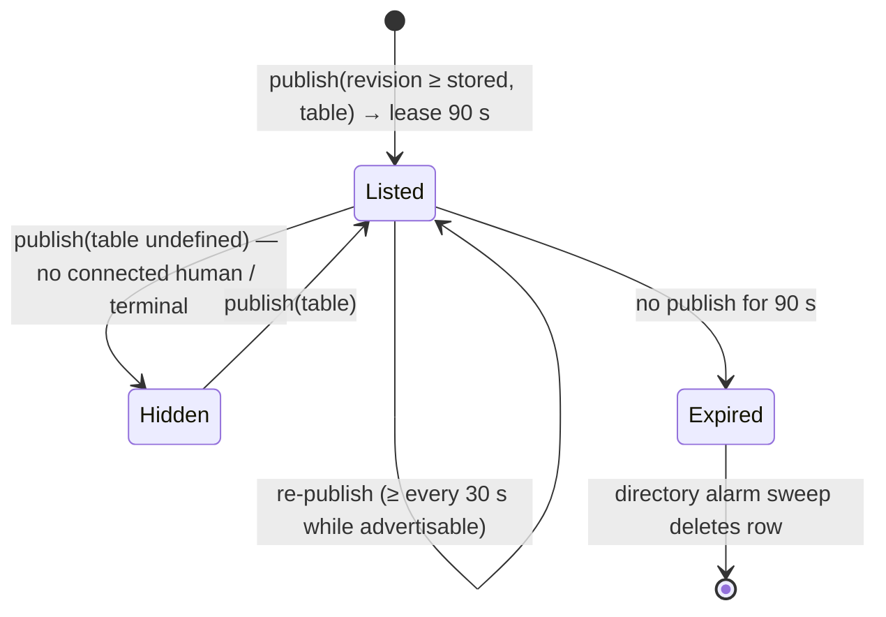
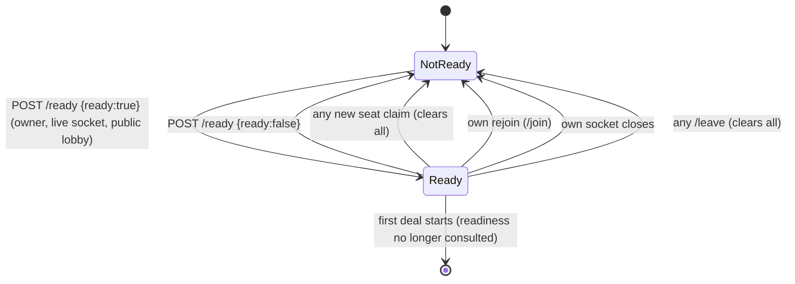
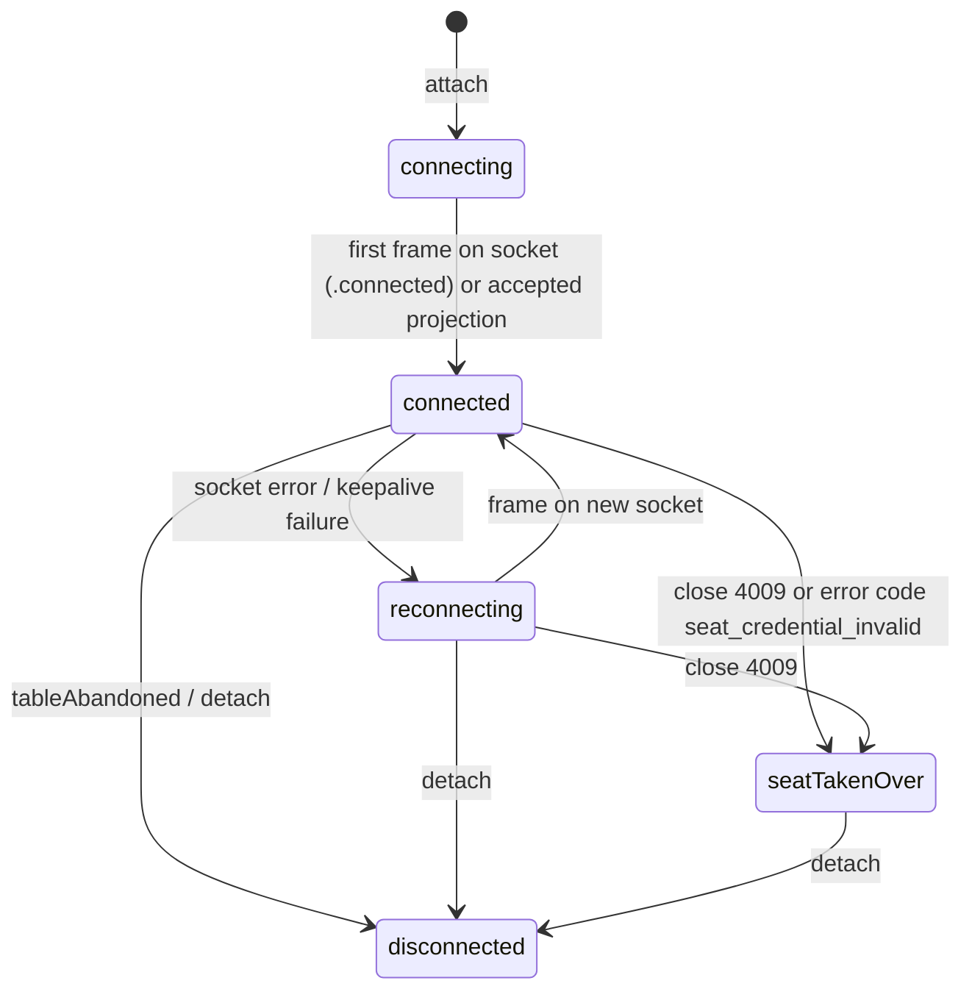
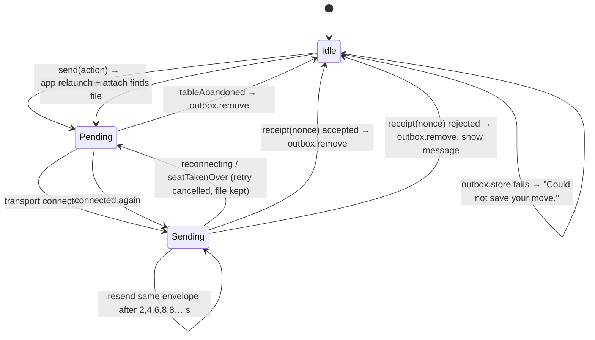

# Data Model (as-built): Preferans Online Multiplayer

**Spec**: [spec.md](spec.md) · **Verified against**: `store/1.0.3-localized-keywords` @ `cd78828`

Conventions:

- TypeScript types live in `workers/room-worker/src/`; Swift types in `Sources/PreferansEngine`, `Sources/PreferansServerCore`, `Preferans/Online`.
- `PlayerID` is serialized as `{"rawValue": "<seat>"}`. Online seats are always `north`, `east`, `south`, `west` (first 3 or 4) — `OnlineSeatSlot.canonicalPlayerIDs` in `Preferans/UI/LobbyModels.swift`.
- Swift `Codable` enums with associated values use the synthesized form `{"<case>": {"<label>": …}}`; unlabeled payloads use `_0` (e.g. `{"clientAction": {"_0": {...}}}`). Optional `nil` fields are omitted.
- Swift dictionaries keyed by `PlayerID` (e.g. `botProfiles`, `trickCounts`) encode as a flat JSON array `[key, value, key, value, …]`.
- Swift dates use ISO-8601 (`PreferansJSONCoder`, `AuthoritativeGameService.encoder`). Worker timestamps are ISO strings from `new Date().toISOString()`.
- Engine-domain types inside projections (`Card`, `BidCall`, `GameContract`, `ScoreSheet`, `DealResult`, `MatchSummary`, `PreferansRules`, `MatchSettings`, `PreferansEvent`, `BotProfile`, `BotDecisionExplanation`) are owned by [`../001-game-rules`](../001-game-rules), [`../002-scoring-and-variants`](../002-scoring-and-variants) and [`../003-bots`](../003-bots).

---

## 1. Server-side entities (Cloudflare Durable Objects)

### 1.1 `RoomState` — key `room` in `PreferansTable` (`room-state.ts`)

| Field | Type | Meaning / invariants |
| --- | --- | --- |
| `schemaVersion` | number | Always `ROOM_SCHEMA_VERSION = 4`; any other value → every access fails 410 `room_upgrade_required` (`loadRequiredRoom`) |
| `roomCode` | string | Normalized 4–12 `[A-Z0-9]`; generated codes are 6 chars from `ABCDEFGHJKLMNPQRSTUVWXYZ23456789`. Also the Durable Object name (`ROOMS.idFromName(roomCode)`) |
| `visibility` | `"private" \| "public"`? | Default `private`; immutable after create |
| `hostPlayerID` | string | Seat ID of the lobby manager; creator at birth |
| `hostEpoch` | number | Starts 1; +1 on each re-election (`electLiveHost`) |
| `peers` | `OnlinePeer[]` | Seat order fixed at create (order of the client's `seats`); length == `maxPlayers` |
| `maxPlayers` | 3 \| 4 | Equals seat count |
| `createdAt`, `updatedAt` | ISO string | `updatedAt` refreshed by every state change |
| `relaySequence` | number | Count of accepted *human* commands; safe-integer guarded (`recordRelay`), sent as `serverSequence` |
| `status` | `"lobby" \| "playing" \| "finished" \| "abandoned"` | Mirrors engine status except `abandoned` (Worker-only) |
| `readyPlayerIDs` | string[]? | Seats that confirmed Ready (public lobby only) |
| `summary` | `GameSummary`? | `{variant?, lastSequence, phase?, dealNumber?, result?}` — server-authored progress metadata; `result {winner?, finalBalances}` is set once `status = finished` (validated by `matchResult`) |
| `engineConfiguration` | `{rules, match, variant?}` | Opaque Swift `PreferansRules` / `MatchSettings` JSON; immutable; `variant` ≤ 32 chars |
| `engineVersion` | string? | `"preferans-1"` once the engine answered |
| `authoritativeState` | string? | Opaque JSON of Swift `AuthoritativeGameState`; dropped when finished or abandoned |
| `authoritativeSequence` | number? | Engine revision; +1 per human command or bot move |
| `authoritativeTableID` | UUID string? | Minted by Swift on first create and reused for every lobby rebuild |
| `authoritativeProjections` | `Record<seat, ProjectionEnvelope JSON>`? | Latest per-seat redacted projections (public rooms masked) |
| `botPending` | boolean? | Current actor is bot-controlled; forced `false` unless `status == "playing"` at commit |
| `retryCount` | number? | Bot failure counter, 0–6 |
| `libraryDirty` | boolean? | Set `true` on every commit; cleared after all library upserts succeed |
| `libraryRemovalAccountIDs` | string[]? | Accounts whose library row must be removed (after `/leave`) |
| `directoryDirty` | boolean? | Public listing must be (re)published |
| `directoryRevision` | number? | Monotonic publication revision (+1 on every commit and public presence broadcast) |

### 1.2 `OnlinePeer` (seat) — TS `room-state.ts`, Swift `RoomRealtimeTransport.swift`

| Field | Type | Meaning |
| --- | --- | --- |
| `playerID` | `{rawValue}` | Seat ID |
| `accountID` | string | One of: human account (`guest:<uuid>`, `apple:`; legacy `dev:*` default), `pending:<seat>` (open), `bot:<seat>`, `deleted:<seat>` (tombstone), or in outbound public payloads the masked `seat:<ROOMCODE>:<seat>` |
| `provider` | `"gameCenter" \| "apple" \| "email" \| "guest" \| "dev"` | Unknown values normalize to `dev`; bots, open seats, tombstones and masked seats are `dev` |
| `displayName` | string | Trimmed, ≤ 60 chars, defaults to the seat ID; bots "Bot N", open "Open seat", tombstone "Deleted player" |
| `seatToken` | string? | 24 chars from `ABCDEFGHJKLMNPQRSTUVWXYZabcdefghijkmnpqrstuvwxyz23456789`; present on every claimed human seat, absent on bots/open/tombstones; **never** in public payloads (`normalizePeer` strips it) |

Classification (`isHumanAccount`): human ⇔ not `pending:`, `bot:` or `deleted:`. Invariants (`uniquePeers`): unique seat IDs (`duplicate_player`), a human account may hold at most one seat (`duplicate_account`).

### 1.3 Seat occupancy state machine

### 1.4 Room lifecycle state machine

Engine status mapping (`AuthoritativeGameService.status`): `waitingForDeal` with sequence 0 → `lobby`; `gameOver` → `finished`; anything else (including `waitingForDeal` between deals and `dealFinished`) → `playing`.

### 1.5 Lobby manager

`hostPlayerID`/`hostEpoch` change only through `electLiveHost` (connect/close/error/leave/account deletion). Rule: if the current manager's seat has no open socket, pick the first human seat in `peers` order that is in the connected set; no change for finished/abandoned rooms or when nobody qualifies. `/leave` passes *all remaining humans* as the candidate set.

### 1.6 Command receipt and stored command (`command-contract.ts`)

`CommandReceipt` (wire and storage):

| Field | Type | Meaning |
| --- | --- | --- |
| `tableID` | UUID string | `authoritativeTableID` |
| `clientNonce` | UUID string (lowercase) | Command ID |
| `sequence` | number | Accepted: new engine sequence. Rejected: engine sequence at rejection time |
| `status` | `"accepted" \| "rejected"` | |
| `code`, `message` | string? | Rejection reason (e.g. `engine_rejected_command`, `table_closed`, `lobby_manager_required`, `room_not_ready`, `players_not_ready`, `protocol_mismatch`, `invalid_command`, `command_id_conflict`) |

Storage key `command:<senderAccountID>:<nonce>` → `{fingerprint, receipt}`. `fingerprint = sha256hex(canonical({sender, tableID, schemaVersion, actor, action, baseSequence}))` where `canonical` sorts object keys recursively.

### 1.7 Revision checkpoint — key `history:<sequence padded to 12 digits>`

`{command?: EngineCommandEnvelope, receipt?: CommandReceipt, engineVersion: string, state: string}`. Written in the commit transaction when `authoritativeState` exists and (`sequence == 0` or key absent). Bot moves and lobby rebuilds have no command/receipt. Never served to clients; deleted wholesale on any participant's account deletion.

### 1.8 `PlayerAccountState` — key `account` in `PlayerAccountV2` (`account-state.ts`)

| Field | Type | Meaning |
| --- | --- | --- |
| `schemaVersion` | number | `ACCOUNT_SCHEMA_VERSION = 2`; mismatch → 401 `account_not_found`/`account_upgrade_required` |
| `accountID` | string | Must contain `:`; also the DO name |
| `provider` | `"apple" \| "guest"` | |
| `displayName` | string | Refreshed on each registration |
| `sessions` | `AccountSession[]` | `{secretHash (sha256 hex), createdAt, expiresAt}`; ≤ 5 unexpired (`MAX_ACTIVE_SESSIONS`); lifetime 180 days (`SESSION_LIFETIME_MS`) |
| `games` | `Record<roomCode, GameSummaryEntry>` | Library (one row per room) |

`PublicAccount` (wire) = `{schemaVersion, accountID, provider, displayName}`. Client mirror: `RegisteredOnlineAccount` (`Preferans/UI/LobbyModels.swift`) with **required** `schemaVersion` (legacy records without it fail to decode).

Session token: `pref2.<base64url(accountID)>.<base64url(32 random bytes)>`; parse requires 3 parts, prefix `pref2`, decoded account ID containing `:`, secret ≥ 32 chars.

### 1.9 Library entry — `GameSummaryEntry` (`library-state.ts`) / `OnlineGameSummary` (Swift)

| Field | Type | Notes |
| --- | --- | --- |
| `roomSchemaVersion` | number | 4; rows with another value are filtered out by `listGames` (not decoded by the client) |
| `roomCode` | string | Key in `games` |
| `hostPlayerID` | PlayerID | |
| `status` | GameStatus | Client: Continue = lobby/playing, History = finished, abandoned hidden |
| `maxPlayers` | number | |
| `peers` | OnlinePeer[] | Masked except the owning account in public rooms |
| `youSeat` | PlayerID | Seat this account holds |
| `variant`, `phase`, `dealNumber` | string?, string?, number? | `phase` = `ProjectedPhase.token` (e.g. `waitingForDeal`, `bidding`, `playing`, `dealFinished`, `gameOver`) |
| `lastSequence` | number | Engine sequence (fallback `relaySequence`) |
| `result` | `{winner?, finalBalances?}`? | Declared; not populated by the server (spec gap 1) |
| `createdAt`, `updatedAt` | ISO string | Sort key for `/v2/my-games` (desc) |

### 1.10 Public listing — `PublicTableEntry` (`public-tables.ts`) / `PublicOnlineTable` (Swift)

Stored as `table:<roomCode>` → `Listing {revision, expiresAt (ms), table?}` in `PublicTableDirectory` (instance `public-v1`).

| Field | Type | Notes |
| --- | --- | --- |
| `roomCode` | string | |
| `variant` | `"odesa" \| "wien" \| "thessaloniki"` | Display names Vienna / Prague / Berlin (`docs/PUBLIC_LOBBY.md`) |
| `poolTarget` | number | Table total (e.g. 33 = 3 × 11) |
| `poolClosure` | `"individualWithAmericanAid" \| "tableTotal"` | |
| `maxPlayers` | number | |
| `players` | `{displayName, ready, connected}[]` | Humans only |
| `openSeats` | number | `pending:` seats in lobby; 0 when playing |
| `status` | `"lobby" \| "playing"` | |
| `dealNumber` | number? | |
| `createdAt` | ISO string | |

Client: `PublicOnlineTable.canJoin = status == .lobby && openSeats > 0`; `OnlineTableSettings.displayedPoolTarget(playerCount:)` = `poolTarget` for `tableTotal`, else `poolTarget / playerCount`.

Older revisions are ignored, so out-of-order publications cannot resurrect a stale listing.

### 1.11 Public readiness (per seat)

---

## 2. Engine-server entities (`Sources/PreferansServerCore/AuthoritativeGameService.swift`)

### 2.1 `AuthoritativeGameState` (opaque blob carried by the Worker)

| Field | Type | Meaning |
| --- | --- | --- |
| `schemaVersion` | Int | `2`; other values → `invalidSchema` |
| `tableID` | UUID | Table identity |
| `sequence` | Int | Revision |
| `snapshot` | `PreferansSnapshot` | Full engine snapshot (all hands, talon, score…) |
| `identities` | `[PlayerIdentity]` | `{playerID, gamePlayerID, displayName}` per seat |
| `botProfiles` | `[PlayerID: BotProfile]` | Bot-controlled seats |
| `appliedNonces` | `[AppliedCommandNonce]` | Last 16 `{id, sequence, sender, actor, action, baseSequence}` |
| `dealSeed` | UInt64 | Random per create (`UInt64.random`) |
| `generatedDealCount` | UInt64 | Deals generated so far |
| `botInsights` | `[BotDecisionExplanation]` | Rolling window of 20 |

Constants: `engineVersion = "preferans-1"`, `maximumRememberedNonces = 16`, `maximumBotActionsPerCommand = 512`.

### 2.2 Requests/responses

See [contracts/engine-server-api.md](contracts/engine-server-api.md): `CreateAuthoritativeGameRequest`, `AuthoritativeCommandRequest`, `AuthoritativeGameResponse {engineVersion, botPending, state, sequence, projections, status, dealNumber, phase}`.

---

## 3. Shared wire entities (`Sources/PreferansEngine/Online`, `Projection`)

### 3.1 `ClientActionEnvelope`

| Field | Type | Notes |
| --- | --- | --- |
| `schemaVersion` | Int | 4 (encoded; required by the Worker) |
| `tableID` | UUID | |
| `actor` | PlayerID | `action.actor ?? localSeat`; may name a controlled seat (open single-whist dummy) |
| `action` | `PreferansAction` | `startDeal`, `bid`, `discard`, `declareContract`, `concedeWithoutThree`, `whist`, `chooseDefenderMode`, `playCard`, `proposeSettlement`, `acceptSettlement`, `rejectSettlement` |
| `clientNonce` | UUID | Command ID (also `id`) |
| `baseHostSequence` | Int | Projection sequence the command was built on |
| `sentAt` | Date | Informational; excluded from the fingerprint |

### 3.2 `ProjectionEnvelope` and `PlayerGameProjection`

`ProjectionEnvelope {schemaVersion (required on decode), tableID, sequence, viewer, projection, eventSummaries ([] from server), events (viewer-redacted), botInsights}`.

`PlayerGameProjection`:

| Field | Type | Notes |
| --- | --- | --- |
| `tableID`, `sequence`, `viewer` | UUID, Int, PlayerID | Must equal the envelope's |
| `players` | [PlayerID] | Seat order |
| `identities` | [PlayerIdentity] | `gamePlayerID` = account ID (private) or `seat:<CODE>:<seat>` (public) |
| `rules`, `match` | PreferansRules, MatchSettings | Public |
| `consecutiveAllPassDeals` | Int | |
| `score` | ScoreSheet | Public |
| `phase` | ProjectedPhase | `waitingForDeal(nextDealer)`, `bidding(currentPlayer, highestBid)`, `awaitingDiscard(declarer, finalBid)`, `awaitingContract(declarer, finalBid)`, `awaitingWhist(currentPlayer, declarer, contract)`, `awaitingDefenderMode(whister, contract)`, `playing(currentPlayer, leader, kind)`, `dealFinished(result)`, `gameOver(summary)`; `.token` is the stable label |
| `seats` | [SeatProjection] | `{player, displayName, isActive, isDealer, isCurrentActor, role, hand: [ProjectedCard], trickCount}`; `role ∈ dealer, declarer, defender, whister, halfWhister, active, sittingOut` |
| `auction`, `whistCalls` | records | Public |
| `currentTrick`, `lastCompletedTrick`, `completedTrickCount`, `trickCounts` | | Public |
| `talon`, `discard` | [ProjectedCard] | `known(Card)` or `hidden` |
| `legal` | LegalActionProjection | Viewer-specific |
| `status` | ProjectedStatus | `readyToDeal`, `bidding`, `takingPrikup`, `namingContract`, `callingWhist`, `choosingDefenderMode`, `playingTrick(currentPlayer, trickNumber)`, `settling(...)`, `dealScored`, `matchOver(winner?)` |

`LegalActionProjection`: `canStartDeal`, `bidCalls`, `whistCalls`, `playableCards`, `contractOptions`, `defenderModes`, `canDiscard`, `settlementOptions`, `pendingSettlement`, `canAcceptSettlement`, `canRejectSettlement`, `playableCardsOwner`.

### Visibility matrix

`ProjectionPolicy.online` = `revealAllHands false`, `revealOpenDefenderHandsToAll true`, `revealDeclarerDiscardToDeclarer true` (`PlayerProjection.swift`). "Known" cards are sorted.

| Phase (`engine.state`) | Own hand | Other hands | Talon | Discard | Viewer-specific legal | Notes |
| --- | --- | --- | --- | --- | --- | --- |
| `waitingForDeal` | empty | empty | `[]` | `[]` | `canStartDeal = true` (all viewers) | Server accepts start only from manager |
| `bidding` | known | hidden (count) | 2 × hidden | `[]` | `bidCalls = legalBidCalls(viewer)` | |
| `awaitingDiscard` | known | hidden | **known to all** | `[]` | `canDiscard` only declarer | Every player sees what the declarer takes |
| `awaitingContract` | known | hidden | hidden | known to declarer, hidden (count) to others | `contractOptions` only declarer | `namingContract(pickingTotusStrain: finalBid == .totus)` |
| `awaitingWhist` | known | hidden | hidden | as above | `whistCalls = legalWhistCalls(viewer)` | |
| `awaitingDefenderMode` | known | hidden | hidden | as above | `defenderModes = [.closed, .open]` only whister | |
| `playing` – game, closed defence | known | hidden | hidden¹ | as above | `playableCards`, settlements | Stalingrad forced whist stays closed |
| `playing` – game, open defence | known | defenders' hands known to all | hidden¹ | as above | idem | |
| `playing` – 10-trick contract, no whisters, no whist calls | known | **all active hands known to all** | hidden¹ | as above | idem | "ten check" |
| `playing` – misère | known | declarer hidden; defenders known to all once `misereDefendersAreOpen` (after the opening lead) | hidden¹ | as above | idem | Defenders' role `whister` |
| `playing` – all-pass (raspasy) | known | hidden | talon-led: card *i* known while `i ≤ completedTricks` during the first 2 tricks, else hidden | `[]` | idem | Rostov: talon hidden throughout |
| `playing` – viewer controls another seat (open single-whist dummy) | known | controlled seat known to viewer | – | – | `playableCardsOwner = controlled seat` | |
| `dealFinished(result)` | empty | empty | `[]` | `[]` | `canStartDeal = true` (all) | `DealResult.initialHands` (pre-exchange hands), tricks, score delta public |
| `gameOver(summary)` | empty | empty | `[]` | `[]` | none | `MatchSummary` (standings, last deal) public |

¹ Unless the all-pass talon-lead rule applies.

Event redaction (`OnlineEventProjection.events`): `talonExchanged(declarer, talon, discard)` keeps `talon`/`discard` only for `viewer == declarer`; all other events (`dealStarted`, `bidAccepted`, `auctionWon`, `allPassed`, `contractDeclared`, `contractConcededWithoutThree`, `whistAccepted`, `defenderModeChosen`, `playStarted`, `cardPlayed`, `trickCompleted`, `settlementProposed/Accepted/Rejected`, `playSettled`, `dealScored`, `matchEnded`) are delivered unchanged.

Never in any projection/frame: deck, `dealSeed`, `generatedDealCount`, `appliedNonces`, `botProfiles`, the snapshot, other seats' tokens, bearer tokens.

---

## 4. Client-side entities (`Preferans/Online`)

### 4.1 `CloudflareRoomSummary` (decoded room / presence / create / join payload)

`{visibility?, readyPlayerIDs?, tableSettings?, status?, schemaVersion (must be 4), roomCode, hostPlayerID, hostEpoch, peers, maxPlayers, createdAt, updatedAt, relaySequence (≥ 0), websocketURL?, seatToken?, authoritativeTableID?}`. The Worker's `summary` field is ignored by the client.

### 4.2 `CloudflareRoomTransport` state

`isPublicTable`, `readyPlayerIDs`, `tableSettings`, `participants`, `connectedPlayerIDs` (initially `[localPeer]`), `hostPlayerID`, `hostEpoch`, `lastError`, `latestConnectionEvent` (replayed to new subscribers), `lastRelaySequence` (floor for `room` frames), immutable `roomCode`, `localPeer` (server-assigned seat), `authoritativeTableID`, `seatToken`, `socketURL`.

### 4.3 `ServerGameCoordinator` state

Published: `projection`, `displayProjection` (trick hold applied; `legal` emptied while submitting or not connected), `pendingAdvance`, `recentEvents` (≤ 100), `eventLog` (≤ 100), `botInsights`, `isHost`, `isPublicTable`, `isReady`, `isUpdatingReadiness`, `tableSettings`, `rosterSeats` (`WaitingRoomSeat` with occupancy `you|human|bot|openWaiting` + `isReady`), `canHostStart`, `hasDisconnectedHumanSeat`, `isSubmitting`, `transportStatus`, `liveness`, `errorText`. Private: `pending` command, `latestReceiptSequence` (init −1), `generation` (attachment UUID; stale tasks are ignored).

Transport status machine (`OnlineTransportStatus`, driven by `RoomTransportEvent`):

Client command lifecycle:

### 4.4 Device persistence

| Item | Location / key | Content | Lifetime |
| --- | --- | --- | --- |
| Bearer token | Keychain generic password, service `com.mixandmatch.preferans.online-account.v2<suffix>`, account `active-session`, `AfterFirstUnlockThisDeviceOnly` | session token string | Until sign-out/deletion |
| Account record | UserDefaults `settings.onlineRegisteredAccount<suffix>` | `RegisteredOnlineAccount` JSON | Until sign-out/deletion or schema mismatch |
| Display name | UserDefaults `settings.onlineDisplayName<suffix>` | string (debounced 300 ms) | |
| Legacy key | UserDefaults `settings.onlineAnonymousAccountID<suffix>` | removed on register/clear | |
| Seat tokens | UserDefaults `online.seatCredentials<suffix>` | `{ROOMCODE: {token, savedAt}}` | Pruned > 90 days on each write; removed on abandon/clear |
| Pending command | `Application Support/Preferans/Commands/<TABLE-UUID>-<base64(accountID), "/"→"_">.json` | `ClientActionEnvelope` JSON (default coder) | Until receipt/abandon |

`<suffix>` = `.owner-v1` (release and default) or `.uiTestLocal.<host>.<port>` when a DEBUG UI-automation loopback worker URL is active (`AppIdentifiers.onlineStorageSuffix`).

---

## 5. Legacy peer-host entities (in-memory room only)

| Entity | File | Role |
| --- | --- | --- |
| `HostGameActor` | `HostGameActor.swift` | Owns `PreferansEngine`, sequence, applied nonces (unbounded set), `ValidatedActionRecord` log; rewrites `startDeal` with `engine.nextDealer` and `dealSource.nextDeck()`; ignores a stale duplicate `startDeal` |
| `HostUpdate` | idem | `{tableID, sequence, projections[PlayerID: projection], events, eventSummaries, validatedAction?, snapshot, status, dealNumber}` |
| `ValidatedActionRecord` | idem | Append-only `{tableID, sequence, actor, action, clientNonce, baseHostSequence, createdAt, events, eventSummaries}`; replayed by `GameLogReplayer` (sequence gaps / event mismatches throw) |
| `BotDecisionPlan` | idem | `{decider, snapshot, baseSequence}` for `RoomBotMoveScheduler` |
| `RoomParticipantRoster` | `RoomParticipantRoster.swift` | Seat→peer map; a `pending:` update never evicts a human/bot; bot seats stay bots |
| `OnlineResumeContext` | `RoomRealtimeTransport.swift` | `{snapshot, sequence}` for host recovery (Cloudflare returns `nil`) |
| `OnlineStateSummary` | `OnlineGameLibrary.swift` | Legacy report payload (`RoomStateReportBuilder` phase labels `waiting`, `bidding`, `exchange`, `declaring`, `whist`, `defending`, `playing`, `scoring`, `finished`) |
| `HeartbeatConfig` | `RoomRealtimeTransport.swift` | default interval 3 s, host timeout 10 s; `.disabled` for in-memory |
