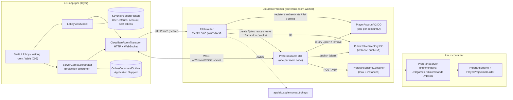
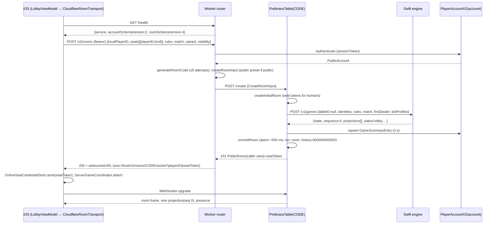
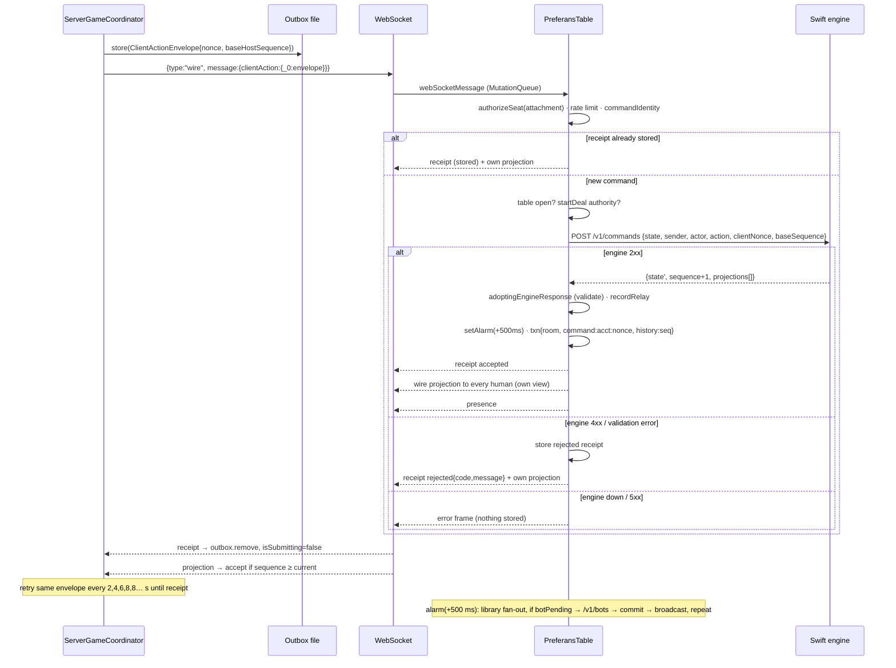
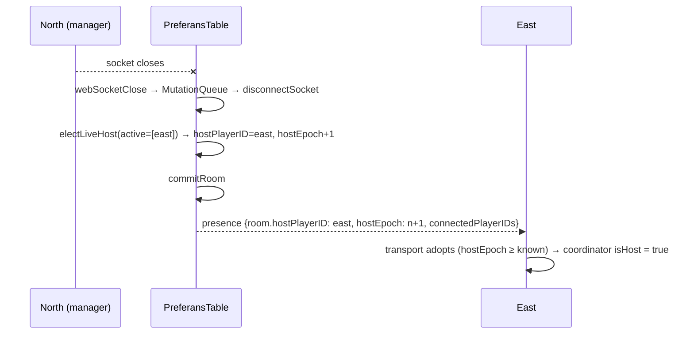
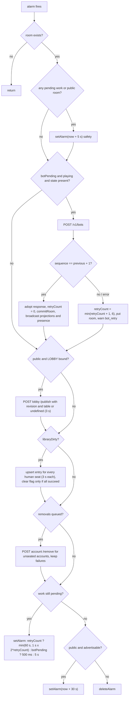

# Implementation Plan (as-built): Preferans Online Multiplayer

**Spec**: [spec.md](spec.md) · **Verified against**: `store/1.0.3-localized-keywords` @ `cd78828`

## Summary

Online tables are owned by a per-table Cloudflare Durable Object (`PreferansTable`) that serializes all mutations and persists an opaque private engine state produced by a stateless Swift/Hummingbird engine container (`PreferansServer`). The iOS app (`ServerGameCoordinator` + `CloudflareRoomTransport`) is a projection consumer with a durable command outbox. Accounts and "Your games" live in per-account Durable Objects (`PlayerAccountV2`); public tables are advertised through a single directory Durable Object (`PublicTableDirectory`, instance `public-v1`). A legacy client-hosted coordinator (`RoomOnlineGameCoordinator` + `HostGameActor`) is retained only for the in-memory DEBUG/UI-test room.

## Technical Context

| Item | As built |
| --- | --- |
| **Language/Version** | Swift 6 (`swift-tools-version: 6.0`; container toolchain `swift:6.3.2-jammy`); TypeScript (ES2022, `typescript ^6.0.3`) on Cloudflare Workers (`compatibility_date = "2026-04-07"`) |
| **Primary Dependencies** | Server: Hummingbird `from: 2.22.0`. Worker: `@cloudflare/containers ^0.3.7`; dev: `wrangler ^4.127.1`, `vitest ^4.1.0`, `@cloudflare/vitest-plugin ^1.1.2`, `@cloudflare/workers-types`. App: SwiftUI, Foundation `URLSession`/`URLSessionWebSocketTask`, Security (Keychain), AuthenticationServices + CryptoKit (Sign in with Apple), `swift-dependencies` (clock/uuid injection). Shared: `PreferansEngine` target |
| **Storage** | Durable Object SQLite-backed storage (key/value API): `room`, `command:*`, `history:*` per table; `account` per account; `table:*` in the directory. No KV/D1/R2. Device: Keychain (bearer token), UserDefaults (account record, display name, seat-token cache), Application Support files (pending command outbox). See [contracts/persistence.md](contracts/persistence.md) |
| **Testing** | Worker: `node --test test/*.test.ts` (52 pure tests), `vitest` with `@cloudflare/vitest-plugin` against real workerd Durable Objects (`runtime-test/`, 14 tests), Bun network scripts (`smoke:live`, `test:network`, `test:public-network`). Swift: XCTest/Swift Testing in `Tests/PreferansServerCoreTests` and `Tests/PreferansEngineTests` (app target `PreferansAppTests`), live tests gated by env vars; XCUITest `NativeOnlineUITests`/`OwnerOnlineUITests` |
| **Target Platform** | iOS 17.0+ app target (the package declares iOS 16, macOS 14, tvOS 16, watchOS 9 for the libraries); Cloudflare Workers + Durable Objects + Containers (linux/amd64 image) |
| **Project Type** | Mobile client + edge API + containerized stateless rules service |
| **Performance Goals** | Bot cadence 500 ms/revision (`BOT_MOVE_DELAY_MS`, mirrors `BotPacing.interactive`); bounded network match ≤ 30 s / 128 commands (test budget); engine request timeout 8 s; internal DO calls 3 s; client room HTTP timeout 30 s, health/directory 8 s |
| **Constraints** | No private state on clients; exactly-once command application; JavaScript-safe integers (UInt64 seeds and `Int.max` never cross as numbers); 128 KiB message cap; one live controller socket per seat; protocol clean break (schema 4) |
| **Scale/Scope** | 3–4 seats per table; container pool `max_instances = 3`; directory pages of 50 (offset ≤ 10 000); ≤ 5 sessions per account; ≤ 64 queued mutations per table. Capacity under real load is unmeasured (`docs/MULTIPLAYER.md`) |

## Project Structure

```text
Package.swift                         # lanes: default (app+server+tests), PREFERANS_SERVER_ONLY=1 (engine+server only), PREFERANS_ENGINE_TESTS_ONLY=1
Dockerfile.server                     # 2-stage build of PreferansServer, ENV PORT=8080, EXPOSE 8080
.dockerignore                         # excludes .build, .git, Xcode project, worker node_modules/.wrangler …
Sources/
  PreferansEngine/
    Online/GameWireMessage.swift      # PreferansWireSchema.current = 4; GameWireMessage + envelopes
    Online/PreferansGameStatus.swift  # lobby | playing | finished | abandoned
    Projection/PlayerProjection.swift # ProjectedCard, SeatProjection, ProjectedPhase/Status, LegalActionProjection, PlayerGameProjection, ProjectionPolicy, PlayerProjectionBuilder
    Projection/PlayerProjectionBuilder+Phase.swift       # per-phase frames, roles, reveal sets
    Projection/PlayerProjectionBuilder+Visibility.swift  # hand/talon/discard redaction
    Projection/ProjectionBuildFrame.swift
    Projection/OnlineEventProjection.swift               # per-viewer event redaction
  PreferansServerCore/AuthoritativeGameService.swift      # create/apply/advanceBot; AuthoritativeGameState (schema 2, engine "preferans-1")
  PreferansServer/main.swift          # Hummingbird routes: GET /health, POST /v1/games, /v1/commands, /v1/bots
workers/room-worker/
  src/index.ts                        # Worker router, PreferansTable DO, PlayerAccountV2 DO, PreferansEngineContainer, AASA + invite page
  src/room-state.ts                   # RoomState, seats, tokens, join/leave/abandon, host election, relay sequence
  src/authoritative-engine.ts         # engine calls, response validation, projection masking, start-deal authority
  src/command-contract.ts             # CommandReceipt, command fingerprint, MutationQueue
  src/account-state.ts                # accounts, sessions (pref2 tokens)
  src/apple-auth.ts                   # Sign in with Apple JWT verification
  src/library-state.ts                # GameSummaryEntry ("Your games")
  src/public-tables.ts                # public presets, listing projection, readiness
  src/public-directory.ts             # PublicTableDirectory DO
  src/local.ts                        # LocalPreferansTable (engine at 127.0.0.1:18081) – local only
  fixtures/create-game.json           # Swift⇄Worker wire fixture for /v1/games
  fixtures/public-rules.json          # canonical public rules (odesa/wien/thessaloniki)
  test/*.test.ts                      # 52 node:test unit tests
  runtime-test/*.test.ts              # 14 workerd Durable Object tests
  scripts/smoke-live.ts | match-network.ts | public-lobby-network.ts   # live/loopback network harnesses
  wrangler.toml | wrangler.owner.toml | wrangler.local.toml | vitest.config.ts | package.json | README.md
Preferans/
  Online/
    CloudflareOnlineGameSession.swift # create/join/resume factory; persists seat token
    CloudflareRoomTransport.swift     # HTTP client, WebSocket lifecycle, account client, frame decoding
    ServerGameCoordinator.swift       # production table state: projections, outbox, receipts, start/ready/leave
    OnlineCommandOutbox.swift         # write-ahead pending command file + OnlineCommandReceipt
    OnlineSeatCredentialStore.swift   # Keychain bearer token store + UserDefaults seat-token cache
    OnlineGameLibrary.swift           # public-table directory client, "Your games" client + view models
    PreferansInviteLink.swift         # invite URL build/parse
    OnlineGamePresenting.swift        # UI-facing protocol for both coordinators
    RoomRealtimeTransport.swift       # transport protocol, OnlinePeer, events, statuses, HeartbeatConfig
    # legacy peer-host path (in-memory room only):
    RoomOnlineGameCoordinator.swift  HostGameActor.swift  HostedOnlineGameCoordinator.swift (typealias)
    InMemoryOnlineGameSession.swift  InMemoryRoomTransport.swift  GameLogReplayer.swift
    RoomBotMoveScheduler.swift  RoomDurabilityBarrier.swift  RoomDurabilityRetryRunner.swift
    RoomHostRecoveryRunner.swift  RoomHostLiveness.swift  RoomRetryBackoff.swift
    RoomInboundMessagePolicy.swift  RoomInboundMessageDispatcher.swift  RoomParticipantRoster.swift
    RoomStateReportBuilder.swift  RoomTransportSubscriptions.swift
  Support/AppIdentifiers.swift        # base URL, storage suffix, schema constants, settings keys, PreferansJSONCoder
  Preferans.entitlements              # Sign in with Apple, Game Center, associated domains
  UI/LobbyViewModel.swift, LobbyOnlineSetupCard.swift … # (owned by 005) call into the online layer
AppStore/UniversalLinks/              # static AASA + hosting notes
bin/dev-online                        # local engine container + local worker
bin/verify-online-invite-flow         # multi-simulator invite smoke (see spec gap 14)
.github/workflows/multiplayer.yml     # worker check + portable engine lane on every push/PR
.github/workflows/owner-server-build.yml  # build-only engine image + smoke, artifact (no deploy)
```

## Architecture

### Topology



Authority: **game rules** = Swift container (stateless); **game state, receipts, membership, ordering** = `PreferansTable`; **identity** = `PlayerAccountV2`; **discovery** = `PublicTableDirectory` (advisory only, never authoritative for seats). The client is authoritative for nothing except its own pending-command intent.

### Component responsibilities

| Component | Responsibility | Key code |
| --- | --- | --- |
| Worker router | CORS, rate limit, health, registration, bearer auth, route to DOs, AASA, invite page, error mapping | `index.ts` default `fetch` |
| `PreferansTable` | Room lifecycle, seats/tokens, sockets, command receipts, engine calls, commit transaction, projections fan-out, presence, manager election, alarm outbox (bots, library, directory, removals) | `index.ts` class `PreferansTable` |
| `PlayerAccountV2` | Account record, sessions, library entries, deletion | `index.ts` class `PlayerAccountV2` |
| `PublicTableDirectory` | Leased listings, filtering, paging, expiry sweep | `public-directory.ts` |
| `PreferansEngineContainer` | Container lifecycle (`defaultPort 8080`, `sleepAfter "10m"`) | `index.ts` |
| `AuthoritativeGameService` | Create game, authorize/apply command, one bot move, projections, status | `AuthoritativeGameService.swift` |
| `ServerGameCoordinator` | Projection acceptance, outbox, retries, receipts, readiness, start gating | `ServerGameCoordinator.swift` |
| `CloudflareRoomTransport` | Compatibility check, room HTTP calls, socket reconnect/keepalive, frame validation, events | `CloudflareRoomTransport.swift` |

## Key Flows

### 1. Register (guest / Apple)

1. Guest: `LobbyViewModel.registerGuestOnlineAccount` → `POST /v2/accounts/guest {displayName}`.
   Apple: `LobbyOnlineSetupCard.configureAppleSignIn` sets `request.nonce = sha256hex(rawNonce)`; on success `completeAppleRegistration` → `POST /v2/accounts/apple {identityToken, nonce: rawNonce, displayName}`; Worker `verifyAppleIdentityToken`.
2. Worker `registerAccount` → `PlayerAccountV2 /register` → `issueSession` → `{account, sessionToken}` (201).
3. App stores the token in the Keychain (fails closed), the `RegisteredOnlineAccount` JSON in UserDefaults.

### 2. Create a room



### 3. Join via invite

1. iOS receives `https://<worker-host>/join/CODE` (Universal Link via `onContinueUserActivity`) or `com.mixandmatch.preferans://table/join/CODE` (`onOpenURL`) → `LobbyViewModel.handleInviteURL` fills the code (no auto-join).
2. User taps Join → `CloudflareOnlineGameSession.joinRoom` → health check → `POST /v2/rooms/CODE/join {requestedPlayerID}`.
3. `PreferansTable /join`: `joinRoom` (bind by account; requested open seat or first open seat; mint token) → if lobby, `createAuthoritativeGame` (sequence 0 rebuild with same `tableID`) → `upsertLibraryEntry(joiner)` → `commitRoom` → close old sockets for that seat (4009) → presence + projections → alarm fan-out to all libraries.
4. Response: caller view + caller's `seatToken`; Worker adds `websocketURL` for the *assigned* seat.
5. App adopts the assigned seat and connects.

### 4. Ready and start (public waiting table)

1. Each player `POST /v2/rooms/CODE/ready {playerID, seatToken, ready:true}` (requires live socket) → presence shows `readyPlayerIDs`.
2. Manager taps Start when `canHostStart` → `send(.startDeal(dealer:nil, deck:nil))` → flow 5. Worker `validateStartDealAuthority` enforces manager, full roster, connected humans, readiness.

### 5. Play a move



### 6. Reconnect

1. `URLSessionWebSocketTask.receive` throws (or keepalive ping fails within 10 s) → `.reconnecting` (retry task cancelled) → wait `reconnectDelay(attempt)` → reopen the same URL (same seat token).
2. `connectWebSocket`: `authorizeSeat` → accept → `closeOtherSocketsForSeat` (4009) → `reconcileHost` → `room` frame → stored projection → presence broadcast.
3. First frame on the new socket → `.connected` → coordinator re-sends the pending envelope (same nonce). If the command had committed before the drop, the stored receipt is returned.
4. App relaunch / "Your games" Continue → `resumeRoom` → `POST /join` (token rotation) → new socket; older devices receive 4009 and become read-only (`seatTakenOver`).

### 7. Manager (host) recovery

- **Production**: there is no engine host to recover. On every socket connect/close/error the Durable Object runs `electLiveHost(room, activePlayerIDs)`; if the manager has no live socket, the first connected human in seat order becomes manager (`hostEpoch + 1`), the room is committed, and presence is broadcast. Clients recompute `isHost` from `hostPlayerID` (`ServerGameCoordinator.refreshRoster`). The new manager can start subsequent deals.
- **Legacy in-memory path**: `RoomOnlineGameCoordinator.reconcileHostAuthority` → `beginHostRecovery` → `RoomHostRecoveryRunner` (250 ms → 4 s backoff) asks `transport.hostRecoveryContext()` for a snapshot, re-checks the election around every await, then `becomeHost` rebuilds `HostGameActor` from the snapshot, persists (`reportState`) before broadcasting `seatAssignment` and projections. Covered by `RoomOnlineGameCoordinatorTests.testServerElectedSuccessorHydratesSnapshotAndContinuesTheSameDeal`, `testStaleRecoveryCannotReclaimAuthorityAfterDemotion`.



### 8. Finish / abandon / leave

- **Finish**: engine returns `status: "finished"` (state `.gameOver`) → `adoptingEngineResponse` drops `authoritativeState`, keeps projections; status `finished` propagates to libraries (History) and removes the public listing. Further commands → stored `table_closed` rejection; retries of earlier IDs still return their receipts.
- **Abandon**: any seated human `POST /v2/rooms/CODE/abandon {playerID, seatToken}` → `abandonRoom` → presence with `status: abandoned` → clients emit `tableAbandoned`; libraries updated; app hides abandoned games.
- **Leave** (public waiting table only): seat reopens, readiness cleared, sockets 4011, `libraryRemovalAccountIDs` queued, re-elect or abandon if empty.

### 9. Alarm loop (durable background work)



## Complexity Notes

- **Two coordinators.** `ServerGameCoordinator` (≈270 lines) is the production path; `RoomOnlineGameCoordinator` (≈1 390 lines) plus about 15 helper files (`HostGameActor`, `InMemory*`, `Room*`, `GameLogReplayer`) implement the retired peer-host model and still back the DEBUG in-memory room and a large test suite. Branches inside it for `isServerAuthoritative` are unreachable because `attach` refuses such transports.
- **Wire enum shared across eras.** `GameWireMessage` still has `hello`, `seatAssignment`, `hostError`, `ping` cases used only by the in-memory path; the Worker rejects all but `clientAction`/`resyncRequest` from clients and only sends `projection`.
- **Serialization boundary.** A single in-memory `MutationQueue` per DO instance (not a storage lock) prevents interleaving across the awaited engine fetch; correctness relies on DO single-instance semantics.
- **Write amplification.** Every commit marks `libraryDirty`, so each move triggers one account-DO write per human seat on the next alarm; public rooms also rewrite `room` on every presence broadcast (`directoryRevision`).
- **Two sequence counters.** Engine `sequence` (revision; human + bot moves) gates client acceptance; `relaySequence` (human commands only) is carried as `serverSequence` and used by the transport only as a floor for `room` frames.
- **Identity masking** is applied at four points (room summaries, library entries, engine identities for public rooms, and re-masking of stored projections on delivery) because of a retrofit for rooms saved before the privacy fix.
