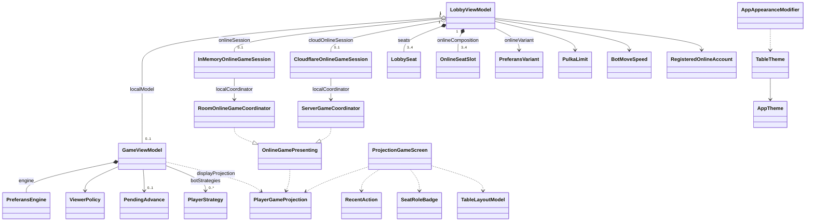
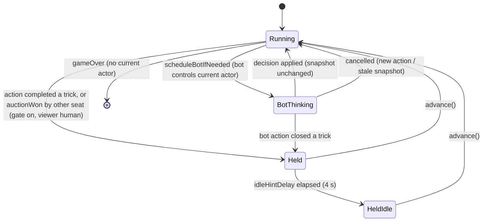
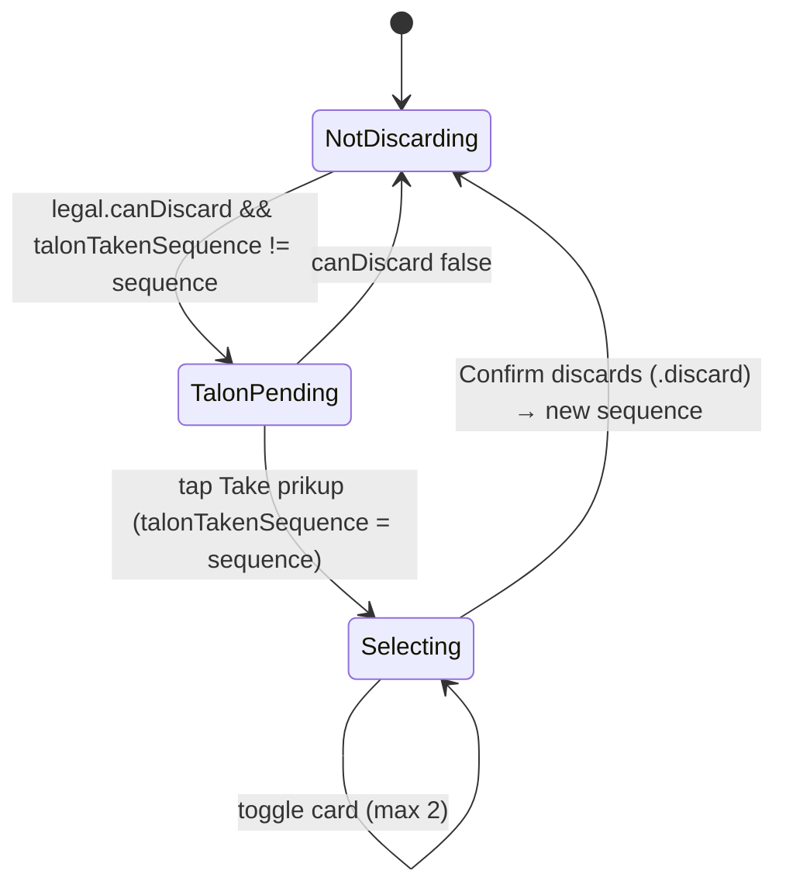
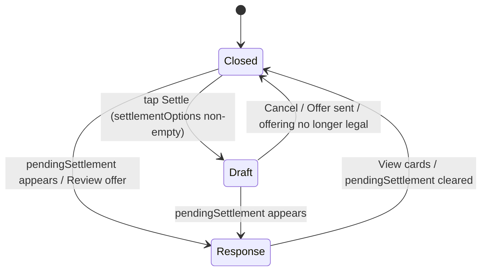
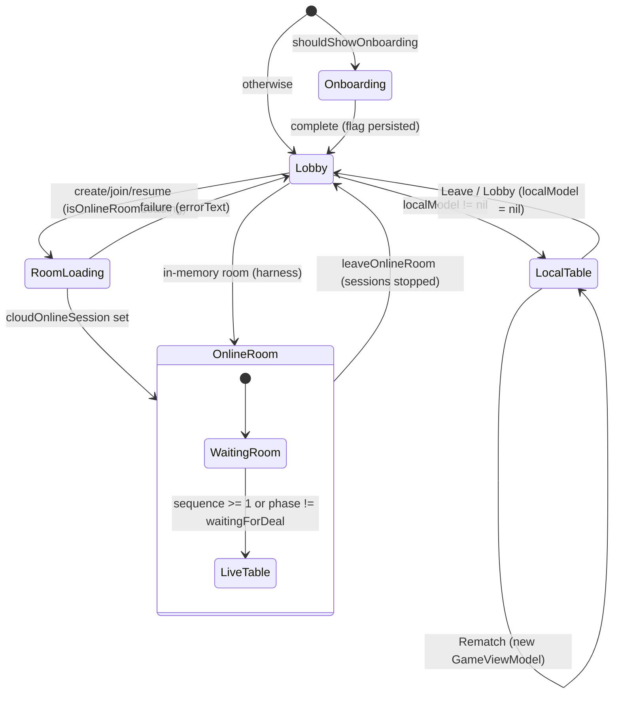

# Data Model (as-built): Preferans iOS App

**Status**: Implemented (as-built) · **Verified against**: `store/1.0.3-localized-keywords` @ `cd78828` · **Spec**: [spec.md](spec.md) · **Plan**: [plan.md](plan.md)

Engine types (`PreferansEngine`, `PreferansAction`, `PreferansEvent`, `DealState`, `ScoreSheet`, `PreferansRules`, `MatchSettings`, `DealResult`, `MatchSummary`, `Card`, `PlayerID`, …) are defined in [`../001-game-rules`](../001-game-rules/) and [`../002-scoring-and-variants`](../002-scoring-and-variants/); bot types (`PlayerStrategy`, `HeuristicStrategy`, `BotProfile`, `BotDecisionExplanation`) in [`../003-bots`](../003-bots/); online sessions, coordinators, accounts and projection building in [`../004-online-multiplayer`](../004-online-multiplayer/). This document covers the app-side models and the view-facing projection shape.

## Entity Relationships

## 1. Local Runtime

### `GameViewModel` (`Preferans/GameViewModel.swift`, `@MainActor final class`, `ObservableObject`)

| Field | Type | Default / source | Meaning |
| --- | --- | --- | --- |
| `engine` | `PreferansEngine` (`@Published private(set)`) | `PreferansEngine(players:rules:match:firstDealer:)` | Authoritative local game state |
| `lastError` | `String?` (`@Published private(set)`) | `nil` | Last rejected action's description (cleared on success) |
| `lastErrorCategory` | `ErrorCategory?` | `nil` | Whether `lastError` deserves a banner |
| `eventLog` | `[String]` | `[]` | Sanitized human summaries (`ActivityLogFeed.summaries`, raw `PlayerID` names); `count` is the local projection `sequence` |
| `recentEvents` | `[PreferansEvent]` | `[]` | Typed rolling window, max `RecentActionFeed.windowSize` = 120 |
| `botInsights` | `[BotDecisionExplanation]` | `[]` | Public-safe bot rationales, max 24 (oldest dropped) |
| `selectedViewer` | `PlayerID` (`@Published`, settable) | `viewerPolicy.initialViewer(among:)` | Seat whose hand is face-up at the bottom; also set by "View as" |
| `viewerPolicy` | `ViewerPolicy` | init arg | `.pinned(seat)` (production) or `.followsActor` (harness) |
| `dealSource` | `DealSource` | `RandomDealSource()` | Deck provider (`Seeded…`, `Scripted…` in tests) |
| `tableID` | `UUID` (`let`) | `@Dependency(\.uuid)` | Projection identity; new per model (rematch ⇒ new id) |
| `botStrategies` | `[PlayerID: PlayerStrategy]` | `[:]` | Autonomous seats; absence = human |
| `botMoveDelay` | `Duration` | `BotPacing.interactive` (500 ms), overwritten by lobby | Sleep before each bot decision |
| `tapToAdvanceEnabled` | `Bool` | `true` | Enables the beat gate |
| `idleHintDelay` | `Duration` | `.seconds(4)` | Delay before `idleHintActive` |
| `pendingAdvance` | `PendingAdvance?` (`@Published private(set)`) | `nil` | Active freeze |
| `idleHintActive` | `Bool` (`@Published private(set)`) | `false` | Escalated "Waiting for you" hint |
| `pendingBotTask`, `idleHintTask` | `Task<Void, Never>?` (private) | `nil` | Cancellable async work |
| `isViewingBot` | `Bool` (computed) | — | `botStrategies[selectedViewer] != nil` |
| `displayableError` | `String?` (computed) | — | `lastError` only for `.system` category |

Methods: `send(_:)`, `sendUserAction(_:)`, `advance()`, `startDeal()`, `projection(revealAll:) -> PlayerGameProjection` (policy `.localDebug` when `true`, `.online` when `false`; identities use `rawValue` as display name; `sequence = eventLog.count`), `displayProjection(revealAll:)`.

Invariants:
- A `.startDeal` is applied only when `engine.canStartDeal` and always carries `engine.nextDealer` and a deck from `dealSource`.
- At most one bot task is in flight; it applies its action only if `engine.snapshot` equals the snapshot captured at scheduling.
- While `pendingAdvance != nil`, no bot task exists.
- While viewing a bot seat, user actions other than `.startDeal` are ignored.

### `GameViewModel.ErrorCategory`

| Case | `PreferansError` cases | Banner |
| --- | --- | --- |
| `.uiValidatable` | `illegalCardPlay`, `cardNotInHand`, `duplicateCards`, `illegalBid`, `illegalWhist`, `illegalSettlement`, `invalidContract`, `notPlayersTurn` | no |
| `.system` | `invalidPlayer`, `invalidPlayers`, `invalidRules`, `invalidMatch`, `invalidDeck`, `invalidState`; any non-`PreferansError` | yes |

### `ViewerPolicy` (`enum`, `Equatable, Sendable`)

| Case | Initial viewer | After each action |
| --- | --- | --- |
| `.pinned(PlayerID)` | the seat | unchanged (manual "View as" still writes `selectedViewer`) |
| `.followsActor` | `players.first` | `engine.controllingActor(of: currentActor)` |

### `PendingAdvance` (`Preferans/Support/AdvancePresentation.swift`, `struct`, `Equatable, Sendable`)

| Field | Type | Meaning |
| --- | --- | --- |
| `waitingOn` | `PlayerID` | Viewer whose table is holding |
| `trickPlays` | `[CardPlay]?` | Plays to keep on the felt (`nil` for a prikup-reveal hold) |
| `trickWinner` | `PlayerID?` | Winner; its displayed trick count is rolled back by 1 |
| `talonOverride` | `[ProjectedCard]?` | Public talon from before the closing card |
| `phaseOverride` | `ProjectedPhase?` | Phase before the authoritative transition |
| `statusOverride` | `ProjectedStatus?` | Status before the transition |
| `completedTrickCountOverride` | `Int?` | Completed-trick count before the close |

`PlayerGameProjection.applyingAdvanceFreeze(_:)` applies the overrides, clears every `isCurrentActor`, and empties `playableCards`, `playableCardsOwner`, `settlementOptions`, `canAcceptSettlement`, `canRejectSettlement`, `canStartDeal`.

### Advance-gate state machine

## 2. View-Facing Projection (`Sources/PreferansEngine/Projection/PlayerProjection.swift`)

Built by `PlayerProjectionBuilder.projection(for:tableID:sequence:engine:identities:policy:)` (owned by `../004-online-multiplayer`); the app only renders it.

### `PlayerGameProjection` (`struct`, `Codable, Sendable, Equatable, Identifiable` by `tableID`)

| Field | Type | UI use |
| --- | --- | --- |
| `tableID` | `UUID` | identity |
| `sequence` | `Int` | reconciliation key (prikup take, selections, choice-rail scroll reset); online "live" test (`≥ 1`) |
| `viewer` | `PlayerID` | bottom seat |
| `players` | `[PlayerID]` | engine order (seat-order badges, clockwise placement) |
| `identities` | `[PlayerIdentity]` | `displayName(for:)` (falls back to `rawValue`) |
| `rules` / `match` | `PreferansRules` / `MatchSettings` | rules sheet, strip, Stalingrad hint, talon policy |
| `consecutiveAllPassDeals` | `Int` | (not read by views) |
| `score` | `ScoreSheet` | score board, pulka diagram |
| `phase` | `ProjectedPhase` | screen mode, titles, center content |
| `seats` | `[SeatProjection]` | seats, hands, roles, actor flags |
| `auction` | `[AuctionCall]` | strip highest bid, defender-mode contract summary |
| `whistCalls` | `[WhistCallRecord]` | role badges |
| `currentTrick` | `[CardPlay]` | felt trick |
| `lastCompletedTrick` | `Trick?` | last-trick button/sheet |
| `completedTrickCount` | `Int` | strip "Trick N", settlement remaining, talon visibility |
| `trickCounts` | `[PlayerID: Int]` | contract progress, settlement split |
| `talon` / `discard` | `[ProjectedCard]` | prikup / raspasy talon |
| `legal` | `LegalActionProjection` | every control |
| `status` | `ProjectedStatus` | localized status sentence |

### Supporting projection types

| Type | Fields / cases |
| --- | --- |
| `SeatProjection` | `player`, `displayName`, `isActive`, `isDealer`, `isCurrentActor`, `role: SeatRole`, `hand: [ProjectedCard]`, `trickCount` |
| `SeatRole` | `dealer`, `declarer`, `defender`, `whister`, `halfWhister`, `active`, `sittingOut` |
| `ProjectedCard` | `.known(Card)`, `.hidden` (`description` "🂠") |
| `ProjectedPhase` | `waitingForDeal(nextDealer)`, `bidding(currentPlayer, highestBid)`, `awaitingDiscard(declarer, finalBid)`, `awaitingContract(declarer, finalBid)`, `awaitingWhist(currentPlayer, declarer, contract)`, `awaitingDefenderMode(whister, contract)`, `playing(currentPlayer, leader, kind)`, `dealFinished(result)`, `gameOver(summary)`; `token` = case name (used by the flow-state probe) |
| `ProjectedPlayKind` | `game(declarer, contract, defenders, whisters, defenderPlayMode)`, `misere(declarer)`, `allPass` |
| `ProjectedStatus` | `readyToDeal`, `bidding(currentPlayer)`, `takingPrikup(declarer)`, `namingContract(declarer, pickingTotusStrain)`, `callingWhist(currentPlayer)`, `choosingDefenderMode(whister)`, `playingTrick(currentPlayer, trickNumber)`, `settling(proposer, target, targetTricks, currentPlayer?)`, `dealScored`, `matchOver(winner?)` |
| `LegalActionProjection` | `canStartDeal`, `bidCalls`, `whistCalls`, `playableCards`, `contractOptions`, `defenderModes`, `canDiscard`, `settlementOptions`, `pendingSettlement`, `canAcceptSettlement`, `canRejectSettlement`, `playableCardsOwner` (non-nil when the viewer controls another seat's open hand) |
| `ProjectionPolicy` | `revealAllHands`, `revealOpenDefenderHandsToAll` (default true), `revealDeclarerDiscardToDeclarer` (default true); presets `.online`, `.localDebug` (reveal all) |

### Status → localized text (`Localized.statusText`)

| Status | English template |
| --- | --- |
| `readyToDeal` | "Tap Deal to start" |
| `bidding(p)` | "%@ to call" |
| `takingPrikup(d)` | "%@ takes the prikup" |
| `namingContract(d, totus)` | "%@ names the contract" / "%@ picks the totus strain" |
| `callingWhist(p)` | "%@ to call whist" |
| `choosingDefenderMode(w)` | "%@ — open or closed?" |
| `playingTrick(p, n)` | "Trick %lld: %@" |
| `settling(...)` | "%@ offers: %@ takes %lld" (+ ". %@ to answer") |
| `dealScored` | "Deal scored" |
| `matchOver(w)` | "%@ takes the pulka" / "Match over" |

Phase titles (`Localized.phaseTitle`): Ready, Bidding, Prikup, Contract, Whist, Defense, Play, Deal complete, Game over.

## 3. Lobby Models (`Preferans/UI/LobbyModels.swift`, `Preferans/UI/LobbyViewModel.swift`)

### `LobbyViewModel` (`@MainActor final class`, `ObservableObject`)

| Field | Type | Default | Persisted |
| --- | --- | --- | --- |
| `localModel` | `GameViewModel?` | `nil` | no |
| `onlineSession` | `InMemoryOnlineGameSession?` | `nil` | no |
| `cloudOnlineSession` | `CloudflareOnlineGameSession?` | `nil` | no |
| `lobbyMode` | `LobbyMode` (`local`, `online`) | `.local` | no |
| `seats` | `[LobbySeat]` | `LobbySeat.defaults(count: 3)` | no |
| `botSpeed` | `BotMoveSpeed` | `.normal` | no |
| `errorText` / `infoText` | `String?` | `nil` | no |
| `registeredOnlineAccount` | `RegisteredOnlineAccount?` (`private(set)`) | loaded (requires Keychain token) | yes (`settings.onlineRegisteredAccount…`) |
| `onlineAccountSessionToken` | `String?` (`private(set)`) | Keychain | Keychain |
| `onlineJoinRoomCode` | `String` | `""` | no |
| `isOnlineRoomLoading` | `Bool` | `false` | no |
| `onlineTableVisibility` | `OnlineTableVisibility` (`publicTable` "public", `privateTable` "private") | `.privateTable` | no |
| `onlineIntent` | `OnlineLobbyIntent` (`findTable`, `createTable`) | `.findTable` | no |
| `isDeletingOnlineAccount` | `Bool` (`private(set)`) | `false` | no |
| `onlineDisplayName` | `String` | account name ?? `settings.onlineDisplayName…` ?? `""` | yes (debounced 300 ms, trimmed; empty removes key) |
| `onlineComposition` | `[OnlineSeatSlot]` | `defaultComposition(count: 3)` | no |
| `onlineVariant` | `PreferansVariant` | `.odesa` | yes (`settings.onlineVariant`) |
| `pulkaLimit` | `PulkaLimit` | `.standard` | yes (`settings.pulkaLimit`) |
| `customPulkaPerPlayer` | `Int` | 21 (clamped 1…999) | yes |
| `customPulkaTableTotal` | `Int` | 63 (clamped 1…3996) | yes |
| `raspasyPenaltyProgression` | `RaspasyPenaltyProgression` | `.arithmetic` | yes |
| `raspasyExitProgression` | `RaspasyExitProgression` | `.strict` | yes |
| `localTableSpeedOverride` | `BotMoveSpeed?` (private) | `nil` | no (remembered for Rematch) |

Derived: `botCount`, `canAddBot` (`seats.count < 4`), `canRemoveBot` (`count > 3` and a bot exists), `pendingJoinRoomCode`, `onlineSetupValidationError` = `onlineIdentityValidationError`, `currentOnlineDisplayName` (registered name, else trimmed field), `currentOnlineAccountID`, `pulkaPerPlayer`, `totalPulkaTarget(playerCount:)` (custom table total for a `.tableTotal` variant with Custom, else per-player × count).

### `LobbySeat` (`struct`, `Identifiable, Equatable`)

| Field | Type | Notes |
| --- | --- | --- |
| `id` | `UUID` | stable row identity |
| `name` | `String` | becomes the local `PlayerID` (trimmed) and display name |
| `kind` | `.human` / `.bot(BotProfile)` | `setBotProfile` only mutates bots |

Stock roster: seat 0 `Neo` human; `Morpheus` bot Expert/Careful; `Trinity` bot Seasoned/Bold; `Agent Smith` bot Expert/Adaptive; extra `Bot N` Casual/Adaptive. `demoBots` gives `Neo` Seasoned/Adaptive. Validation: every trimmed name non-empty and unique. `rosterSummary` "<n> human(s) · <n> bot(s)" (unused by views).

### `OnlineSeatSlot` (`struct`, `Identifiable, Equatable`)

`kind ∈ {you, invite, bot}`; slot 0 is always `.you` (`setOnlineSeatKind` ignores index 0). Resize appends `.invite`, truncates from the end, clamps to 3…4. `canonicalPlayerIDs(count:)` = `north, east, south, west` prefix. Room peers: you → registered account; bot → `OnlinePeer.botAccountPrefix + seat`, provider `.dev`, name "Bot N"; invite → `pendingAccountPrefix + seat`, name "Open seat".

### `PreferansVariant` (`String` raw value, persisted identifiers)

| Case | `title` key → en / ru / uk | `standardName` (en) | `rules` | `poolClosure` | `raspasy` (canonical) | Public |
| --- | --- | --- | --- | --- | --- | --- |
| `odesa` | Vienna / Вена / Відень | Balanced scoring | `.sochi` | `individualWithAmericanAid` | `.sochi` (1–2–3, 6–7–8) | yes |
| `wien` | Prague / Прага / Прага | Double whists, shared pool | `.leningrad` | `tableTotal` | `.leningrad` (1–2–3, 6–7–8 base; doubled penalties) | yes |
| `thessaloniki` | Berlin / Берлин / Берлін | Semi-responsible whist, hidden talon on all-pass | `.rostov` | `individualWithAmericanAid` | `.rostov` (flat, 6–6–6) | yes |
| `kruty` | Kruty / Круты / Крути | Kruty · Stalingrad | `.stalingrad` | `individualWithAmericanAid` | `.sochi` | no |

`summary` keys: `variant.<id>.summary`. Local/private tables use the lobby raspasy pickers instead of `raspasy` (see spec Known Gap 10).

### `PulkaLimit`, `BotMoveSpeed`, `RegisteredOnlineAccount`

| Type | Cases / fields |
| --- | --- |
| `PulkaLimit` (`String`) | `short` "11" → 11, `standard` "21" → 21, `custom` "custom" → custom value; constants `defaultCustomTarget` 21, `customRange` 1…999, `defaultCustomTableTarget` 63, `customTableRange` 1…3996 |
| `BotMoveSpeed` (`String`) | `instant` → 0, `normal` → 1200 ms, `slow` → 2200 ms (labels Instant/Normal/Slow) |
| `RegisteredOnlineAccount` (`Codable`) | `schemaVersion` (must equal `AppIdentifiers.onlineAccountSchemaVersion` = 2), `provider: OnlineAccountProvider` (only `.apple`/`.guest` accepted on load), `accountID`, `displayName` |

Label extensions: `BotDifficulty.label` (Casual/Seasoned/Expert), `BotTemperament.label` (Careful/Adaptive/Bold), `BotDecisionRationale.label` → `bot.insight.<rationale>` for `auctionPass`, `gameBid`, `misereBid`, `totusBid`, `contractFit`, `contractConcession`, `discardForContract`, `discardForMisere`, `fullWhist`, `halfWhist`, `defensivePass`, `openDefense`, `closedDefense`, `forcedSettlement`, `contestSettlement`.

### Online interface models consumed by the lobby/screens (owned by 004)

| Type | Fields the UI reads |
| --- | --- |
| `OnlineGamePresenting` | see [plan.md §6](plan.md#6-online-screens-consume-projections) |
| `WaitingRoomSeat` | `player`, `occupancy: .you(name) / .human(name) / .bot(name) / .openWaiting`, `isReady` |
| `OnlineTableSettings` | `variant?`, `poolTarget`, `poolClosure` (`"tableTotal"` or other), `displayedPoolTarget(playerCount:)` |
| `PublicOnlineTable` | `roomCode`, `variant`, `poolTarget`, `poolClosure`, `maxPlayers`, `players[{displayName, ready, connected}]`, `openSeats`, `status`, `dealNumber`, `createdAt`, `canJoin` |
| `OnlineGameSummary` | `roomCode`, `status`, `variant`, `dealNumber`, `opponents`, `botCount`, `updatedAt`, `winnerName`, `peers`, `result.finalBalances`, `result.winner`, `youSeat` |
| `PublicTableLobby` / `OnlineGameLibrary` | `tables`/`inProgress`/`finished`, `isLoading`, `errorText`/`loadError`, `hasLoaded`, `nextOffset`, `refresh(...)`, `removeLocally(roomCode:)` |

## 4. Presentation Models (`Preferans/UI/*`)

| Model | Kind | Fields / cases | Notes |
| --- | --- | --- | --- |
| `RecentAction` | struct | `id: Int` (offset in the deal-scoped window), `player`, `label: Label` | `Label`: `bid(ContractBid)`, `pass`, `whist`, `halfWhist`, `whistPass`, `declared(GameContract)`, `withoutThree(ContractBid)`, `discarded`, `defenderMode(DefenderPlayMode)`; card plays excluded |
| `RecentActionFeed` | enum | `windowSize = 120`, `append`, `banner(from:)`, `perSeat(from:)` | scoped to events since last `dealStarted`; per-seat stops at `playStarted` and drops auction passes after `contractDeclared` |
| `SeatRoleBadge` | enum | `declarer` "Declarer", `whist` "Whist", `halfWhist` "½", `pass` "Pass"; `isAccent` | from whist calls first, then seat role; nil in waitingForDeal/bidding/results |
| `ActivityLogEntry` | struct | `id`, `title`, `detail?`, `kind` | `Kind`: deal, auction, contract, defense, play, settlement, scoring (icons `rectangle.stack.fill`, `hand.raised.fill`, `checkmark.seal.fill`, `shield.fill`, `suit.club.fill`, `text.bubble.fill`, `chart.bar.fill`) |
| `DealScoreDeltaRow` | struct | `player`, `pool`, `mountain`, `whistsIn`, `whistsOut`, `balance: Double` | balance = normalized balance of a fresh sheet with the delta applied (`DealScoreDeltaPresentation.rows`) |
| `GameSheetDestination` | enum (`String`) | `score`, `log`, `rules`, `settings`, `lastTrick` | `ProjectionGameScreen.activeSheet` |
| `LobbyView.Sheet` | private enum | `settings`, `conventionLegend`, `gameSummary(OnlineGameSummary)` | lobby `activeSheet` |
| `ActionBarView.SettlementSheet` | private enum | `draft`, `response` | settlement sheet routing |
| `ActionBarView.SettlementContext` | private struct | `declarer`, `activePlayers`, `defenders`, `remaining` (10 − completed), `currentDeclarerTricks`, `goal`, `defaultShare` | only in `playing` game/misère with remaining > 0 |
| `SettlementComposer.Goal` | enum | `contract(needs:tricks:strain:)`, `misere` | `share` state 0…remaining |
| `TableHandlers` | struct | `onAdvance`, `onStartDeal`, `onLeaveTable`, `onRematch`, `onSelectPlayCard`, `onPlayCard(PlayerID, Card)`, `onTakeTalon`, `onTapToAdvance` | all optional |
| `TableDisplayState` | struct | `renderOpponentsAtTop` (true), `idleHintActive`, `isTalonTakePending`, `isPadDevice` | |
| `TableLayoutModel` | struct | `bounds: CGSize`; `RegularSplit{totalWidth, spacing=16, trailingInset=16, sidebarWidth, tableWidth, usesSidebar, minimumSidebarLayoutWidth=900}`; `OpponentSlot{seat, position (unit), orientation, kind, id=player}`; `SlotKind{topWide, topNarrow, compactHidden}` | geometry in plan.md |
| `CardView.Size` | enum | `compact` 38×54 r5, `standard` 52×74 r7, `large` 64×92 r9 | rank/pip/center fonts 11/11/22, 14/14/30, 17/17/38 |
| `CardSuitDisplayOrder` | enum (`String`) | `spadesDiamondsClubsHearts` (default ♠♦♣♥), `clubsDiamondsSpadesHearts`, `diamondsClubsHeartsSpades`, `spadesClubsDiamondsHearts` | ranks ascending; hidden cards last |
| `ProjectionGameLayoutPolicy` | enum | `phonePortrait`, `phoneLandscape`, `iPad` | |
| `ActionChoiceLayoutPolicy` | struct | h/v size class, `usesAccessibilityText`, `availableWidth`; `minimumRegularGridWidth = 566` | |
| `LobbyLayoutPolicy`, `DealSummaryLayoutPolicy`, `GameOverLayoutPolicy`, `OnlineWaitingRoomLayoutPolicy`, `SeatOrderBadgeLayoutPolicy` | structs | see plan.md | unit-tested pure policies |
| `ScoreBoardPresentation` | enum | `sheet`, `feltSidebar` | ink choice for unbacked labels |
| `DealStateStrip.ContractProgress` | private struct | `taken`, `target`, `state ∈ {live, met, behind}` | behind = cannot reach target in remaining tricks |
| `OnlineWaitingRoomView.OccupancyInfo` | private struct | icon, colour, title, pill, `isOpen`, `token` (`you`/`human`/`bot`/`open`) | token is the seat row's accessibility value |
| `LobbyFormat` | enum | `variantDisplayName(_:)`, `relativeTime(_:)` (abbreviated, ISO-8601 with/without fractions) | |
| `ScoreFormatting.balance` | func | `"%.1f"` en_US_POSIX, `+` prefix for positive, |x| < 0.05 → `0.0` | no negative zero |

`ProjectionGameScreen` view state (`@State`): `selectedDiscard: Set<Card>` (≤ 2), `selectedPlayCard: Card?`, `talonTakenSequence: Int?`, `activeSheet: GameSheetDestination?`, `showLeaveConfirm: Bool`.

### Discard (prikup) sub-states in `ProjectionGameScreen`

### Settlement sheet states in `ActionBarView`

## 5. Themes (`Preferans/UI/TableTheme.swift`)

`AppTheme` (`String`, `CaseIterable`): `clubhouse` (default), `midnight`, `aubergine`, `graphite`, `parchment`, `nordic`; properties `name`, `subtitle`, `colorScheme`, `titleDesign`, `motif`; `resolve(_:)` falls back to `.default` for unknown/nil.

`TableTheme` (`struct`, `Equatable, Sendable`): 14 `ThemeSwatch` values (`hex: UInt32`, `color`, WCAG `luminance`, `contrast(against:)`) plus derived `Color`s (`backgroundTop/Mid/Base`, `panel`, `textPrimary/Secondary/Muted`, `accent` = `accentStrong`, `onAccent`, `error`, `warning`, `success`, `cardBack`, `cardBackInk`, `shade`, `edge`, `controlRadius`, `gradient`), `Surface {seat, seatActive, chip, card}` fills (panel at 0.72 / 1.0 / 0.80 / 1.0) and borders (text 12 % / accent 65 % / text 12 % / accent 28 %), `Radius {pill 999, xs 10, sm 14, md 20}`. Injected through `EnvironmentValues.tableTheme`.

### Theme palettes

| Theme | top | mid | base | panel | primary | secondary | muted | accent | onAccent | error | warning | success | card back | back ink |
| --- | --- | --- | --- | --- | --- | --- | --- | --- | --- | --- | --- | --- | --- | --- |
| clubhouse | 21453D | 17372F | 102820 | 112C25 | F4EFDF | D0D8CC | B0C1B5 | E9CD8B | 18291D | FFAAA2 | F5CC8B | A8DEC2 | 4B1624 | E9CD8B |
| midnight | 202F4C | 17243D | 101B2E | 162238 | EFF4FF | C8D6EA | ADBED8 | B9D9FF | 122540 | FFAFB5 | F3CF98 | 9AE1C6 | 233E66 | D0E5FF |
| aubergine | 442C40 | 342132 | 251A27 | 2F2030 | F9EEF4 | DDCAD6 | C8AFC0 | F1C4AF | 3B2332 | FFAFB9 | F4D29E | BBDCBF | 5A354D | F2D3B8 |
| graphite | 282D30 | 202528 | 161B1E | 202629 | F3F7F5 | CED9D5 | AFBFBA | AFF0D2 | 17382B | FFB4AD | F0D69C | AFF0D2 | 303D39 | BCF5DC |
| parchment | F6EFDF | EEE5D2 | E8DEC8 | FFF9ED | 302A23 | 575044 | 645C50 | 805125 | FFF9ED | A32633 | 795219 | 246348 | 614738 | F4DEB9 |
| nordic | F2F6F2 | E8EEEA | DEE7E1 | FAFCF9 | 22392F | 465C50 | 53685D | 2C6552 | F7FFF8 | A1263D | 76520C | 246348 | 35574A | D9F2DA |

Fixed card-face inks: hearts/diamonds `BD1722`, spades/clubs `172022`. `FeltButtonStyle.Emphasis`: `primary` (accent fill, onAccent text), `secondary` (panel fill, primary text or tint), `dim` (panel fill, secondary text); min height 44, disabled opacity 0.46.

## 6. Localization Model

`AppLanguage` (`String`, `CaseIterable, Identifiable, Sendable`): `uk` ("Українська", default), `ru` ("Русский"), `en` ("English"). `current` reads `settings.appLanguage` (fallback `.uk`); `apply(_:)` writes `settings.appLanguage` and `AppleLanguages = [code]`.

Catalog (`Localizable.xcstrings`): source `en`, 480 keys, every key has `en`/`ru`/`uk` units in state `translated` (leaf units: en 487, ru 495, uk 495 including plural forms).

## Persisted Settings

All keys are defined in `SettingsKeys` (`Preferans/Support/AppIdentifiers.swift`) unless noted. `<sfx>` = `AppIdentifiers.onlineStorageSuffix` = `.owner-v1`, or `.uiTestLocal.<host>.<port>` when `TestHarness.localRoomWorkerURL()` is set (DEBUG + `-uiTest…` + `PREFERANS_ROOM_WORKER_URL`).

| Key | Store / type | Default | Written by | Read by | Notes |
| --- | --- | --- | --- | --- | --- |
| `settings.appTheme` | UserDefaults `String` (`AppTheme.rawValue`) | `clubhouse` | `ThemeGallery` (`@AppStorage`), `PreferansApp.init` (DEBUG `-uiTestTheme`) | `AppAppearanceModifier`, `SettingsScreen`, `ThemeGallery` | unknown values resolve to Clubhouse |
| `settings.revealAllHands` | `Bool` | `false` | `SettingsScreen` (DEBUG Admin toggle) | `LocalGameScreen` | `true` ⇒ `.localDebug` projection |
| `settings.appLanguage` | `String` (`uk`/`ru`/`en`) | `uk` | `AppLanguage.apply` (launch, Settings picker) | `AppLanguage.current`, `SettingsScreen` | restart required |
| `AppleLanguages` | `[String]` (system key) | — | `AppLanguage.apply` | Foundation bundle lookup | overwritten every launch |
| `settings.cardSuitDisplayOrder` | `String` (`CardSuitDisplayOrder.rawValue`) | `spadesDiamondsClubsHearts` | `SettingsScreen` | `ProjectionGameScreen` | presentation only |
| `settings.onlineRegisteredAccount<sfx>` | `Data` (JSON `RegisteredOnlineAccount`, ISO-8601 coder) | absent | `LobbyViewModel.registerOnlineAccount` | `LobbyViewModel.init`, `SettingsScreen.accountStatusText` | discarded if schema ≠ 2 or provider ∉ {apple, guest} |
| `settings.onlineAnonymousAccountID<sfx>` | legacy v1 | absent | — (only removed) | — | erased on load failure, registration, deletion |
| `settings.onlineDisplayName<sfx>` | `String` (trimmed) | absent | `LobbyViewModel.setOnlineDisplayName` (300 ms debounce) | `LobbyViewModel.init`, `SettingsScreen` | empty removes key |
| `settings.onlineVariant` | `String` (`PreferansVariant.rawValue`) | `odesa` | `LobbyViewModel.onlineVariant.didSet` | `LobbyViewModel.init` | shared by local and online tables |
| `settings.trackingPermissionRequested` | `Bool` | `false` | `TrackingPermissionCenter.requestPermissionIfNeeded`, `SettingsScreen.requestTrackingPermission` | (audit only) | iOS owns the real status |
| `settings.firstLaunchOnboardingCompleted` | `Bool` | `false` | `RootLaunchView` on completion | `RootLaunchView` | bypassed under automation |
| `settings.pulkaLimit` | `String` (`11`/`21`/`custom`) | `21` | `LobbyViewModel.pulkaLimit.didSet` (also by Create a table → `11`) | `LobbyViewModel.init` | |
| `settings.customPulkaPerPlayer` | `Int` | 21 | `didSet` (clamped 1…999) | `init` (clamped) | |
| `settings.customPulkaTableTotal` | `Int` | 63 | `didSet` (clamped 1…3996) | `init` (clamped) | table-total variants with Custom |
| `settings.raspasyPenaltyProgression` | `String` (`flat`/`arithmetic`/`cappedDouble`/`geometric`) | `arithmetic` | `didSet` | `init` | |
| `settings.raspasyExitProgression` | `String` (`simple`/`constrained`/`strict`) | `strict` | `didSet` | `init` | |
| `online.seatCredentials<sfx>` | UserDefaults `Data` (JSON `[ROOMCODE: {token, savedAt}]`) | absent | `OnlineSeatCredentialStore.store` (online layer) | `LobbyViewModel.abandonOnlineGame`, online layer | pruned after 90 days; cleared on account deletion/sign-out |
| Keychain `com.mixandmatch.preferans.online-account.v2<sfx>` / `active-session` | generic password (`kSecAttrAccessibleAfterFirstUnlockThisDeviceOnly`) | absent | `KeychainOnlineAccountSessionStore.store` | `LobbyViewModel.init`, `SettingsScreen` | account bearer token |

Not persisted: local roster, bot speed, lobby mode, online composition/visibility/intent, any local match state, theme gallery scroll position.

## 7. Navigation State

## 8. Test-Harness Configuration (`Preferans/Support/TestHarness.swift`)

| Type | Fields |
| --- | --- |
| `TestHarness.Defaults` | `players`, `firstDealer?`, `rules` (default `.sochi`), `match` (default `.unbounded`) |
| `TestHarness.Configuration` | `players`, `firstDealer?`, `rules`, `match`, `dealSource`, `viewerPolicyOverride: ViewerPolicy?` (`.followsActor` with `-uiTestViewerFollowsActor`) |
| `DealScenario` (`String`) | `sortedDeck`, `northBidsSpadesSix`, `northBidsMisere` (3-player, first dealer `south`, so `north` bids first) |

Raspasy policy strings: `singleshot|single|single_shot`, `sochi|arithmetic|1-2-3`, `leningrad|piter|2-4-6`, `geometric|1-2-4`. Totus policy strings: `asTenTrickGame:<bool>`, `dedicated:<bool>:<bonusPool>`. Full flag list: [quickstart.md](quickstart.md#launch-arguments).

## 9. Accessibility Identifier Grammar (`Sources/PreferansEngine/UIIdentifiers.swift`)

| Family | Pattern / examples |
| --- | --- |
| Encodings | suit `S C D H`, strain `NT`, rank `7 8 9 T J Q K A`, card `<rank><suit>` (`AS`, `TC`), contract `<tricks><strain>` (`6S`, `10NT`), bid `pass`/contract/`misere`/`totus`, whist `pass`/`whist`/`halfWhist`, defender mode `open`/`closed`, result kind `game.<decl>.<contract>.<w1+w2>`, `misere.<decl>`, `withoutThree.<decl>.<bid>`, `halfWhist.<decl>.<contract>.<hw>`, `passedOut`, `allPass` |
| Screens | `app.root`, `screen.onboarding`, `screen.lobby`, `screen.game`, `screen.waitingRoom`, `screen.settings`, `screen.themes`, `screen.settlementPreview`, `online.flowState`, `connection.banner` |
| Lobby | `lobby.title`, `lobby.region.navigation`, `lobby.region.mode`, `lobby.mode.local/online`, `button.startLocalTable`, `button.addBot`, `button.removeBot`, `lobby.playerName.<i>`, `lobby.botProfile.<i>`, `lobby.tableOptions`, `lobby.startSummary`, `lobby.botSpeed`, `lobby.error`, `lobby.info`, `lobby.validationError`, `button.watchBots`, `lobby.settings`, `lobby.houseConventions`, `match.poolTarget`, `match.customPulkaPerPlayer`, `match.raspasyPrice`, `match.raspasyExit` |
| Online lobby / room | `online.displayName`, `online.registerAsGuest`, `online.registerWithApple`, `online.variant`, `online.tableSize`, `online.seat.<i>`, `online.seatKind.<i>`, `online.joinRoomCode`, `online.joinRoom`, `online.createRoom`, `online.roomCode`, `online.shareInvite`, `online.startGame`, `online.fillWithBots`, `online.waitingForHost`, `online.games.section/refresh/empty`, `online.games.resume.<code>`, `online.games.history.<code>`, `waitingRoom.region.invite/roster`, `waitingRoom.seat.<i>`; literal (non-contract) ids `online.findTable`, `online.createTable`, `online.refreshTables`, `online.publicTables`, `online.publicTable.<code>`, `online.takeSeat`, `online.confirmReady` |
| Settings / rules | `settings.language`, `settings.theme`, `theme.<rawValue>`, `online.deleteAccount`, `privacy.tracking.request`, `lobby.conventionLegend`, `rules.variantPicker`, `rules.variant.<id>`, `rules.contractTable`, `rules.dealerTalon`, `rules.stalingrad`, `rules.raspasyProgression`, `rules.raspasy.stage.<n>` |
| Table header | `phase.title`, `phase.message`, `viewer.label`, `error.banner`, `menu.overflow`, `menu.activityLog`, `menu.rulesReference`, `button.lastTrick`, `button.scoreSheet`, `button.leaveTable`, `button.dismissSheet` |
| Table felt | `action.banner`, `bot.insight.banner`, `table.tapToAdvance`, `table.trickResultHold`, `table.waitingForViewer`, `button.startDeal`, `button.takeTalon`, `panel.currentTrick`, `card.<region>.<card>` (`hand.<seat>`, `talon`, `discard`, `discardSelect`, `trick.<seat>`), `card.hand.<seat>.hidden.<i>` |
| Seats | `seat.<id>` (container), `seat.<id>.order`, `seat.<id>.actor`, `seat.<id>.role` (OUT / sitting out), `seat.<id>.roleBadge`, `seat.<id>.dealer`, `seat.<id>.trickCount`, `seat.<id>.lastAction`, `score.player.<id>` (name labels) |
| Action bar | `panel.bidding/contract/whist/defenderMode/discard`, `bid.<call>`, `contract.<contract>`, `whist.<call>`, `defenderMode.<mode>`, `button.concedeWithoutThree`, `button.discardSelected`, `button.playSelectedCard`, `button.offerSettlement`, `button.reviewSettlement`, `actionBar.passiveStatus`, `action.choiceGrid.regular`, `action.choiceRail.compact` |
| Settlement | `settlement.scroll`, `settlement.splitControl`, `settlement.responder`, `button.submitSettlement`, `button.cancelSettlement`, `button.acceptSettlement`, `button.rejectSettlement` |
| Results | `panel.dealFinished`, `dealResult.status`, `dealResult.kind`, `dealResult.scoreDelta`, `dealResult.balance.<id>`, `dealResult.initialHands.toggle`, `dealResult.initialHand.<id>`, `panel.gameOver`, `gameOver.title`, `gameOver.winner`, `gameOver.dealsPlayed`, `gameOver.standing.<rank>.player/pool/mountain/balance`, `button.backToLobby`, `button.rematch` |
| Sheets | `panel.score`, `score.pool/mountain/balance.<id>`, `score.whists.<writer>.on.<target>`, `panel.eventLog`, `eventLog.entry.<i>`, `bot.insight.entry.<i>` |
| Onboarding | `onboarding.skip`, `onboarding.continue`, `onboarding.slide.<i>`, `onboarding.title.<i>`, `onboarding.description.<i>` |

`AccessibilityStrings`: `viewerLabelPrefix` "Viewing as " (parsed by `MatchUIRobot.currentViewer()`), `gameOverWinnerPrefix` "Winner: ", `completedDealsPrefix` "Completed deals: " (the last two unused by the app).
