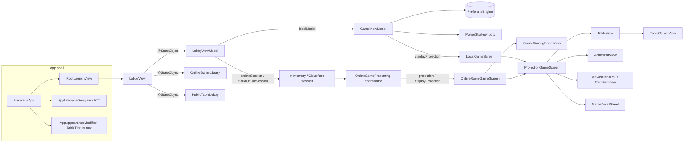
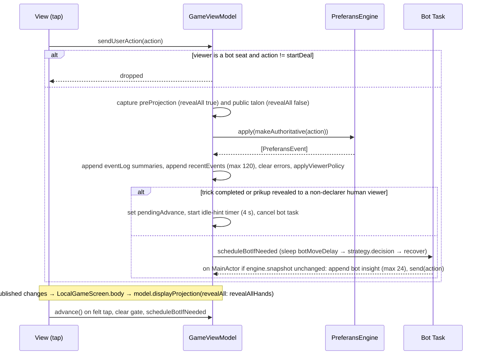

# Implementation Plan (as-built): Preferans iOS App

**Status**: Implemented (as-built) · **Verified against**: `store/1.0.3-localized-keywords` @ `cd78828` · **Spec**: [spec.md](spec.md) · **Data model**: [data-model.md](data-model.md) · **Quickstart**: [quickstart.md](quickstart.md)

## Summary

The app is a thin SwiftUI shell around the shared `PreferansEngine` package. A single `WindowGroup` shows onboarding or `LobbyView`; the lobby owns a `LobbyViewModel` (`ObservableObject`) whose published optionals (`localModel`, `onlineSession`, `cloudOnlineSession`) decide which full-screen experience is displayed. Every table, local or online, is drawn by the same `ProjectionGameScreen` from a `PlayerGameProjection` value plus a typed `[PreferansEvent]` window. Local tables are driven by `GameViewModel` (engine owner, bot scheduler, tap-to-advance gate); online tables by an `OnlineGamePresenting` coordinator (see [`../004-online-multiplayer`](../004-online-multiplayer/)). Views hold only ephemeral interaction state (`@State` selections, sheet routing); all persistent preferences live in `UserDefaults` via `@AppStorage` or `LobbyViewModel` property observers; secrets live in Keychain.

## Technical Context

| Item | Value |
| --- | --- |
| **Language/Version** | Swift 6.0 (`SWIFT_VERSION = 6.0`; `swift-tools-version: 6.0`), strict concurrency (`@MainActor` view models, `Sendable` models) |
| **Primary Dependencies** | SwiftUI, UIKit (lifecycle delegate, pasteboard, device idiom), AuthenticationServices + CryptoKit (Sign in with Apple), AppTrackingTransparency/AdSupport, GameKit (wired, unused), local package products `PreferansEngine` and `Dependencies` (pointfreeco swift-dependencies 1.17.1, resolved); tests add `SnapshotTesting` 1.19.4, `DependenciesTestSupport`, `Clocks` |
| **Storage** | `UserDefaults.standard` (preferences, account record, seat-credential cache), Keychain generic password (account session token), no local game persistence |
| **Testing** | XCTest + Swift Testing in SwiftPM target `PreferansAppTests` (path `Tests/PreferansEngineTests`), structural text snapshots (`__Snapshots__/*.txt`), XCUITest target `PreferansUITests` (Xcode only) |
| **Target Platform** | iOS 17.0 (Xcode `IPHONEOS_DEPLOYMENT_TARGET`), iPhone + iPad (`TARGETED_DEVICE_FAMILY = 1,2`), Mac Catalyst enabled (`SUPPORTS_MACCATALYST = YES`); `Package.swift` declares iOS 16 / macOS 14 (see spec Known Gap 2) |
| **Project Type** | Mobile app (Xcode project `Preferans.xcodeproj`, scheme `Preferans`, bundle id `com.mixandmatch.preferans`, version 1.0.3 build 29, category Games) + SwiftPM library mirror `PreferansApp` |
| **Performance Goals** | Bot beat ≥ 1 render cycle (`BotPacing.testFast` = 10 ms), production pacing 0.5–2.2 s; 4-player all-bot match to pool 6 in < 30 s with instant pacing; banner/badge derivations computed once per screen construction (event window ≤ 120) |
| **Constraints** | Portrait + landscape on iPhone and iPad (no upside-down), `UIRequiresFullScreen = YES`; Dynamic Type up to Accessibility XXXL (table chrome clamped to `.small ... .xxxLarge`); ≥ 44 pt touch targets; WCAG 4.5:1 palette contrast; no network in local mode |
| **Scale/Scope** | 76 Swift files under `Preferans/` (39 in `UI/`, 8 in `Support/`, 26 in `Online/`, 1 in `GameKit/`, 2 at root), ~19.6 k lines (~14.1 k excluding `Online/` and `GameKit/`); 480 catalog keys × 3 languages; 26 screens/surfaces; 6 themes |

## Project Structure

```text
Preferans/                               # App sources (Xcode target "Preferans"; SwiftPM target "PreferansApp" minus PreferansApp.swift)
├── PreferansApp.swift                   # @main App: language/theme/animation bootstrap, WindowGroup, AppLifecycleDelegate, GameCenterService env object
├── GameViewModel.swift                  # Local table runtime: engine, bots, tap-to-advance gate, event streams, ViewerPolicy
├── Info.plist                           # Custom URL scheme com.mixandmatch.preferans (merged with generated plist)
├── Preferans.entitlements               # Game Center, Sign in with Apple, associated domains
├── Assets.xcassets/                     # AppIcon (18 images incl. 1024 marketing), AccentColor (sRGB 0.039/0.463/0.176)
├── Resources/Localizable.xcstrings      # String catalog: source en, locales en/ru/uk, 480 keys
├── GameKit/GameCenterService.swift      # GKLocalPlayer wrapper (not used by any view)
├── Online/                              # Owned by 004-online-multiplayer: sessions, coordinators, transports, library, credential stores
│   └── OnlineGamePresenting.swift       # Protocol the online screens consume (interface documented here)
├── Support/
│   ├── AdvancePresentation.swift        # PendingAdvance + completedTrickHold + PlayerGameProjection.applyingAdvanceFreeze
│   ├── AppEngineSnapshot.swift          # Codable engine snapshot (online host cache only)
│   ├── AppIdentifiers.swift             # Worker URLs, SettingsKeys, AppLanguage, PreferansJSONCoder
│   ├── BotPacing.swift                  # interactive 500 ms, normal 1200 ms, slow 2200 ms, testFast 10 ms, instant 0
│   ├── Localized.swift                  # Engine value → LocalizedStringKey/Text helpers
│   ├── PreferansEngine+UI.swift         # ScoreSheet.pool/mountain/balance, GameContract.declarationOptions
│   ├── TestHarness.swift                # Launch-flag parsing, scripted configurations, DealScenario decks
│   ├── TrackingPermissionCenter.swift   # ATT status/request + AppLifecycleDelegate
│   └── Preferans.entitlements.example   # Template (excluded from builds)
└── UI/
    ├── OnboardingView.swift             # RootLaunchView router + 4-slide tour
    ├── LobbyView.swift                  # Lobby shell, local card, start bar, table options, sheet routing, URL handling
    ├── LobbyOnlineSetupCard.swift       # extension LobbyView: identity, intents, join, create, variant/seat controls, Apple sign-in
    ├── LobbyPublicTablesSection.swift   # Public directory list, filters, details sheet
    ├── LobbyYourGamesSection.swift      # Continue/History rows + shared onlinePanel chrome
    ├── LobbyModels.swift                # PreferansVariant, PulkaLimit, BotMoveSpeed, LobbySeat, OnlineSeatSlot, RegisteredOnlineAccount, labels
    ├── LobbyViewModel.swift             # Lobby state machine, persistence, table/room creation
    ├── OnlineGameSummarySheet.swift     # LobbyFormat helpers + finished-game sheet
    ├── LocalGameScreen.swift            # GameViewModel → ProjectionGameScreen adapter (+ View as, error banner)
    ├── OnlineRoomGameScreen.swift       # OnlineGamePresenting → waiting room / ProjectionGameScreen adapter
    ├── OnlineWaitingRoomView.swift      # Pre-first-deal room
    ├── ProjectionGameScreen.swift       # Device layouts, selection/talon state, hand rail, action bar visibility
    ├── GameHeaderStrip.swift            # extension ProjectionGameScreen: header strip + overflow menu
    ├── GameDetailSheet.swift            # GameSheetDestination router: score, log, rules, settings, last trick
    ├── TableView.swift                  # Felt: strip, sitting-out band, seats, center, banner, hold overlay
    ├── TableLayoutModel.swift           # Layout policies, RegularSplit, seat slots, trick offsets, card-size policy
    ├── TableCenterView.swift            # Center content per phase + TableCenterLayoutPolicy
    ├── AuctionPanel.swift               # AuctionContextView
    ├── ActionBarView.swift              # Per-phase controls + settlement sheets + ActionChoiceLayoutPolicy
    ├── SettlementComposer.swift         # Tug-of-war split control + DEBUG SettlementPreviewGallery
    ├── CardFanView.swift / CardView.swift / ViewerHandRail.swift / OpponentSeatView.swift
    ├── CenterActionBanner.swift / RecentAction.swift / DealStateStrip.swift / LastTrickView.swift
    ├── DealSummaryCard.swift / DealScoreDeltaView.swift / GameOverCard.swift
    ├── ScoreBoardView.swift / PulkaDiagramView.swift / ScoreFormatting.swift
    ├── ActivityLogSheet.swift / ConventionLegendSheet.swift
    ├── SettingsScreen.swift / ThemeGallery.swift
    └── TableTheme.swift                 # AppTheme, TableTheme palettes, environment key, modifiers, FeltButtonStyle, suit colours

Sources/PreferansEngine/UIIdentifiers.swift            # Accessibility identifier encoders, UITestFlags, AccessibilityStrings
Sources/PreferansEngine/Projection/PlayerProjection.swift  # PlayerGameProjection & friends (built by 004)
Tests/PreferansEngineTests/                            # SwiftPM target "PreferansAppTests" (app + online integration tests)
PreferansUITests/                                      # XCUITest target (Xcode only)
bin/                                                   # sim, test-ui, screens, screens-latest, test-engine, dev-online, verify-online-invite-flow
```

**How the app compiles in two places**

- **Xcode** (`Preferans.xcodeproj`): target `Preferans` compiles all 76 files under `Preferans/` directly (including `PreferansApp.swift`), bundles `Assets.xcassets` and `Localizable.xcstrings`, and links products `PreferansEngine` and `Dependencies` from the local package reference `"."`. Target `PreferansUITests` links `PreferansEngine` only (for `UIIdentifiers`/`UITestFlags`).
- **SwiftPM** (`Package.swift`, default lane): library target `PreferansApp` with `path: "Preferans"`, excluding `Assets.xcassets`, `Preferans.entitlements`, `PreferansApp.swift`, `Info.plist`, `Support/Preferans.entitlements.example`; resource `.process("Resources/Localizable.xcstrings")`; depends on `PreferansEngine` + `Dependencies`. Test target `PreferansAppTests` (`Tests/PreferansEngineTests`, excluding `__Snapshots__`) imports it with `@testable`. The env lanes `PREFERANS_ENGINE_TESTS_ONLY=1` and `PREFERANS_SERVER_ONLY=1` drop the app target entirely.

## Architecture

### Layering



Patterns:

- **MVVM with observable objects**: `GameViewModel`, `LobbyViewModel`, `OnlineGameLibrary`, `PublicTableLobby`, the online coordinators and `GameCenterService` are `@MainActor ObservableObject`s with `@Published` state. Views observe them with `@StateObject` (owner: `LobbyView`) or `@ObservedObject` (`LocalGameScreen`, `OnlineRoomGameScreen`, `OnlineWaitingRoomView`, lobby sections).
- **Value-driven rendering**: below the adapters everything is a pure function of `PlayerGameProjection` + `[PreferansEvent]` + `[BotDecisionExplanation]` + `PendingAdvance?` + small `@State`. `ProjectionGameScreen` precomputes `seatActions`, `bannerAction` and `seatRoleBadges` in `init` so each body pass scans the event window once.
- **Intent closures**: views never touch the engine; they call `onSend(PreferansAction)` (local → `GameViewModel.sendUserAction`, online → `coordinator.send`), `onTapToAdvance`, `onLeaveTable`, `onRematch`. `TableHandlers` and `TableDisplayState` bundle these for `TableView`.
- **Dependencies**: swift-dependencies is used only for `\.continuousClock` (bot sleeps, idle hint, name-persistence debounce, banner dismissal) and `\.uuid` (local `tableID`, DEBUG room codes). No `withDependencies` override exists in the app, so live values apply; `AppTestCase` installs `ImmediateClock` and `.incrementing`. Network/identity collaborators are injected by protocol through initializers (`OnlineAccountServing`, `OnlineAccountSessionStoring`, `PublicTableServing`, `OnlineGameDirectory`).
- **Environment**: `\.tableTheme` (custom `EnvironmentKey`), `\.locale`, size classes, `dynamicTypeSize`, `accessibilityReduceMotion`, `scenePhase`.

### How engine state flows to views (local)



## Key Flows

### 1. Cold launch

1. `PreferansApp.init`: read launch arguments; DEBUG `-uiTestTheme` → write `settings.appTheme`; apply language (pinned or `AppLanguage.current`, default `uk`) to `settings.appLanguage` + `AppleLanguages`; read `-uiTestDisableAnimations` and disable UIView animations.
2. `body`: `WindowGroup { rootContent.appAppearance().environment(\.locale, …).transaction{…}.environmentObject(gameCenter) }`.
3. `RootLaunchView`: `TestHarness.shouldShowOnboarding(completed:)` → `OnboardingView` or `LobbyView`.
4. `AppLifecycleDelegate.applicationDidBecomeActive` (first activation) → after 1 s `TrackingPermissionCenter.requestPermissionIfNeeded()` (skipped under automation / when already determined). Onboarding also schedules a request after 1.4 s and on completion; the system shows the prompt at most once.
5. `LobbyView.onAppear` → `runOnlineHarnessIfNeeded()` (only reacts to `-uiTestAutoCreate*` / `-uiTestAutoJoinOnlineRoom`).

### 2. Starting a local table

1. User edits roster/options; each option setter persists (`LobbyViewModel` `didSet`).
2. **Sit down** → `startLocalTable()` → `TestHarness.resolveConfiguration(from: args, defaults: lobby roster/variant/match)`.
3. `GameViewModel(players:rules:match:firstDealer:viewerPolicy:dealSource:)` creates the engine (`firstDealer` = last seat), `selectedViewer` = first seat, `tableID = uuid()`.
4. Bot seats → `HeuristicStrategy(profile:)` (skipped if harness changed the player list). `botMoveDelay` from speed. `tapToAdvanceEnabled = false` when skipping or all-bot.
5. `localModel = model` → `LobbyView` swaps to `LocalGameScreen`. The table opens at `waitingForDeal`; the centered **Deal** sends `.startDeal(dealer:nil, deck:nil)`, rewritten by `makeAuthoritative` with `engine.nextDealer` and `dealSource.nextDeck()`.
6. **Leave table** (confirm) → `localModel = nil` (match discarded). **Rematch** → `rematchLocalTable()` → `startLocalTable(speedOverride: localTableSpeedOverride)` (fresh engine and `tableID`).

### 3. Bot pacing (`BotPacing`)

| Constant | Value | Used by |
| --- | --- | --- |
| `interactive` | 500 ms | `GameViewModel.botMoveDelay` initial default (overwritten by the lobby) |
| `normal` | 1200 ms | `BotMoveSpeed.normal` (lobby default) |
| `slow` | 2200 ms | `BotMoveSpeed.slow` |
| `testFast` | 10 ms | `-uiTestFastBotDelay` (local and online bot delay) |
| `instant` | 0 | `BotMoveSpeed.instant`, Watch bots |

Online rooms pass the same speed (`onlineBotMoveDelay`) to the session factories as `botMoveDelay`.

### 4. Tap-to-advance (`AdvancePresentation`)

1. Before applying an action, `GameViewModel` captures the full projection and the public (`.online`) talon.
2. If the resulting events contain `.trickCompleted`, `AdvancePresentation.completedTrickHold` returns a `PendingAdvance` with the trick's `tablePlays`, winner, pre-close talon, phase, status and completed-trick count — even when the engine already jumped to `dealFinished`.
3. Else, if `.auctionWon(declarer, _)` and `declarer != selectedViewer`, a talon-reveal hold (no trick override) is raised.
4. Holds are skipped when `tapToAdvanceEnabled == false` or the viewer is a bot.
5. While held: bot scheduling stops; `displayProjection` applies `applyingAdvanceFreeze`; `ProjectionGameScreen` hides the action bar; `TableView` overlays a full-felt tap target and a capsule hint; the phase chip says "<winner> took the trick". After `idleHintDelay` (4 s) `idleHintActive` → darker shade and capsule scale 1.06; the capsule text becomes "Waiting for <name>" only on a prikup-reveal hold (a trick hold keeps "<winner> took the trick") (`TableView.trickResultHint`).
6. Tap → `advance()` → gate cleared → next bot move scheduled.
7. Online coordinators call the same factory but clear the hold on a 2.4 s timer, and `OnlineRoomGameScreen` passes no tap handler, so the overlay is identified `table.trickResultHold` and is not interactive.

### 5. Rendering pipeline for one frame

1. Adapter computes the projection (`model.displayProjection(revealAll: revealAllHands)` or `coordinator.displayProjection ?? coordinator.projection`).
2. `ProjectionGameScreen.init` derives `seatActions = RecentActionFeed.perSeat`, `bannerAction = RecentActionFeed.banner`, `seatRoleBadges = SeatRoleBadgeFeed.perSeat`.
3. `body` picks `resultBody` for `dealFinished`/`gameOver`, else `ProjectionGameLayoutPolicy` → `compactBody` / `landscapeBody` / `regularBody` (split or narrow).
4. `TableView` splits opponents (`tableClockwiseOpponentSeats`) into active and sitting-out, builds `TableLayoutModel(bounds:)` from a `GeometryReader`, positions `TableCenterView` and `OpponentSeatView`s, optionally the `CenterActionBanner`, and overlays the hold.
5. `onChange(of: projection.sequence)` reconciles prikup-take state, discard selection and play selection.

### 6. Online screens consume projections

`OnlineRoomGameScreen<Coordinator: OnlineGamePresenting>` reads only the protocol surface: `projection`, `displayProjection`, `pendingAdvance`, `eventLog`, `recentEvents`, `botInsights`, `isHost`, `liveness`, `transportStatus`, `errorText`, `isSubmitting`, `rosterSeats`, `canHostStart`, `hasDisconnectedHumanSeat`, `isPublicTable`, `isReady`, `isUpdatingReadiness`, `tableSettings`, and calls `send(_:)`, `startFirstDeal()`, `fillOpenSeatsWithBotsAndStart()`, `setReady(_:)`, `leaveWaitingTable()`. Implementations: `RoomOnlineGameCoordinator` (in-memory DEBUG room, `isSubmitting` always false) and `ServerGameCoordinator` (Cloudflare worker). Transport, durability, reconnect and projection building are specified in [`../004-online-multiplayer`](../004-online-multiplayer/). The screen never builds projections itself.

### 7. Theme switch

`ThemeGallery` writes `settings.appTheme` via `@AppStorage`; `AppAppearanceModifier` (also `@AppStorage`) re-renders with a new `TableTheme` in the environment, sets `preferredColorScheme` and `tint`. Because the modifier wraps the root without changing view identity, `LobbyViewModel`, `GameViewModel` and coordinators survive (verified by `ThemeUITests.testThemeSwitchPreservesLiveDealAndPersistsOnRelaunch`).

### 8. Language switch

Settings' language picker binds `@AppStorage(settings.appLanguage)`; `onChange` calls `AppLanguage.apply` (also writes `AppleLanguages`) and shows "Restart required". Nothing re-localizes in-process: `\.locale` is set once in `App.body` and `Bundle.main` resolves the catalog language at launch.

### 9. Invite URL

`LobbyView.onOpenURL` / `onContinueUserActivity(NSUserActivityTypeBrowsingWeb)` → `LobbyViewModel.handleInviteURL` → `PreferansInviteLink.roomCode(from:)` (custom scheme `com.mixandmatch.preferans://table/join/<code>` or `https://<inviteBaseURL host>/join/<code>`; codes 4–12 alphanumerics, upper-cased) → `lobbyMode = .online`, code pre-filled, info text. Joining still requires a registered identity.

### 10. Settlement

`ActionBarView` keeps `settlementSheet: .draft | .response`. **Settle** (shown when `legal.settlementOptions` non-empty) opens the draft with a `SettlementContext` derived from the playing phase (remaining = 10 − completed tricks; goal = contract tricks or misère; default share = tricks still needed). **Offer** builds `TrickSettlement(target: declarer, targetTricks:, finalTrickCounts:)` (declarer + share; rest round-robin over defenders) and sends `.proposeSettlement`. When `legal.pendingSettlement` becomes non-nil the response sheet opens automatically; Accept/Reject send `.acceptSettlement`/`.rejectSettlement`.

### 11. Account deletion

Lobby gear → `SettingsScreen(onDeleteOnlineAccount: { try await viewModel.deleteRegisteredOnlineAccount() })` → confirm → server `deleteAccount(sessionToken:)` → clear Keychain token, `OnlineSeatCredentialStore.removeAll()`, account/anonymous/display-name defaults → "Online account deleted.". From a game, `GameDetailSheet` builds `SettingsScreen()` without the closure, so the button is disabled.

## Table Layout Model

### Composition policies

| Policy | Inputs | Outcome |
| --- | --- | --- |
| `ProjectionGameLayoutPolicy.resolve` | `isPadDevice`, h/v size class | `.iPad` if pad or h ≠ compact; else `.phoneLandscape` (v compact) / `.phonePortrait` |
| `TableLayoutModel.RegularSplit` | total width | sidebar = min(340, max(280, 0.28·W)); table = W − sidebar − 16 − 16; sidebar iff W ≥ 900 |
| `TableHandCardSizePolicy.readableSize` | pad, h class | `.large` (64×92) on pad or regular, else `.standard` (52×74) |
| `TableCenterLayoutPolicy` | pad, h class | trick & talon: large on pad/regular else standard; public talon during play: large or `.compact` (38×54) |
| `ActionChoiceLayoutPolicy` | h/v class, a11y text, width | 7-col grid if regular ∧ ¬a11y ∧ width ≥ 566; two-row rail unless v compact or a11y |
| `ActionBarLayoutPolicy.shouldShow` | legal, selection, h class | always on non-compact; compact only with a real control |
| `LobbyLayoutPolicy` | regular, a11y, pad | tablet chrome = pad ∨ regular; two regions = regular ∧ ¬a11y; stacked mode buttons = tablet ∨ a11y |
| `DealSummaryLayoutPolicy`, `GameOverLayoutPolicy`, `OnlineWaitingRoomLayoutPolicy` | regular, a11y | two regions = regular ∧ ¬a11y (waiting room also centers vertically) |
| `SeatOrderBadgeLayoutPolicy` | h class, condensed | 24/20 pt regular, 20/18 pt compact |

### Viewer rotation and seat order

- `TableLayoutModel.clockwiseOpponents(players:viewer:)` returns `players[(viewerIndex + k) % n]` for k = 1…n−1: the viewer is always at the bottom, the engine's next seat is first.
- `PlayerGameProjection.tableClockwiseOpponentSeats` maps that order to `SeatProjection`s (appending any unknown seat). `TableView` then splits active vs `role == .sittingOut`.
- Seat-order badges show `players.firstIndex + 1` (engine order), independent of placement.
- Auction panel order (`tableClockwiseAuctionSeats`): with exactly two active opponents `[opp0, viewer, opp1]`; otherwise `[viewer] + opponents`.

### Seat placement (normalized felt coordinates; `y` raised to ≥ 0.22 for an open hand)

| Active opponents | When it happens | Slots (x, y, orientation, kind) |
| --- | --- | --- |
| 2, both closed or both open | 3-player table; 4-player table with active viewer (dealer sits out in its own band) | (0.25, 0.18, top, topNarrow), (0.75, 0.18, top, topNarrow) |
| 2, one open | Open whist / misère dummy | open: (0.38 or 0.62, 0.30, topNarrow); closed: (0.20 or 0.80, 0.18, compactHidden) |
| 3 | 4-player deal where the viewer is the sitting-out dealer | (0.18, 0.26, left), (0.50, 0.10, top), (0.82, 0.26, right), all topNarrow (closed peers of an open seat become compactHidden) |
| 1 | Defensive only | (0.50, 0.16, top, topWide) |
| ≥ 4 | Defensive only | x = (i+1)/(n+1), y = 0.18, top |

Slot frames: `topWide` min(0.78W, 320) × 182 (230 open); `topNarrow` min(0.46W, 190) × 182, open min(0.46W, 250) × 230; `compactHidden` min(0.30W, 124) × 132. Play area: 0.86W × 0.62H centred at y 0.62H; with any open opponent 0.86W × 0.50H at y 0.68H. Felt minimum height 320 pt. Banner centre: (0.5W, 0.52H) when the centre is free (whist, defender mode, playing) else (0.5W, 0.42H). The `orientation` value is stored on `OpponentSeatView` but not used for rendering (no rotation).

### Trick-card offsets (`TableLayoutModel.trickOffset`, card w × h)

| Player | 1 opponent | 2 opponents | 3 opponents |
| --- | --- | --- | --- |
| viewer | (0, +0.7h) | (0, +0.7h) | (0, +0.7h) |
| opponents[0] | (0, −0.7h) | (−1.1w, −0.45h) | (−1.05w, −0.55h) |
| opponents[1] | — | (+1.1w, −0.45h) | (0, −0.85h) |
| opponents[2] | — | — | (+1.05w, −0.55h) |

For `.standard` cards (52×74) this is viewer (0, 51.8), 2-opponent sides (∓57.2, −33.3) (`TableLayoutModelTests.testTrickOffsetsTrackViewerAndOpponentCount`).

### Phone vs iPad

| Aspect | iPhone portrait | iPhone landscape | iPad (≥ 900 pt) | iPad (< 900 pt) |
| --- | --- | --- | --- | --- |
| Opponents | Felt top band | Left column 180 pt (260 pt with an open hand) | Felt top band | Felt top band |
| Score sheet | Header button → sheet | Sheet | Persistent sidebar (`.feltSidebar`) | Sheet |
| Hand / trick cards | standard 52×74 | standard | large 64×92 | large |
| Hidden opponent pile | standard (compact when deemphasized) | standard | large if h regular | large if h regular |
| Bid/contract choices | Two-row scroll rail | One-row rail | 7-column grid | Rail (width capped < 566) |
| Passive status lane | Hidden unless a control exists | Same | Shown | Shown |
| Lobby | Single column ≤ 560 pt, 2×2 variant grid | Same | Two regions (340 + 620), segmented variant picker | Tablet chrome, stacked |
| Rules sheet | Segmented picker + scroll | Same | 220 pt sidebar + detail | Sidebar |
| Deal summary / game over / waiting room | Stacked | Stacked | Two regions | Two regions if h regular |

Note: the phone/iPad switch is size-class based for iPhones. Large iPhones in landscape report a **regular** horizontal size class, so `ProjectionGameLayoutPolicy.resolve` returns `.iPad` for them (the landscape column layout is used only when both size classes are compact), and `RegularSplit` adds the score sidebar when the landscape width is ≥ 900 pt.

## Themes

All palettes live in `TableTheme.init` (`Preferans/UI/TableTheme.swift`); see [data-model.md](data-model.md#theme-palettes) for every hex value.

| Theme (`rawValue`) | Name / subtitle | Scheme | Title font | Card-back motif (SF Symbol) | Control radius | Backdrop linework |
| --- | --- | --- | --- | --- | --- | --- |
| `clubhouse` (default) | Clubhouse · Green felt · warm brass | dark | serif | `suit.club.fill` | 22 | Horizontal lines, 36 pt |
| `midnight` | Midnight · Deep blue · silver light | dark | default | `moon.stars.fill` | 14 | Dot grid, 36 pt |
| `aubergine` | Aubergine · Plum velvet · rose gold | dark | serif | `suit.diamond.fill` | 22 | Concentric ellipses |
| `graphite` | Graphite · Charcoal · crisp mint | dark | default | `square.grid.2x2.fill` | 10 | Dot grid, 48 pt |
| `parchment` | Parchment · Warm paper · printed ink | light | serif | `suit.spade.fill` | 14 | Horizontal lines, 36 pt |
| `nordic` | Nordic · Soft porcelain · forest green | light | rounded | `leaf.fill` | 22 | Concentric ellipses |

Shared rules: `shade` is white on light themes and black on dark; `accentStrong == accent`; card faces are always white with fixed suit inks (red `#BD1722`, black `#172022`); on the felt, hearts/diamonds use the theme `error` colour and spades/clubs `textPrimary`. Linework is stroked at 4.5 % accent opacity and ignores hit testing.

## Localization

- **Catalog**: `Preferans/Resources/Localizable.xcstrings`, `sourceLanguage: en`, version 1.0, 480 keys, all `extractionState: manual`, 320 with translator comments; locales `en`, `ru`, `uk` (Xcode `knownRegions` en/ru/uk/Base, `developmentRegion = uk`; SwiftPM `defaultLocalization: "en"`). Plural variations exist for `%lld friends/bots/humans/players/deals played/tricks/completed deals`.
- **Key styles**: ~360 English-sentence keys (the English text is the key, e.g. "Enter your name to play online.") and 120 namespaced keys (`rules.*` 50, `convention.*` 27, `bot.*` 16, `variant.*` 12, `strip.*` 8, `badge.*` 4, `bid.*` 2, `settings.*` 1).
- **Lookup**: SwiftUI `Text("literal")`/`LocalizedStringKey`; `String(localized:)` for non-view strings (validation messages, activity log, account status); `Localized.*` for engine types; `Text(verbatim:)` for player names and room codes; `NSLocalizedString("NT")` / `String(localized: "NT")` for the no-trump strain (`NT` → `БК` in ru/uk). Suit glyphs are universal Unicode.
- **Language selection**: `AppLanguage` (uk default, ru, en) written to `AppleLanguages` before views load; changing it requires a restart.
- **House names**: `PreferansVariant.title` → `variant.<id>.title` (Vienna/Prague/Berlin/Kruty and translations); `LobbyFormat.variantDisplayName` maps worker tags `odesa`/`wien`/`thessaloniki` to "Vienna"/"Prague"/"Berlin".

## Persistence

See [data-model.md §Persisted settings](data-model.md#persisted-settings) for the complete key table. Summary: 15 `settings.*` keys (three of them suffixed per environment) plus the system `AppleLanguages` array, a seat-credential cache (`online.seatCredentials<suffix>`), and one Keychain item (`com.mixandmatch.preferans.online-account.v2<suffix>` / `active-session`). The suffix is `.owner-v1` in production and `.uiTestLocal.<host>.<port>` when a local worker is configured, so QA identities never mix with production ones.

## Animations and Haptics

- No haptics or sounds anywhere in the app (no `UIFeedbackGenerator`, `sensoryFeedback` or audio APIs).
- Animations: card selection spring (0.28 s, disabled under Reduce Motion); felt button press scale 0.98 (Reduce Motion aware); `matchedGeometryEffect` hand → trick via a shared namespace (suppressed while prikup cards are in the fan); trick cards `.scale + .opacity` transition; centre banner spring (0.28 s, bounce 0.18) in, ease-out 0.32 s fade; hold overlay `.opacity` transition and idle-hint ease (0.35 s); prikup take ease-in-out 0.22 s; opening-hands disclosure 0.18 s; onboarding page dots spring; "Copied" chip 1.6 s; connection banners `.default` animation.
- All animations are disabled under `-uiTestDisableAnimations` (UIKit flag + SwiftUI transaction override).

## Error States

| Surface | Trigger | Presentation |
| --- | --- | --- |
| Local table | `GameViewModel.lastErrorCategory == .system` | Top capsule (`error.banner`) |
| Local table | UI-validatable engine rejection | No banner (inline affordances already prevent it); `lastError` set |
| Lobby | Roster invalid | Warning text in start bar; Sit down disabled |
| Lobby | Online identity missing / operation failure | `errorText` (error colour) under the mode card and in "Start a table"; `infoText` (accent + seal icon) for success |
| Lobby | Apple sign-in missing credential/token | "Apple sign-in did not return …" messages; user cancel is silent |
| Public tables | Directory error | Error text + **Try again** |
| Your games | Load failure | Warning text inside the panel |
| Online table | Reconnecting / seat taken over / host unreachable / submitting / coordinator error | Top capsules (`connection.banner`, `error.banner`) |
| Waiting room | Start failure | Error text; Start re-enabled |
| Settings | Account deletion failure | "Account deletion failed" alert |

## Complexity Notes

- **Two runtimes, one screen**: local and online share `ProjectionGameScreen` and `PendingAdvance`, but only local supplies `onTapToAdvance`, `idleHintActive`, `isSpectating` and `onRematch`. Feature work on the table must be validated in both adapters.
- **Freeze vs truth**: during a hold the rendered projection deliberately differs from the engine (trick count rolled back, phase restored). Tests distinguish `projection()` from `displayProjection()`; UI code must only read the latter.
- **Projection policy default**: `GameViewModel.projection(revealAll:)` defaults to `true` (`.localDebug`), which is what tests use; the app passes the DEBUG-only `revealAllHands` (default `false`).
- **Harness coupling in production code**: `LobbyViewModel` always calls `TestHarness.resolveConfiguration` (no-ops without flags) and `LobbyView` reads automation flags on appear; `bin/sim` launches with `-uiTestViewerFollowsActor` and `-uiTestDisableAnimations` by default, which also counts as "UI automation" (skips onboarding and ATT).
- **State keyed by `sequence`**: prikup-take state and the choice rail's scroll identity reset per projection `sequence`; local `sequence` is `eventLog.count`.
- **Dead/unused paths**: `TableCenterView` result branches, `OpponentSeatView.orientation`, `GameCenterService`, `AppEngineSnapshot` (online only), `TrackingPermissionCenter.advertisingIdentifierForTracking`, unused `UIIdentifiers` (see spec Known Gaps).
- **Generic sections**: `LobbyView` is split across two files via an extension (`LobbyOnlineSetupCard.swift` uses `viewModel`, `publicLobby`, `appleSignInNonce`, `layoutPolicy` from the main file), so these members are internal rather than private; `LobbyYourGamesSection` and `LobbyPublicTablesSection` are separate views, and `onlinePanel` is a free function in `LobbyYourGamesSection.swift`.
