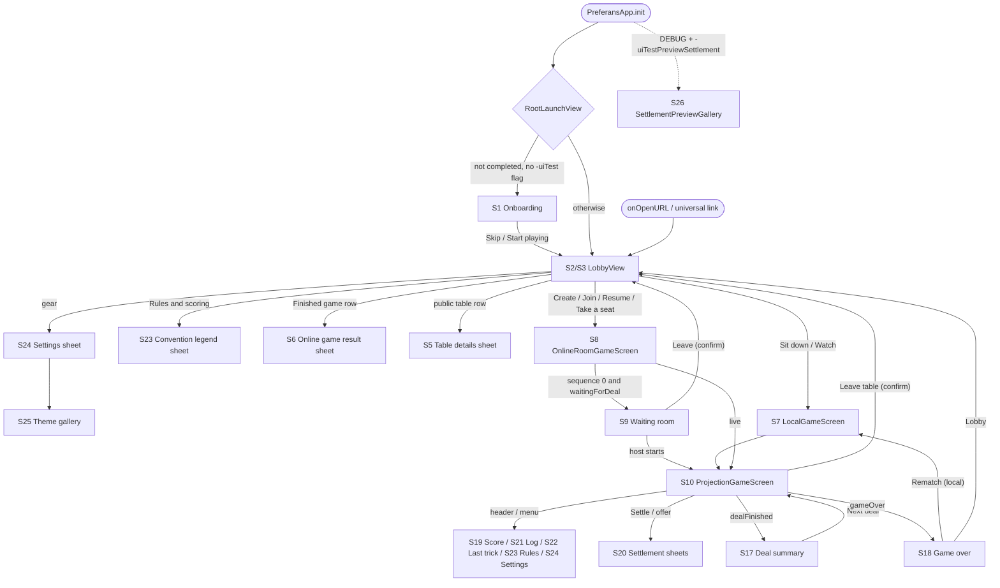

# Feature Specification: Preferans iOS App (SwiftUI shell, screens, table presentation)

**Status**: Implemented (as-built) · **Verified against**: `store/1.0.3-localized-keywords` @ `cd78828` · **Primary code**: `Preferans/PreferansApp.swift`, `Preferans/GameViewModel.swift`, `Preferans/UI/*`, `Preferans/Support/*`, `Preferans/Resources/Localizable.xcstrings`, `Sources/PreferansEngine/UIIdentifiers.swift`, `Sources/PreferansEngine/Projection/PlayerProjection.swift`

Related specs (do not duplicate; this document only describes the interfaces the app consumes):

| Folder | What it owns |
| --- | --- |
| [`../001-game-rules`](../001-game-rules/) | Engine phases, `PreferansAction`, `PreferansEvent`, legality |
| [`../002-scoring-and-variants`](../002-scoring-and-variants/) | `ScoreSheet`, `PreferansRules` presets (`.sochi`, `.leningrad`, `.rostov`, `.stalingrad`), `MatchSettings`, `PreferansRulebook` |
| [`../003-bots`](../003-bots/) | `HeuristicStrategy`, `BotProfile`, `BotDecisionExplanation`, `BotDecisionRecovery` |
| [`../004-online-multiplayer`](../004-online-multiplayer/) | Online sessions/coordinators, transports, worker, server, projection building, accounts, public directory |
| [`../006-testing-and-release`](../006-testing-and-release/) | Test lanes, UI-test robots, `TestHarness` in depth, `bin/` scripts, CI, fastlane, App Store |

## Summary

Update 2026-11-02: the production waiting room now offers per-seat Add bot and
Bot settings menus, with visible strength and removal before the first deal,
for public and private tables. This replaces the production fill-all-and-start
CTA described in FR-066; the old CTA remains only for the legacy in-memory
harness. See [online bot seats](../007-online-waiting-room-bots/spec.md).

Preferans is a universal (iPhone + iPad, Mac Catalyst enabled) SwiftUI app for the Russian/Ukrainian trick-taking game Preferans. One `WindowGroup` hosts a first-run onboarding tour and a lobby. From the lobby the player either sits down at a **local table** against 2–3 configurable bots (or watches four bots play) or goes **online** (guest or Sign in with Apple identity, public table directory, invite links/room codes, a "Your games" library, a pre-deal waiting room).

Both local and online tables render through one projection-driven screen, `ProjectionGameScreen`, which consumes a `PlayerGameProjection` (the viewer-safe view of the engine) plus a typed recent-event stream. Local play is driven by `GameViewModel` (engine + bot scheduling + a tap-to-advance "beat" gate); online play is driven by coordinators conforming to `OnlineGamePresenting` (see `../004-online-multiplayer`). Presentation is fully themeable (six persistent themes), localized in English, Russian and Ukrainian (Ukrainian is the first-launch default), adapts between phone portrait, phone landscape and iPad (with a persistent score-sheet sidebar), and exposes a stable accessibility-identifier contract (`UIIdentifiers`) that the XCUITest suite drives.

## User Scenarios & Testing

### User Story 1 – Sit down at a local table against bots (Priority: P1)

A player opens the lobby, keeps or edits the default roster (themselves plus two bots), optionally tunes table options, taps **Sit down**, then **Deal**, and plays.

**Why this priority**: This is the default and offline-capable core loop; everything else (online, settings) is optional.

**Independent Test**: `LobbyViewModelTests.testStartLocalTableAssignsBotStrategiesFromRoster`, `PreferansUITests.testStartLocalTableThenDeal`, `AccessibilityContractTests.testLobbyAndGameExposeStableAutomationRoots`.

**Acceptance Scenarios**:

1. **Given** a fresh lobby, **When** it renders, **Then** the local mode is selected, the "At this table" card lists `Neo` (YOU badge), `Morpheus` (BOT, Careful · Expert) and `Trinity` (BOT, Bold · Seasoned), the stepper shows "2 bots", and the bottom bar shows "3 players · Balanced scoring" and an enabled **Sit down** button.
2. **Given** three seats, **When** the player taps **+**, **Then** a fourth seat `Agent Smith` (Expert/Adaptive bot) appears, **+** disables and **−** enables; **When** they tap **−**, **Then** the last bot is removed.
3. **Given** a seat name is blank or duplicated, **When** the lobby re-renders, **Then** the start bar shows "Every seat needs a name." / "Names must be unique." and **Sit down** is disabled.
4. **Given** a valid roster, **When** the player taps **Sit down**, **Then** the game screen appears in phase "Ready" with a centered **Deal** button, bots are bound to `HeuristicStrategy(profile:)`, the viewer is pinned to seat 1, and the last seat is the first dealer (seat 1 is forehand).
5. **Given** the game screen in "Ready", **When** the player taps **Deal**, **Then** the phase becomes "Bidding" and the auction panel appears in the felt center.

---

### User Story 2 – Play a full deal through every phase (Priority: P1)

The player bids, takes the prikup, discards, names a contract (or concedes "without three"), whists or passes, chooses open/closed defence, plays cards, optionally settles, reviews the deal summary and starts the next deal until the match ends.

**Why this priority**: The table is the product; every phase must expose exactly the legal controls.

**Independent Test**: `MatchUITests` (deal summary, match completion, settlements), `FullGameUITests.testGame1_ClassicSochi` / `testGame2_LongSochi` / `testGame3_RostovDedicatedTotus`, `ScenarioFlowTests`.

**Acceptance Scenarios**:

1. **Given** it is the viewer's turn to bid, **When** the action bar renders, **Then** it shows the title "Your bid" and one chip per legal `BidCall` (Pass dim; game bids as "6♠" with suit-coloured pip; Misere accent; Totus primary) with identifiers `bid.<encoding>`.
2. **Given** the viewer won the auction, **When** the deal enters `awaitingDiscard`, **Then** the two prikup cards are shown on the felt as a **Take prikup** button and the action bar is hidden; **When** tapped, **Then** the 12 cards merge into the hand fan (prikup cards marked with a "P" badge) and the bar shows "Discard two cards · N of 2" with **Confirm discards** enabled only at exactly 2 selected.
3. **Given** `awaitingContract` for the viewer, **When** the bar renders, **Then** it lists legal contracts (strain only for a totus declaration) and, for a game/totus final bid, a **Without 3** concession button.
4. **Given** `awaitingWhist` for the viewer, **When** the bar renders, **Then** it shows "Your call" with Whist (primary), Half-whist (secondary) and Pass (dim) as legal; if Whist is the only legal call on 6♠ under Stalingrad rules, the Stalingrad explanation is shown.
5. **Given** `awaitingDefenderMode` for the viewer, **When** the bar renders, **Then** it shows "Defend open or closed?" with Open/Closed buttons.
6. **Given** trick play and the viewer holds playable cards, **When** they tap a card, **Then** it is only selected (lifted, outlined) and a **Play card** button appears; **When** they double-tap or drag it ≥ 44 pt, or tap **Play card**, **Then** `.playCard` is sent.
7. **Given** the last card of a trick is played, **When** the viewer is human and tap-to-advance is on, **Then** the completed trick stays on the felt with "<winner> took the trick · Tap to continue" until the felt is tapped.
8. **Given** the deal is scored, **When** the screen renders, **Then** a reading surface shows "Deal complete" (or "Agreed result"), the headline, trick tally, per-player score delta and balance, an optional "Show opening hands" disclosure and **Next deal**.
9. **Given** the match ends, **When** the screen renders, **Then** "Game over", the winner ("<name> takes the pulka") or "Shared lead: …", the deal count, standings and **Lobby** / **Rematch** buttons are shown.

---

### User Story 3 – Read the table at a glance (Priority: P1)

The player always sees whose turn it is, what every seat just did, who is declarer/whister, the contract and its progress, and where each card was played.

**Why this priority**: Comprehension of a 3/4-seat table on a phone is the main UX risk.

**Independent Test**: `TableScreenSnapshotTests` (structural snapshots), `TableLayoutModelTests`, `SeatRoleBadgeFeedTests`.

**Acceptance Scenarios**:

1. **Given** a 3-player table viewed from any seat, **When** it renders, **Then** the viewer is at the bottom and the next seat clockwise is placed on the left (`x=0.25`), the other on the right (`x=0.75`), both at `y=0.18` of the felt.
2. **Given** a 4-player deal, **When** the viewer is active, **Then** the sitting-out dealer is drawn in its own band above the felt as "name · OUT", and the two active opponents occupy the left/right slots.
3. **Given** a bot bids, **When** the event arrives, **Then** a centered toast "<name> · <call>" appears for 1.4 s (2.8 s when it carries a matching bot insight) unless the center already narrates it (auction, discard/contract, results, trick in progress).
4. **Given** a contract is on the table, **When** seats render, **Then** each participating seat shows a persistent role ("Declarer 6♠", "Whist", "Half-whist", "Passed") and the deal-state strip shows "<declarer> 6♠ … TRICKS taken/target" (red when it can no longer be made).

---

### User Story 4 – Set up online play from the lobby (Priority: P1)

A player registers as a guest or with Apple, then finds a public table, joins via a pasted code/invite link, resumes a game from "Your games", or creates a public/invite-only table.

**Why this priority**: Online play with friends is the second headline feature (README, onboarding slide 3).

**Independent Test**: `LobbyViewModelTests.testOnlinePlayerNameIsRequiredBeforeCreateJoinOrDebugRoom`, `testInviteSwitchesFromLocalToOnlineAndPreservesCodeForSignIn`, `testPublicCreationStartsWithPublicSeatsOnlyWhenDirectoryIsAvailable`, `NativeOnlineUITests.*` (requires a local worker).

**Acceptance Scenarios**:

1. **Given** online mode with no account, **When** the name field is empty, **Then** "Enter your name to play online." is shown, **Continue as Guest** is disabled and create/join/in-memory room attempts set `errorText` without starting a session.
2. **Given** a name, **When** the player taps **Continue as Guest** (or completes Sign in with Apple), **Then** the server account is registered, its token stored in Keychain, the account persisted, and "Online account ready." shown.
3. **Given** the join field contains `ABC123` or a `/join/ABC123` link, **When** it parses, **Then** a "Join table ABC123 · Tap to take a seat" row appears; tapping it (or pressing Go) joins.
4. **Given** the app is opened from an invite URL, **When** `onOpenURL` fires, **Then** the lobby switches to online mode, the code is pre-filled and "Invite ABC123 is ready — tap Join to take a seat." is shown.
5. **Given** **Create a table** and a reachable public directory, **When** tapped, **Then** visibility defaults to Public, pulka to 11 per player, only Vienna/Prague/Berlin are offered, and all non-host seats are open; a public request with a bot seat or a non-public variant is rejected with "Choose Vienna, Prague, or Berlin and leave seats open for players.".

---

### User Story 5 – Wait for players, then play online (Priority: P2)

After creating/joining, the player lands in a waiting room (room code, share link, seat roster, readiness on public tables, host Start / Fill with bots), then on the same table UI as local play.

**Why this priority**: Required for online, but the transport logic lives in `../004-online-multiplayer`; the app only presents it.

**Independent Test**: `OnlineWaitingRoomUITests.testInMemoryRoomLandsOnWaitingRoomThenStarts`, `testHostFillsOpenSeatsTransactionallyThenStarts`, `testOnlineCompletedTrickShowsTimedResultHold`, `OnlineWaitingRoomLayoutTests`.

**Acceptance Scenarios**:

1. **Given** a room whose projection has `sequence == 0` and phase `waitingForDeal`, **When** the screen renders, **Then** `OnlineWaitingRoomView` is shown (`screen.waitingRoom`), not the felt.
2. **Given** the host with an unfilled invite seat, **When** they tap **Fill empty seats with bots & start**, **Then** the coordinator fills and starts and the live table replaces the waiting room once `sequence ≥ 1`.
3. **Given** a guest, **When** the waiting room renders, **Then** it shows "Waiting for the host to start…" instead of host controls.
4. **Given** an online trick completes, **When** the projection advances, **Then** the trick stays visible with a non-tappable hold (`table.trickResultHold`) for the coordinator's hold duration (2.4 s) without any tap.
5. **Given** the transport reconnects / the seat is opened on another device / the host is unreachable, **When** the status changes, **Then** a capsule banner "Reconnecting…" / "Opened on another device — this table is read-only here." / "Recovering host…" appears at the top.

---

### User Story 6 – First launch: onboarding and tracking prompt (Priority: P2)

**Why this priority**: Shown once; affects App Store review (ATT) but not gameplay.

**Independent Test**: `TestHarnessTests.testProductionShowsOnlyIncompleteOnboarding`, `testAutomationBypassesOnboardingRegardlessOfPersistedState`, `testDedicatedAutomationFlagForcesOnboarding`, `OnboardingLocalizationUITests`, `PreferansUITests.testOnboardingRemainsNavigableAtAccessibilityTextSize`.

**Acceptance Scenarios**:

1. **Given** `settings.firstLaunchOnboardingCompleted` is false and no `-uiTest*` argument, **When** the app starts, **Then** the four-slide tour is shown; **When** the user taps **Skip** or **Start playing** on slide 4, **Then** the flag is set and the lobby appears.
2. **Given** ATT status `notDetermined`, **When** the app first becomes active (or onboarding settles for 1.4 s, or onboarding completes), **Then** the system tracking prompt is requested once and `settings.trackingPermissionRequested` is set.
3. **Given** any `-uiTest…` launch argument, **When** the app starts, **Then** onboarding and the ATT prompt are skipped (unless `-uiTestShowOnboarding`).

---

### User Story 7 – Personalize via Settings (Priority: P2)

**Why this priority**: Persistent preferences that change presentation only.

**Independent Test**: `ThemeUITests.testThemeSwitchPreservesLiveDealAndPersistsOnRelaunch`, `ThemeUITests.testGallerySupportsLargestText`, `ThemePaletteTests`, `AccessibilityContractTests.testSettingsExposeStableLanguageControl`.

**Acceptance Scenarios**:

1. **Given** a live deal, **When** the player opens Menu → Settings → Table theme and selects Parchment, **Then** the theme applies immediately, the deal and auction are preserved, and after relaunch Parchment is still selected.
2. **Given** Settings, **When** the player changes Language, **Then** `AppleLanguages` is rewritten and a "Restart required — Language will switch on next launch." alert appears.
3. **Given** Settings opened from the lobby with a registered account, **When** the player confirms **Delete online account**, **Then** the server account is deleted first, then Keychain token, seat credentials and local identity are cleared and "Online account deleted." is shown.
4. **Given** Settings opened from a game, **When** it renders, **Then** **Delete online account** is disabled with "Return to the lobby before deleting the online account.".

---

### User Story 8 – Consult score sheet, log, last trick and rules (Priority: P2)

**Independent Test**: `TableLayoutModelTests.testRegularSplit*`, `ActivityLogFeedTests`, `RedesignScreenshotTests.testCaptureFourPlayerPulkaDiagram`, `testBotDecisionInsightAndActivityLog`.

**Acceptance Scenarios**:

1. **Given** a phone or iPad window narrower than 900 pt, **When** the player taps the score-sheet icon, **Then** a sheet shows the pulka diagram (triangle for 3, square for 4) and per-player Bullet/Mountain/Whists cards with balances.
2. **Given** an iPad window ≥ 900 pt wide, **When** a live table renders, **Then** the score sheet is a persistent right sidebar 280–340 pt wide.
3. **Given** a completed trick exists, **When** the player taps the last-trick icon, **Then** a sheet shows "<winner> won" and the trick cards with the winner highlighted.
4. **Given** the overflow menu, **When** "Activity log" is chosen, **Then** recent events (newest first, display names, discards redacted) and up to 12 "Bot notes" are listed.
5. **Given** a table in progress, **When** "Rules & scoring" is chosen, **Then** the reference is fixed to the table's actual rules and match settings (convention switching disabled).

---

### User Story 9 – Watch bots play (Priority: P3)

**Independent Test**: `LobbyViewModelTests.testWatchBotsPreservesThreeOrFourSeatTableAndPacingPreference`, `testWatchBotsCompletesFourSeatMatchAtSixPointsEach`, `RedesignScreenshotTests.testWatchBotsFullMatchFourPlayersPoolSix`.

**Acceptance Scenarios**:

1. **Given** the lobby, **When** the player taps **Watch bots play** and confirms "Watch", **Then** every seat becomes a bot, the table starts with zero bot delay and no tap-to-advance, and the player spectates (status pill "Watching", all action controls hidden, Deal/Next deal still available).
2. **Given** a Watch table, **When** **Rematch** is tapped, **Then** the instant pace is kept; **When** the player later taps **Sit down**, **Then** the lobby's chosen Bot speed is used.

---

### User Story 10 – Accessibility and automation (Priority: P2)

**Independent Test**: `AccessibilityContractTests`, `MatchUITests.testDealSummaryBalancesAtLargestTextSize`, `testMatchCompletionAtLargestTextSize`, `testMisereSettlementAtLargestTextSize`, `RedesignScreenshotTests.testCaptureTableAuctionAtAccessibilityXXXL`.

**Acceptance Scenarios**:

1. **Given** Accessibility XXXL text, **When** the table renders, **Then** table chrome is clamped to `.small ... .xxxLarge` while the action bar uses the full size with a single natural-height scroll row, and results/settings switch to stacked/collapsible layouts.
2. **Given** VoiceOver, **When** focusing a hand card, **Then** its label is the card ("A♠") and its value "Playable"/"Not playable"; the settlement split control is adjustable (increment/decrement).
3. **Given** a shipping launch without `-uiTest*` flags, **When** the accessibility tree is inspected, **Then** no invisible automation-only room-creation buttons exist.

---

### User Story 11 – Device-appropriate layouts (Priority: P2)

**Independent Test**: `TableLayoutModelTests.testIPadSplitViewKeepsTabletCompositionEvenWithCompactWidth`, `testIPhoneUsesCompactPortraitAndLandscapeCompositions`, `LobbyViewModelTests.testLobbyLayout*`, `OnlineWaitingRoomLayoutTests`.

**Acceptance Scenarios**:

1. **Given** an iPhone in landscape with compact width and height size classes, **When** a table renders, **Then** opponents are in a left column (180 pt, 260 pt if an opponent hand is open) and the strip, felt, action bar and hand stack on the right. (Large iPhones whose landscape width class is regular get the iPad composition instead.)
2. **Given** an iPad reporting compact width, **When** a table renders, **Then** the tablet composition and large card sizes are kept (device idiom wins).
3. **Given** a regular-width iPad lobby at normal text sizes, **When** it renders, **Then** navigation (hero + mode) and mode content are side by side (340 pt + up to 620 pt).

### Edge Cases

- **Duplicate Deal taps**: `GameViewModel.send(.startDeal)` is ignored when `engine.canStartDeal` is false, so a double tap neither errors nor consumes a second scripted deck (`GameViewModelDealSourceTests.testDuplicateStartDealIsIgnoredWithoutConsumingAnotherDeck`).
- **Stale bot decisions**: a bot task applies its action only if `engine.snapshot` still equals the snapshot it decided on; any interleaved human action or rematch cancels it (`GameViewModel.scheduleBotIfNeeded`).
- **Illegal card played via drag/double-tap**: the card is just selected; no action is sent (`ProjectionGameScreen.playCard`). Engine rejections of UI-validatable categories (illegal card/bid/whist/settlement, not-your-turn, …) set `lastError` but show no banner (`GameViewModel.ErrorCategory`).
- **Viewing a bot via "View as"**: all non-deal actions are dropped and legal controls stripped; bot turns keep advancing (`GameViewModelDealSourceTests.testViewingBotIsReadOnlyWhileInternalBotActionsStillAdvance`).
- **Last trick of a deal**: the engine jumps straight to `dealFinished`; the freeze keeps the pre-close phase/status/talon/trick count visible until the tap (`AdvancePresentation.completedTrickHold`).
- **4-player raspasy**: the freeze restores the public talon from *before* the closing card so a later talon lead is not revealed early (`GameViewModelTapAdvanceTests.testFourPlayerRaspasyFreezeDoesNotRevealSecondTalonLeadEarly`).
- **Prikup take state across deals**: `talonTakenSequence` is keyed to `projection.sequence`; a new projection resets the discard selection; selections not in hand+talon are dropped (`ProjectionGameScreen.reconcile*`).
- **Settlement offer arrives while the draft sheet is open**: the response sheet replaces it; when the offer disappears the response sheet closes; when offering becomes illegal the draft sheet closes (`ActionBarView` `onChange` handlers).
- **Public table creation without a reachable directory**: Public is disabled and any switch to it is reverted to Invite only (`LobbyView.onlineSetupCard` `onChange`).
- **Persisted account with wrong schema/provider or no Keychain token**: the account is discarded on load; the user must register again (`LobbyViewModel.loadRegisteredOnlineAccount`, `init`).
- **Unknown persisted theme** (e.g. from a newer version) resolves to Clubhouse without rewriting the stored value (`ThemePaletteTests.testUnknownSavedThemeFallsBackWithoutChangingTheSavedValue`).
- **Custom pulka out of range** is clamped (1…999 per player, 1…3996 table total) on assignment and on load (`LobbyViewModel.customPulka*` `didSet`).
- **Accessibility text sizes**: segmented pickers become menus (`LobbyChoiceControlStyle`); two-region layouts collapse to one column; settings explanations move into disclosure groups.
- **Invite URL arriving during a game**: the lobby state is updated (mode, code, info) but stays hidden until the player leaves the table (`LobbyView.onOpenURL` is attached above the game screens).
- **Online room with `sequence == 0` but a non-`waitingForDeal` phase**: treated as live to avoid trapping the user in the waiting room (`OnlineRoomGameScreen.isLiveTable`).

## Requirements

### Functional Requirements

#### App entry, scene and dependency injection

- **FR-001**: The system MUST start a single `WindowGroup` whose root is `RootLaunchView`, wrapped by `.appAppearance()`, `.environment(\.locale, Locale(identifier: AppLanguage.current.rawValue))`, and a `.transaction` that nils animations when animations are disabled; in DEBUG with `-uiTestPreviewSettlement` the root MUST be `SettlementPreviewGallery`. — `Preferans/PreferansApp.swift` `PreferansApp.body`, `rootContent`. Test: `AccessibilityContractTests.testLobbyAndGameExposeStableAutomationRoots`.
- **FR-002**: Before any view loads, the system MUST apply the UI language: `-uiTestPinLanguageEn`/`-uiTestPinLanguageRu` win; otherwise the persisted `settings.appLanguage` or the default `uk`; applying writes both `settings.appLanguage` and `AppleLanguages = [code]`. — `PreferansApp.init`, `Preferans/Support/AppIdentifiers.swift` `AppLanguage.apply`. Tests: `LocalizationCatalogTests.testApplyingLanguagePersistsAppAndBundlePreferences`, `TestHarnessTests.testAutomationLanguagePinsAreExplicitAndDeterministic`.
- **FR-003**: In DEBUG builds, `-uiTestTheme <name>` MUST persist `AppTheme.resolve(name)` into `settings.appTheme` before the view tree is created. — `PreferansApp.init`. Test: `ThemeUITests.test*Screens`.
- **FR-004**: When `-uiTestDisableAnimations` is present the system MUST call `UIView.setAnimationsEnabled(false)` and strip SwiftUI transaction animations. — `PreferansApp.init`, `TestHarness.disableAnimations`.
- **FR-005**: The system MUST install `AppLifecycleDelegate` (UIKit) and inject a `GameCenterService` environment object without authenticating Game Center at launch. — `PreferansApp`, `Preferans/GameKit/GameCenterService.swift`.
- **FR-006**: `GameViewModel`, `LobbyViewModel`, `CenterActionBanner` and `InMemoryOnlineGameSession` MUST obtain time and identifiers only through swift-dependencies (`\.continuousClock`, `\.uuid`) so tests can substitute `ImmediateClock`, `TestClock` and `.incrementing`. — `Preferans/GameViewModel.swift`, `Preferans/UI/LobbyViewModel.swift`, `Preferans/UI/CenterActionBanner.swift`. Tests: `AppTestCase`, `GameViewModelTapAdvanceTests.testIdleHintFiresAfterDelayElapsesOnTestClock`, `LobbyViewModelTests.testOnlineDisplayNamePersistenceIsDebounced`.
- **FR-007**: `LobbyViewModel.init` MUST accept an `OnlineAccountServing` client (default `CloudflareAccountClient()`) and an `OnlineAccountSessionStoring` store (default `KeychainOnlineAccountSessionStore()`). — `LobbyViewModel.init`. Test: `LobbyViewModelTests.testAccountDeletionRevokesServerBeforeClearingLobbyIdentity`.

#### Onboarding and privacy

- **FR-008**: The system MUST show onboarding iff `-uiTestShowOnboarding` is present, or (no `-uiTest…` argument and `settings.firstLaunchOnboardingCompleted == false`); completion MUST set the flag and route to the lobby in the same launch. — `Preferans/UI/OnboardingView.swift` `RootLaunchView`, `Preferans/Support/TestHarness.swift` `shouldShowOnboarding`. Tests: `TestHarnessTests.testProductionShowsOnlyIncompleteOnboarding`, `testAutomationBypassesOnboardingRegardlessOfPersistedState`, `testDedicatedAutomationFlagForcesOnboarding`.
- **FR-009**: Onboarding MUST present four paged slides ("Classic Preferans, made readable", "Play a full hand", "Invite friends by room code", "Track the pulka") with decorative illustrations hidden from accessibility, a **Skip** button, a capsule page indicator, and a primary button reading "Continue" (slides 1–3) or "Start playing" (slide 4); the last slide MUST show the tracking-permission note. — `OnboardingView`, `OnboardingSlide.sampleSlides`. Tests: `PreferansUITests.testOnboardingRemainsNavigableAtAccessibilityTextSize`, `OnboardingLocalizationUITests.testRussianIntroductionThroughTheLobby`, `testUkrainianIntroductionThroughTheLobby`.
- **FR-010**: The system MUST request App Tracking Transparency authorization only when status is `.notDetermined` and not under UI automation, from (a) `AppLifecycleDelegate.applicationDidBecomeActive` once per process after a 1 s delay, (b) the onboarding `.task` after 1.4 s, (c) onboarding completion; each automatic request MUST set `settings.trackingPermissionRequested = true`. — `Preferans/Support/TrackingPermissionCenter.swift` `requestPermissionIfNeeded`, `AppLifecycleDelegate`, `OnboardingView.requestTrackingAfterLaunchSettles`.
- **FR-011**: Settings MUST show the ATT status ("Not requested", "Restricted", "Denied", "Authorized", "Unknown", "Unavailable"), a **Request tracking permission** button enabled only while not determined, and an **Open Privacy Settings** button otherwise. — `Preferans/UI/SettingsScreen.swift` `privacySection`.

#### Navigation and lobby (local)

- **FR-012**: `LobbyView` MUST render, in precedence order, `LocalGameScreen` (when `localModel != nil`), `OnlineRoomGameScreen` for the in-memory session, `OnlineRoomGameScreen` for the Cloudflare session, else the lobby content; the settings gear toolbar item MUST exist only while the lobby content is shown. — `Preferans/UI/LobbyView.swift` `LobbyView.body`. Test: `AccessibilityContractTests.testLobbyAndGameExposeStableAutomationRoots`.
- **FR-013**: The lobby MUST offer a two-way mode choice ("Play with bots" / "Play online") and MUST NOT render the inactive mode's controls (e.g. no `online.createRoom` in local mode, no `button.startLocalTable` in online mode). — `LobbyView.modeSegment`, `lobbyModeRegion`, `localStartBar`. Tests: `AccessibilityContractTests.testOnlineControlsBelongToVisibleOnlineMode`, `PreferansUITests.testLobbyRendersCoreControls`.
- **FR-014**: The default local roster MUST be `Neo` (human), `Morpheus` (bot Expert/Careful), `Trinity` (bot Seasoned/Bold); **+** MUST append `Agent Smith` (Expert/Adaptive), then `Bot N` (Casual/Adaptive), up to 4 seats; **−** MUST remove the last bot only when there are 4 seats. — `Preferans/UI/LobbyModels.swift` `LobbySeat.defaults`, `addBot`, `stockBotProfile`; `LobbyViewModel.addBot`, `removeBot`. Tests: `LobbyViewModelTests.testBotStepperAddsAndRemovesFourthBot`, `PreferansUITests.testFourPlayerRosterAddsSeat`.
- **FR-015**: Every seat name MUST be editable; the roster MUST be rejected when any trimmed name is empty ("Every seat needs a name.") or names repeat ("Names must be unique."), disabling **Sit down** and showing the message in the start bar; otherwise the bar MUST show "<n> players · <variant standard name>". — `Array<LobbySeat>.validationError`, `LobbyView.localStartBar`. Test: `LobbyViewModelTests.testLobbyRosterValidationRejectsBlankAndDuplicateNames`.
- **FR-016**: Each bot seat MUST expose a profile menu with Strength (Casual/Seasoned/Expert) and Style (Careful/Adaptive/Bold) that never changes the seat's human/bot kind. — `LobbyView.seatRow`, `LobbySeat.setBotProfile`. Test: `LobbyViewModelTests.testBotProfileUpdatePreservesSeatKindInvariant`.
- **FR-017**: The "Table options" disclosure MUST contain: Variant (4 variants; a 2×2 button grid on phones at normal text sizes, a segmented/menu picker on tablets or accessibility sizes) with a card showing the variant's standard name and summary; Bot speed (Instant/Normal/Slow); Pulka (11 / 21 / Custom, labelled as table totals for the table-total variant); Raspasy price (1–1–1, 1–2–3, 1–2–2, 1–2–4); Exit minimum (6–6–6, 6–7–7, 6–7–8); every choice except Bot speed MUST persist. — `LobbyView.localTableCard`, `variantControls`, `botSpeedPicker`, `pulkaLimitPicker`, `raspasyControls`; `LobbyViewModel` property observers. Tests: `LobbyViewModelTests.testOnlineVariantDefaultsToOdesaAndPersists`, `testPulkaLimitDefaultsPersistsAndSeedsLocalMatchPerPlayer`, `testCustomPulkaPersistsAndSeedsLocalMatchPerPlayer`, `testCustomWienPulkaPersistsAsAnExactSharedTableTotal`, `testRaspasyHouseSettingsPersistAndSeedLocalMatch`.
- **FR-018**: `startLocalTable` MUST create a `GameViewModel` with: players = trimmed seat names; first dealer = last seat; rules = `onlineVariant.rules`; match = `poolTarget` (per-player preset × seat count, or the custom table total for a table-total variant with Custom), `poolClosure = onlineVariant.poolClosure`, `raspasy = .progressive(penalties: lobby price, exit: lobby exit)`; viewer policy `.pinned(first player)` unless overridden; a `HeuristicStrategy(profile:)` for every bot seat (only when harness players equal lobby players); `botMoveDelay = BotPacing.testFast` under `-uiTestFastBotDelay`, else `(speedOverride ?? botSpeed).delay`; tap-to-advance disabled under `-uiTestSkipTapToAdvance` or when no human seat exists. — `LobbyViewModel.startLocalTable`, `selectedMatchSettings`, `totalPulkaTarget`. Tests: `LobbyViewModelTests.testStartLocalTableAssignsBotStrategiesFromRoster`, `testNormalLocalTableUsesTheSelectedProductionPace`, `testWienVariantUsesStrictRuleProfileAndSharedPoolClosureForLocalPlay`.
- **FR-019**: **Watch bots play** MUST ask for confirmation ("Watch the bots play?"), replace the roster with all bots of the same count, start with `BotMoveSpeed.instant` without changing `botSpeed`, and keep the override for **Rematch** only. — `LobbyView` confirmation dialog, `LobbyViewModel.watchBots`, `rematchLocalTable`. Tests: `LobbyViewModelTests.testWatchBotsPreservesThreeOrFourSeatTableAndPacingPreference`, `testWatchBotsCompletesFourSeatMatchAtSixPointsEach`.
- **FR-020**: A "Rules & scoring" footer link MUST open `ConventionLegendSheet(initialVariant: onlineVariant)` with convention switching enabled. — `LobbyView.conventionsFooterLink`.

#### Lobby (online presentation)

- **FR-021**: The online card MUST show a "You" panel: when not registered, a name field (persisted after a 300 ms debounce), **Continue as Guest** (disabled while loading or name empty) and **Sign in with Apple** (full-name scope, SHA-256 hashed random nonce); when registered, "Signed in as <name>" with a sign-out button that clears credentials but keeps the display name; plus the current identity validation message. — `Preferans/UI/LobbyOnlineSetupCard.swift` `onlineIdentitySection`, `configureAppleSignIn`, `handleAppleSignIn`; `LobbyViewModel.setOnlineDisplayName`, `registerGuestOnlineAccount`, `completeAppleRegistration`, `clearRegisteredOnlineAccount`. Tests: `LobbyViewModelTests.testOnlinePlayerNameIsRequiredBeforeCreateJoinOrDebugRoom`, `testOnlineDisplayNamePersistenceIsDebounced`.
- **FR-022**: Online setup MUST be rejected with "Enter your name to play online." when the effective name is empty and with "Register as a guest or sign in with Apple to play online." when no registered account+session token exists. — `LobbyViewModel.onlineIdentityValidationError`.
- **FR-023**: The "Play online" panel MUST offer **Find a table** (shows the public tables section) and **Create a table** (`prepareOnlineTableCreation`: intent `.createTable`, clear messages, visibility Public iff the directory loaded without error, pulka reset to `.short`, non-public variant reset to Vienna, open seats for public). — `LobbyOnlineSetupCard.onlineSetupCard`, `LobbyViewModel.prepareOnlineTableCreation`. Test: `LobbyViewModelTests.testPublicCreationStartsWithPublicSeatsOnlyWhenDirectoryIsAvailable`.
- **FR-024**: The public tables section MUST require a session ("Sign in or continue as a guest to find players."), offer Convention / Players / Match length / status (Waiting for players, In progress) filters, refresh on appear, every 15 s while the scene is active, on foregrounding, and manually, support "Load more tables", and open a details sheet with roster readiness and **Take a seat** only when `canJoin`. — `Preferans/UI/LobbyPublicTablesSection.swift`. Test: `NativeOnlineUITests.testNativePlayerFindsPublicTableReadiesAndReceivesFirstDeal`.
- **FR-025**: The join panel MUST parse the text field with `PreferansInviteLink.roomCode(from:)` and show a "Join table <CODE>" action row only for a valid code; the Go key MUST join when a code parses. — `LobbyOnlineSetupCard.onlineJoinSection`, `readyToJoinRow`. Test: `AccessibilityContractTests.testOnlineControlsBelongToVisibleOnlineMode`.
- **FR-026**: In create mode the card MUST show "Who can join?" (Public table disabled until the directory has loaded without error; Invite only), Variant (variant controls, pulka; raspasy controls only for invite-only), Seats (3/4 and, for invite-only, Friend/Bot per non-host seat; "Open seat" for public), and **Open public table** / **Create invite link** (spinner "Opening your table…"), disabled while invalid or loading. — `LobbyOnlineSetupCard.onlineVariantSection`, `onlineCompositionSection`, `onlineRoomActionsSection`; `LobbyViewModel.startCloudflareOnlineRoom`. Test: `NativeOnlineUITests.testNativeHostCreatesDiscoverablePublicTable`.
- **FR-027**: "Your games" MUST be hidden until there is something to show; it MUST list Continue rows (resume; context menu **Abandon game**) and Finished rows (open `OnlineGameSummarySheet` with winner and final balances), a refresh button, a loading row, an empty-state hint for registered accounts and a load error. — `Preferans/UI/LobbyYourGamesSection.swift`, `Preferans/UI/OnlineGameSummarySheet.swift`; `LobbyViewModel.resumeCloudflareOnlineRoom`, `abandonOnlineGame`. Test: `NativeOnlineUITests.testNativeHostCreatesStartsLeavesAndResumesAfterRelaunch`.
- **FR-028**: Invite URLs delivered via `onOpenURL` or `NSUserActivityTypeBrowsingWeb` MUST switch the lobby to online mode, pre-fill the parsed code and set the info text. — `LobbyView.body`, `LobbyViewModel.handleInviteURL`. Test: `LobbyViewModelTests.testInviteSwitchesFromLocalToOnlineAndPreservesCodeForSignIn`.
- **FR-029**: Create/join/resume MUST share one busy gate (`isOnlineRoomLoading`) that clears messages, awaits `session.start()`, publishes `cloudOnlineSession`, stores the room code, and on failure sets `errorText`. — `LobbyViewModel.launchCloudRoom`.

#### Local game runtime (`GameViewModel`)

- **FR-030**: `send(_:)` MUST ignore `.startDeal` when `!engine.canStartDeal`, and MUST rewrite `.startDeal` to `.startDeal(dealer: engine.nextDealer, deck: dealSource.nextDeck())` before applying. — `GameViewModel.send`, `makeAuthoritative`. Tests: `GameViewModelDealSourceTests.testStartDealConsumesDeckFromDealSource`, `testDuplicateStartDealIsIgnoredWithoutConsumingAnotherDeck`, `testTwoModelsWithSameSeedReachIdenticalBiddingStateAfterDeal`.
- **FR-031**: After each successful action the system MUST append sanitized summaries to `eventLog` (no card lists for discards, no debug descriptions), append events to `recentEvents` (rolling window of 120), clear errors, and apply the viewer policy. — `GameViewModel.send`, `Preferans/UI/RecentAction.swift` `ActivityLogFeed.summaries`, `RecentActionFeed.append`. Test: `ActivityLogFeedTests.testSanitizedSummariesDoNotUseDebugEventDescriptions`.
- **FR-032**: Engine errors MUST be stored in `lastError`; only `.system` category errors (`invalidPlayer`, `invalidPlayers`, `invalidRules`, `invalidMatch`, `invalidDeck`, `invalidState`, non-engine errors) MUST surface as the top banner (`error.banner`). — `GameViewModel.ErrorCategory`, `displayableError`, `LocalGameScreen.body`. Test: `ScenarioFlowTests.testEastCannotSluffWhenHoldingALeadSuitCard`.
- **FR-033**: When no advance gate is up and the controlling actor of the current actor has a strategy, the system MUST schedule one bot decision: sleep `botMoveDelay` (if > 0), ask the strategy, recover via `BotDecisionRecovery`, and apply only if `engine.snapshot` is unchanged; explanations MUST be appended to `botInsights` (max 24). Any newer state change MUST cancel the pending task. — `GameViewModel.scheduleBotIfNeeded`. Test: `GameViewModelTapAdvanceTests.testBotStrategicActionAppendsAPlayerFacingInsight`.
- **FR-034**: When `tapToAdvanceEnabled` and the viewer is not a bot seat, the system MUST raise a `PendingAdvance` (a) on any action that completes a trick (from the pre-action projection) and (b) when the auction is won by someone other than the viewer (prikup reveal); while raised, bot scheduling MUST stop and `idleHintActive` MUST become true after `idleHintDelay` (4 s; immediately when zero). `advance()` MUST clear the gate and resume bots. — `GameViewModel.makePendingAdvance`, `startIdleHintTimer`, `advance`; `Preferans/Support/AdvancePresentation.swift`. Tests: `GameViewModelTapAdvanceTests.testTrickCloseFreezesTheFeltOnAllFourPlays`, `testMidTrickAllHumanPlayDoesNotFireTheGate`, `testAdvanceReleasesTheFreeze`, `testGateIsBypassedWhenDisabled`, `testIdleHintFiresImmediatelyWhenDelayIsZero`, `testIdleHintFiresAfterDelayElapsesOnTestClock`, `testViewerSelfPlayDoesNotFireGateEvenWithBotsBehind`, `testBotCardPlayDoesNotFreezeFeltMidTrickWhenAnotherBotIsNext`, `testBotClosingCardFreezesCompletedTrick`, `testBotCardPlayDoesNotFreezeWhenViewerIsNext`, `testPrikupRevealFreezesForDefenderViewer`, `testPrikupRevealDoesNotFreezeForDeclarerViewer`.
- **FR-035**: `displayProjection` MUST apply the freeze: show the held trick, roll the winner's trick count back by one, restore the pre-close talon/phase/status/completed-trick count, clear current-actor flags and suppress playable cards, settlement options and `canStartDeal`. — `PlayerGameProjection.applyingAdvanceFreeze`. Tests: `GameViewModelTapAdvanceTests.testDisplayProjectionRollsBackTrickCountWhileFrozen`, `testFreezeSuppressesPlayableCardsForViewer`, `testSharedTrickPresentationPreservesExactOpenPhaseAndPublicTalon`, `testFourPlayerRaspasyFreezeDoesNotRevealSecondTalonLeadEarly`.
- **FR-036**: When the selected viewer is a bot seat, `sendUserAction` MUST drop every action except `.startDeal`, and `displayProjection` MUST expose only `canStartDeal` and `pendingSettlement` as legal. — `GameViewModel.sendUserAction`, `displayProjection`. Test: `GameViewModelDealSourceTests.testViewingBotIsReadOnlyWhileInternalBotActionsStillAdvance`.
- **FR-037**: Production tables MUST use `ViewerPolicy.pinned`; `.followsActor` MUST only be selectable through `-uiTestViewerFollowsActor`; the local overflow menu MUST offer a "View as" section listing every player (checkmark on the current viewer). — `ViewerPolicy`, `LobbyViewModel.defaultViewerPolicy`, `LocalGameScreen.body`.
- **FR-038**: Local settlements MUST require each settlement party (human or bot) to accept for itself. — engine via `GameViewModel.send`. Tests: `GameViewModelTapAdvanceTests.testLocalSettlementWaitsForEachHumanBeforeScoring`, `testLocalSettlementDoesNotForceBotPartyConsent`.
- **FR-039**: The local screen MUST project with `ProjectionPolicy.online` (hidden opponent hands) unless the DEBUG-only "Reveal all hands" setting is on (`ProjectionPolicy.localDebug`). — `LocalGameScreen` (`@AppStorage settings.revealAllHands`), `GameViewModel.projection(revealAll:)`.

#### Table screen (`ProjectionGameScreen` and children)

- **FR-040**: The screen MUST choose `.iPad` whenever the device idiom is pad or the horizontal size class is not compact, else `.phoneLandscape` (vertical compact) or `.phonePortrait`; `dealFinished`/`gameOver` MUST use a scrolling reading surface (header + card, max width 960) in every layout. — `Preferans/UI/TableLayoutModel.swift` `ProjectionGameLayoutPolicy.resolve`; `Preferans/UI/ProjectionGameScreen.swift` `body`, `resultBody`. Tests: `TableLayoutModelTests.testIPadSplitViewKeepsTabletCompositionEvenWithCompactWidth`, `testIPhoneUsesCompactPortraitAndLandscapeCompositions`.
- **FR-041**: The iPad layout MUST show a persistent score-sheet sidebar when the window is ≥ 900 pt wide (sidebar = clamp(28% of width, 280…340)), else a stacked layout whose action bar width is capped below the regular-grid threshold. — `TableLayoutModel.RegularSplit`, `ProjectionGameScreen.regularBody`, `narrowRegularBody`. Tests: `TableLayoutModelTests.testRegularSplitKeepsGameplayPrimaryAcrossIPadWidths`, `testRegularSplitStacksWhenAnIPadWindowCannotFitTheSidebar`, `testRegularSplitClampsInvalidDimensions`.
- **FR-042**: The header MUST show a phase chip (localized phase title; status sentence; "<name> took the trick" during a hold; an invisible status node in the idle Deal state), a last-trick button (only when a completed trick exists), a score-sheet button, a leave button (when leaving is possible), and an overflow menu with caller extras ("View as" locally, "Room" online), Activity log, Rules & scoring, Settings and Leave table; leaving MUST confirm via "Leave this table?" with the caller's message. — `Preferans/UI/GameHeaderStrip.swift`.
- **FR-043**: The action bar MUST be hidden while a hold is up, in `dealFinished`/`gameOver`, while the centered Deal CTA is shown, or while the prikup is waiting to be taken; on compact width it MUST additionally be hidden unless it contains a real control (bid/contract/whist/defender/discard/settlement controls or a selected card). — `ProjectionGameScreen.shouldShowActionBar`, `ActionBarLayoutPolicy.shouldShow`. Tests: `TableLayoutModelTests.testCompactActionBarOmitsPassiveCardPlayStatus`, `testCompactActionBarAppearsAfterSelectingAPlayableCard`, `testCompactActionBarKeepsEveryDedicatedControlSurface`, `PreferansUITests.testAllPassDrivesEngineIntoPlayingPhase`.
- **FR-044**: The action bar MUST render exactly one surface in priority order bid → contract → whist → defender mode → discard → status, each with the identifiers in `UIIdentifiers.Panel` and per-button encoders. — `Preferans/UI/ActionBarView.swift` `body`. Tests: `PreferansUITests.testBiddingExposesPassAndMisereOptions`, `MatchUITests.testTenTrickConventionOffersBothDefendersPassOrWhist`.
- **FR-045**: Bid and contract choices MUST use a 7-column grid (74–112 pt columns) only on regular width, normal text sizes and ≥ 566 pt available width; otherwise a horizontal scroll rail (two 44 pt rows unless vertically compact or accessibility text) with a trailing fade, reset to the start for every new projection sequence. — `ActionChoiceLayoutPolicy`, `ActionBarView.adaptiveChoiceSurface`, `scrollableRow`. Tests: `TableLayoutModelTests.testWideRegularChoiceSurfaceUsesFullGrid`, `testNarrowRegularChoiceSurfaceFallsBackToScrollableRail`, `testAccessibilityChoiceSurfaceAlwaysUsesScrollableRail`, `testAccessibilityChoiceRailUsesOneNaturalHeightRow`, `testStandardPortraitChoiceRailKeepsTwoRows`.
- **FR-046**: The status surface MUST show **Review offer** when a settlement is pending, otherwise a status message ("Selected <card>", "Your turn — play a card", "<name>'s turn", or the localized status) with **Settle** when `settlementOptions` is non-empty and **Play card** when a card is selected. — `ActionBarView.statusRow`, `statusMessage`.
- **FR-047**: During the declarer's discard the prikup MUST first be shown as a **Take prikup** button on the felt; after the tap, hand and prikup MUST merge into one sorted selectable fan, at most two cards may be selected, and **Confirm discards** MUST send `.discard` with exactly the two selections. — `ProjectionGameScreen.takeTalon`, `toggleDiscardSelection`, `viewerHandFan`; `TableCenterView.talonContext`; `ActionBarView.discardRow`. Test: `PreferansUITests.testNorthSpadesSixScenarioDrivesEngineToDiscardWindow`.
- **FR-048**: Card play MUST be two-step: a tap selects; double-tap, a drag of ≥ 44 pt, or **Play card** plays; a play of a non-playable card MUST only select it; a selection no longer playable after a projection change MUST be cleared. — `ProjectionGameScreen.playCard`, `reconcilePlaySelection`; `Preferans/UI/CardFanView.swift`. Test: `PreferansUITests.testSingleTapOffersExplicitPlayConfirmation`.
- **FR-049**: The viewer's hand rail MUST be hidden when there is no viewer seat, in results, during the idle Deal state, or when the viewer sits out without a discard; spectators MUST get no card interactions. — `ProjectionGameScreen.shouldShowHandRail`, `viewerHandFan`, `Preferans/UI/ViewerHandRail.swift`.
- **FR-050**: The felt center MUST show, in order: game-over card; deal summary; centered **Deal** CTA (idle `waitingForDeal` with `canStartDeal`); the current trick (cards offset toward their owners, winner highlighted during a hold, plus the public talon during the first two raspasy tricks under classic/lead-suit talon policies); otherwise phase context (Take-prikup button, the face-up prikup for non-declarers, the raspasy talon, or the auction panel during bidding and contract naming). — `Preferans/UI/TableCenterView.swift`.
- **FR-051**: The auction panel MUST list active seats (viewer between the two opponents in a 3-seat deal) with "You"/name, the seat's latest action glyph, "Choosing" (or "…") for the current actor, or "—". — `Preferans/UI/AuctionPanel.swift` `AuctionContextView`, `PlayerGameProjection.tableClockwiseAuctionSeats`.
- **FR-052**: The center banner MUST show the latest non-card action since the last `dealStarted` for 1.4 s (2.8 s with a matching bot insight, which adds a sparkles line), never block hits, and be suppressed during holds, bidding, discard, contract naming, results, all-pass play and once any card of play is on the felt; its y-position MUST be 52% of the felt in whist/defender/playing phases and 42% otherwise. — `Preferans/UI/CenterActionBanner.swift`, `TableView.showsActionBanner`, `TableLayoutModel.bannerPosition`. Test: `TableLayoutModelTests.testBannerUsesLowerLaneOnlyWhenCenterFeltIsAvailable`.
- **FR-053**: Per-seat last-action pills MUST cover only the pre-play part of the current deal, drop auction passes once a contract is declared, and disappear once play starts; persistent role badges (Declarer/Whist/½/Pass) MUST appear from contract naming until the deal ends and never during bidding or results. — `RecentActionFeed.perSeat`, `PlayerGameProjection.roleBadge`, `SeatRoleBadgeFeed.perSeat`. Tests: `SeatRoleBadgeFeedTests.testBiddingHasNoPersistentRoleBadges`, `testPlayingDerivesSameRoleMapForEveryLayout`.
- **FR-054**: Opponent seats MUST be ordered clockwise from the viewer and placed by `TableLayoutModel.opponentSlots` (see plan.md §Table layout); a sitting-out seat MUST be rendered in a separate band above the felt; open (face-up) hands MUST get larger slots and push the play area down while closed peers compact. — `TableView.tableLayout`, `sittingOutBand`, `TableLayoutModel`. Tests: `TableLayoutModelTests.testClockwiseOpponentsRotateFromEveryViewer`, `testThreePlayerClockwiseOpponentsKeepNextSeatOnTheLeft`, `testThreeOpponentSlotsStayInUpperThirdWithCenterSeatHighest`, `testOpenOpponentEarnsLargerSlotAndShrinksPlayArea`, `testSingleOpenOpponentInTwoSeatLayoutGetsPrimarySpace`, `testTwoOpenOpponentSlotsDoNotOverlapOnCompactWidth`, `testOpponentSlotIdentityFollowsSeatAcrossRotatingDeals`, `testTrickOffsetsTrackViewerAndOpponentCount`; `TableScreenSnapshotTests`.
- **FR-055**: An opponent seat MUST show a name chip (seat-order badge, name highlighted when acting, subtitle "Open hand · Declarer 6♠ / Whist / Half-whist / Passed" or "Dealer" or the last action), a face-down pile (5 per row, two overlapping rows) or a readable face-up fan (sorted, interactive when the viewer controls that hand), and "N tricks" once play started or a trick was won. — `Preferans/UI/OpponentSeatView.swift`.
- **FR-056**: The deal-state strip MUST be hidden in waitingForDeal, bidding, awaitingContract and results, and otherwise show the declarer and contract (or "AUCTION" with the highest bid, or the phase title) plus "TRICKS taken/target" (error colour when unreachable), "Trick N", or the status. — `Preferans/UI/DealStateStrip.swift`.
- **FR-057**: During a hold the felt MUST be covered by a full-size tap target (only when a tap handler exists) with a capsule "<winner> took the trick"/"Waiting for <viewer>" and "Tap to continue"; without a handler (online) the overlay MUST be non-interactive and identified `table.trickResultHold`. — `TableView.tapToAdvanceOverlay`, `trickResultHint`.
- **FR-058**: The deal summary MUST show the status ("Deal complete"/"Agreed result"), the localized headline, a trick tally (declarer highlighted) when any trick was taken, the per-player score delta (pool, mountain, whists earned/owed, normalized balance), an "opening hands" disclosure when available, and **Next deal** when `canStartDeal`; on regular width at normal text sizes result and score MUST be side by side. — `Preferans/UI/DealSummaryCard.swift`, `Preferans/UI/DealScoreDeltaView.swift`. Tests: `DealSummaryPresentationTests.*`, `TableLayoutModelTests.testDealSummaryUsesSeparateIPadResultAndScoreRegions`, `MatchUITests.testDealSummaryBalancesAndNextDeal`, `testDealSummaryBalancesAtLargestTextSize`.
- **FR-059**: The game-over card MUST show title, sole winner or shared lead, completed deals, ranked standings (balance, pool, mountain) and **Lobby** (leave) / **Rematch** (local only) actions, with a separate action column on regular width. — `Preferans/UI/GameOverCard.swift`. Tests: `MatchUITests.testMatchCompletionRematchAndLeave`, `testMatchCompletionAtLargestTextSize`, `testEqualPoolsFinishWithASharedLead`, `ActivityLogFeedTests.testTiedMatchNamesEveryLeaderInTheActivityLog`, `TableLayoutModelTests.testGameOverUsesASeparateIPadActionColumnButStacksAccessibilityText`.
- **FR-060**: **Settle** MUST open a draft sheet with `SettlementComposer` (drag a divider across the remaining tricks, initial share = tricks the declarer still needs, live verdict, Offer/Cancel); an incoming offer MUST auto-open a response sheet (responder name, headline, final trick counts, Reject/Accept per legality, "View cards" to dismiss). The proposed split MUST give the declarer the chosen share and distribute the rest round-robin to defenders. — `ActionBarView.settlementSheetContent`, `send(settlement:in:)`, `settlementResponse`; `Preferans/UI/SettlementComposer.swift`. Tests: `MatchUITests.testOpenDefenseSettlementCancelRejectAcceptAndNextDeal`, `testMisereSettlementCancelRejectAcceptAndNextDeal`, `testMisereSettlementAtLargestTextSize`, `LocalizationCatalogTests.testSettlementFlowHasCatalogEntries`.
- **FR-061**: The score sheet MUST render the pulka diagram (3 or 4 players: triangle/square, pairwise whist totals on edges, per-corner pool "П", mountain "Г" and balance) followed by per-player cards (Bullet, Mountain, Whists vs each opponent, balance badge) and a legend. — `Preferans/UI/ScoreBoardView.swift`, `Preferans/UI/PulkaDiagramView.swift`.
- **FR-062**: The activity log MUST list up to 12 newest bot notes (actor, temperament, difficulty, rationale) and the newest-first activity entries (last 60 of the event window) with kind tags; discards MUST be redacted; an empty state MUST read "No activity yet". — `Preferans/UI/ActivityLogSheet.swift`, `ActivityLogFeed.entries`. Test: `ActivityLogFeedTests.testActivityEntriesUseDisplayNamesAndRedactExchangeCards`.
- **FR-063**: The rules reference MUST, from the lobby, allow switching among all four variants (segmented picker on phones, 220 pt sidebar on iPad) and, from a table, be fixed to the table's `PreferansRules`/`MatchSettings` (variant inferred: Stalingrad → Kruty, Leningrad → Prague, Rostov → Berlin, else Vienna); all numbers MUST come from `PreferansRulebook.examples`. — `Preferans/UI/ConventionLegendSheet.swift`.
- **FR-064**: Face-up hands MUST be sorted by the persisted suit order (default ♠ ♦ ♣ ♥) then rank ascending, with hidden cards last. — `Preferans/UI/CardView.swift` `CardSuitDisplayOrder`, `sortedForTableDisplay`. Tests: `CardDisplayOrderingTests.*`.

#### Online screens

- **FR-065**: `OnlineRoomGameScreen` MUST show the waiting room until the projection is live (`sequence ≥ 1` or phase ≠ `waitingForDeal`), then `ProjectionGameScreen` fed by `displayProjection ?? projection`, `pendingAdvance` (no tap handler), events and bot insights, with a "Room" menu (Copy code, Share invite) and a hidden flow-state probe; overlays MUST show connection status, "Sending move…" while submitting, and the coordinator error. — `Preferans/UI/OnlineRoomGameScreen.swift`. Test: `OnlineWaitingRoomUITests.testOnlineCompletedTrickShowsTimedResultHold`.
- **FR-066**: The waiting room MUST show a tap-to-copy room code ("Copied" for 1.6 s), a share link when available, the seat roster with occupancy tokens (`you`/`human`/`bot`/`open`) and Ready state on public tables, readiness controls on public tables, host controls (**Start game** gated by `canHostStart`; **Fill empty seats with bots & start** for private tables with open seats; explanatory captions) or the guest caption, the error text, and a leave button with confirmation (public tables release the seat first). — `Preferans/UI/OnlineWaitingRoomView.swift`. Tests: `OnlineWaitingRoomUITests.testInMemoryRoomLandsOnWaitingRoomThenStarts`, `testHostFillsOpenSeatsTransactionallyThenStarts`, `OnlineWaitingRoomLayoutTests.*`.

#### Settings, themes, localization

- **FR-067**: Settings MUST contain Appearance (Table theme → gallery), Table (Suit order), Language (uk/ru/en, restart alert), Account (status, Delete online account with confirmation; disabled without a deletion closure), Privacy (ATT), legal links, a DEBUG-only Admin "Reveal all hands" toggle and About (version "x (build)"). — `Preferans/UI/SettingsScreen.swift`. Test: `AccessibilityContractTests.testSettingsExposeStableLanguageControl`.
- **FR-068**: Account deletion MUST call the server first and only then clear the Keychain token, seat credentials, persisted account, legacy anonymous ID and display name; failures MUST surface as an "Account deletion failed" alert. — `LobbyViewModel.deleteRegisteredOnlineAccount`, `clearOnlineAccountData`, `SettingsScreen.deleteOnlineAccount`. Test: `LobbyViewModelTests.testAccountDeletionRevokesServerBeforeClearingLobbyIdentity`.
- **FR-069**: The theme gallery MUST list all six themes as previews in their own palette and apply/persist a selection immediately without recreating game models or coordinators. — `Preferans/UI/ThemeGallery.swift`, `AppAppearanceModifier`. Tests: `ThemeUITests.testThemeSwitchPreservesLiveDealAndPersistsOnRelaunch`, `testGallerySupportsLargestText`.
- **FR-070**: Every theme's text, accent, error, warning and success inks MUST reach ≥ 4.5:1 contrast against all four background surfaces; on-accent vs accent and card-back ink vs card back MUST also reach 4.5:1. — `Preferans/UI/TableTheme.swift` `TableTheme.init`. Test: `ThemePaletteTests.testEveryThemeKeepsSmallTextReadableOnAllTableSurfaces`.
- **FR-071**: Every catalog key MUST have `translated`, non-empty `en`, `ru` and `uk` string units (including plural variations); diagnostic strings MUST NOT be catalog keys. — `Preferans/Resources/Localizable.xcstrings`. Tests: `LocalizationCatalogTests.testStringCatalogIsCompleteForSupportedLanguages`, `testDiagnosticErrorsAreNotLocalized`.
- **FR-072**: Engine values (phases, statuses, bids, contracts, whist calls, defender modes, deal results) MUST be localized through `Localized` helpers rather than engine `description`; player names MUST be inserted verbatim. — `Preferans/Support/Localized.swift`.

#### Accessibility contract

- **FR-073**: Screen roots and controls MUST carry identifiers from `UIIdentifiers` (`app.root`, `screen.onboarding`, `screen.lobby`, `screen.game`, `screen.waitingRoom`, `screen.settings`, `screen.themes`, `screen.settlementPreview`, …), with cards encoded `card.<region>.<rank><suit>` and hidden cards `card.hand.<seat>.hidden.<i>`. — `Sources/PreferansEngine/UIIdentifiers.swift`. Test: `AccessibilityContractTests.*`.
- **FR-074**: The system MUST expose test probes without visible chrome: `viewer.label` ("Viewing as <name>"), invisible `phase.message` in idle, 0×0 "Acting" markers (`seat.<id>.actor`), `online.flowState` (value "room …, viewer …, sequence …, phase <token>"). — `ViewerHandRail`, `GameHeaderStrip.phaseChip`, `OpponentSeatView.nameChip`, `OnlineRoomGameScreen.onlineFlowState`.
- **FR-075**: Interactive header icons, steppers and refresh buttons MUST have ≥ 44 pt targets; felt buttons MUST have a 44 pt minimum height. — `GameHeaderStrip.headerIconTarget`, `LobbyView.botCountStepper`, `FeltButtonStyle.makeBody`.
- **FR-076**: Selection and press animations MUST be disabled when Reduce Motion is on. — `CardView.body`, `FeltButtonStyle`.
- **FR-077**: Automation affordances (auto-create/join rooms, local worker URL, onboarding bypass, ATT suppression) MUST only activate when a `-uiTest…` argument is present; the local worker URL MUST be http on `localhost`/`127.0.0.1`, root path, no credentials/query/fragment. — `TestHarness.isUIAutomation`, `localRoomWorkerURL`, `LobbyView.runOnlineHarnessIfNeeded`. Test: `TestHarnessTests.testLocalRoomWorkerRequiresAutomationAndLoopbackRoot`.

#### Test harness (summary; see `../006-testing-and-release`)

- **FR-078**: Table configuration MUST resolve as: lobby defaults → named match script (`-uiTestMatchScript game1|game2|game3`) → per-field overrides (`-uiTestPlayers`, `-uiTestFirstDealer`, `-uiTestPoolTarget`, `-uiTestRaspasyPolicy`, `-uiTestTotusPolicy`), with `-uiTestDealScenario`/`-uiTestDealSeed` selecting the deal source unless a script supplies one. — `TestHarness.resolveConfiguration`, `dealSource(from:)`. Tests: `ScenarioFlowTests.*`, `PreferansUITests.testDeterministicScenarioPinsFirstBidder`.

### Screen Inventory

| # | Screen / surface | Type & file | Entry points | What it shows | User actions |
| --- | --- | --- | --- | --- | --- |
| S1 | Onboarding | Full screen, `UI/OnboardingView.swift` | First launch; `-uiTestShowOnboarding` | 4 paged slides with illustrations, page dots, tracking note on slide 4 | Swipe pages; **Skip**; **Continue**/**Start playing** |
| S2 | Lobby – local | Root, `UI/LobbyView.swift` | App start after onboarding; leaving any table | Hero, mode switch, "At this table" card (bot stepper, seat rows, Table options, Watch bots), info/error, Rules & scoring link, start bar | Switch mode; ± bot; rename seat; bot profile menu; expand options; pick variant/speed/pulka/custom/raspasy; Watch bots (confirm); **Sit down**; gear → Settings; Rules link |
| S3 | Lobby – online setup card | Section, `UI/LobbyOnlineSetupCard.swift` | Mode "Play online"; invite URL | You panel, Play online intents, Join panel, (create) visibility, variant, seats, start | Type name; Guest; Apple sign-in; sign out; Find/Create; paste code; Join; choose visibility/variant/pulka/raspasy/size/seat kinds; Open public table / Create invite link |
| S4 | Your games | Section, `UI/LobbyYourGamesSection.swift` | Online mode with an account | Continue and Finished rows, refresh, loading/empty/error | Resume; long-press → Abandon; open finished game; refresh |
| S5 | Public tables + table details | Section + sheet, `UI/LobbyPublicTablesSection.swift` | Online mode, intent Find | Filters, status picker, table rows, load more; details sheet with players/readiness | Filter; refresh; load more; open row; **Take a seat**; Create a table (empty state); Done |
| S6 | Online game result | Sheet, `UI/OnlineGameSummarySheet.swift` | Finished row in Your games | Winner, final balances per seat | Done |
| S7 | Local game screen | Wrapper, `UI/LocalGameScreen.swift` | **Sit down**, Watch, Rematch | `ProjectionGameScreen` + system error banner + "View as" menu section | View as <player>; all table actions |
| S8 | Online room screen | Wrapper, `UI/OnlineRoomGameScreen.swift` | Create/join/resume/public seat | Waiting room or live table, connection/sending/error banners, Room menu | Copy code; Share invite; table actions; leave |
| S9 | Online waiting room | Screen, `UI/OnlineWaitingRoomView.swift` | Online room before first deal | Header, room code/share, seats, readiness, host controls or waiting caption, error | Copy code; share; I'm ready / Not ready; Start game; Fill with bots & start; leave (confirm) |
| S10 | Table (felt) | `UI/ProjectionGameScreen.swift`, `UI/TableView.swift`, `UI/TableCenterView.swift` | S7/S8 | Header, deal-state strip, sitting-out band, opponent seats, center (Deal CTA / auction / prikup / trick / talon), banner, hold overlay, hand rail, action bar | Deal; take prikup; select/play cards; tap to continue; header buttons |
| S11 | Header strip | `UI/GameHeaderStrip.swift` | S10 | Phase chip, last trick, score sheet, leave, overflow menu | Open sheets; leave; menu items |
| S12 | Action bar | `UI/ActionBarView.swift` | S10 per phase | Bid rail/grid, contract choices + Without 3, whist, defender mode, discard, status/Settle/Play/Review offer | Bid; declare; concede; whist; defend; confirm discards; play; settle; review |
| S13 | Auction panel | `UI/AuctionPanel.swift` | Center during bidding/contract | Per-seat latest call / Choosing / — | (read-only) |
| S14 | Card fan & hand rail | `UI/CardFanView.swift`, `UI/ViewerHandRail.swift`, `UI/CardView.swift` | Bottom of S10 | Overlapping fan, prikup "P" badges, name plate (order, name, status, role, last action, tricks) | Tap select; double-tap/drag play; toggle discard |
| S15 | Opponent seats | `UI/OpponentSeatView.swift` | S10 | Name chip, hidden/open fan, trick counter, OUT chip | Play from a controlled open hand |
| S16 | Table center / recent action banner | `UI/TableCenterView.swift`, `UI/CenterActionBanner.swift`, `UI/RecentAction.swift`, `UI/DealStateStrip.swift` | S10 | Trick with owner labels, talon, toast with optional bot rationale, contract strip | Deal (CTA); Take prikup |
| S17 | Deal summary | `UI/DealSummaryCard.swift`, `UI/DealScoreDeltaView.swift` | Phase `dealFinished` | Status, headline, tallies, score delta, opening hands | Show/Hide opening hands; **Next deal** |
| S18 | Game over | `UI/GameOverCard.swift` | Phase `gameOver` | Winner/shared lead, deals, standings | **Lobby**; **Rematch** (local) |
| S19 | Score sheet / pulka diagram | Sheet or iPad sidebar, `UI/ScoreBoardView.swift`, `UI/PulkaDiagramView.swift`, `UI/GameDetailSheet.swift` | Header icon; iPad ≥ 900 pt | Envelope diagram, per-player cards, legend | Done |
| S20 | Settlement composer / response | Sheets in `UI/ActionBarView.swift`, `UI/SettlementComposer.swift` | **Settle**; incoming offer; **Review offer** | Split bar with locked won tricks, verdict; offer details | Drag/adjust split; Offer; Cancel; Accept; Reject; View cards |
| S21 | Activity log | Sheet, `UI/ActivityLogSheet.swift` | Menu → Activity log | Bot notes, latest activity, empty state | Done |
| S22 | Last trick | Sheet, `UI/LastTrickView.swift` via `GameDetailSheet` | Header icon | Winner line and the four/three cards | Done |
| S23 | Rules & scoring (convention legend) | Sheet, `UI/ConventionLegendSheet.swift` | Lobby footer link; Menu → Rules & scoring | Hero, at-a-glance metrics, contract table, misère, raspasy stages, table rules | Switch convention (lobby only); Done |
| S24 | Settings | Sheet, `UI/SettingsScreen.swift` | Lobby gear; Menu → Settings | Appearance, Table, Language, Account, Privacy, links, Admin (DEBUG), About | Theme; suit order; language; delete account; request ATT; open settings; links; Done |
| S25 | Theme gallery | Pushed, `UI/ThemeGallery.swift` | Settings → Table theme | Six theme previews | Select theme; Back |
| S26 | Settlement preview gallery | DEBUG root, `UI/SettlementComposer.swift` | `-uiTestPreviewSettlement` | Four composer states | (inspection only) |

### Navigation Map

Navigation is state-driven, not route-driven: `LobbyView` swaps its whole `NavigationStack` content based on `LobbyViewModel.localModel`, `onlineSession` and `cloudOnlineSession`; modal surfaces are `.sheet(item:)` keyed by `LobbyView.Sheet` and `GameSheetDestination`; only Theme gallery is pushed (`NavigationLink`).

### Key Entities

- **GameViewModel** – local table runtime: engine, viewer, bot strategies, pacing, tap-to-advance gate, event streams. (`Preferans/GameViewModel.swift`)
- **LobbyViewModel** – lobby state for both modes, persisted table options, online identity and session launch. (`Preferans/UI/LobbyViewModel.swift`)
- **LobbySeat / OnlineSeatSlot** – local roster seat (human/bot+profile) and online composition slot (you/invite/bot). (`Preferans/UI/LobbyModels.swift`)
- **PreferansVariant** – house convention (`odesa`, `wien`, `thessaloniki`, `kruty`) mapped to rules, pool closure and canonical raspasy. (`Preferans/UI/LobbyModels.swift`)
- **PlayerGameProjection** – the viewer-safe table model every screen renders. (`Sources/PreferansEngine/Projection/PlayerProjection.swift`)
- **PendingAdvance** – presentation freeze descriptor shared by local tap-to-advance and online timed holds. (`Preferans/Support/AdvancePresentation.swift`)
- **RecentAction / SeatRoleBadge / ActivityLogEntry** – derived presentation of the event stream. (`Preferans/UI/RecentAction.swift`)
- **TableLayoutModel** – pure geometry for seats, play area, banner, trick offsets and iPad split. (`Preferans/UI/TableLayoutModel.swift`)
- **AppTheme / TableTheme** – six themes and their palettes. (`Preferans/UI/TableTheme.swift`)
- **AppLanguage / SettingsKeys** – UI language and every persisted preference key. (`Preferans/Support/AppIdentifiers.swift`)
- **OnlineGamePresenting** – the protocol through which online coordinators feed the screens (owned by `../004-online-multiplayer`). (`Preferans/Online/OnlineGamePresenting.swift`)
- **UIIdentifiers / UITestFlags / AccessibilityStrings** – the automation contract. (`Sources/PreferansEngine/UIIdentifiers.swift`)

Full field-level definitions: [data-model.md](data-model.md).

## Success Criteria

### Measurable Outcomes

- **SC-001**: Three structural table snapshots (`biddingEastViewerKeepsClockwiseTableOrder`, `talonExchangeDefenderViewKeepsPublicPrikupScreen`, `midTrickDefenderViewKeepsTrickPlacement`) match their recorded `.txt` references byte-for-byte (`TableScreenSnapshotTests`).
- **SC-002**: A four-seat all-bot local match at a 6-per-player pulka completes within 30 s wall-clock and ≤ 60 deals with every standing at pool ≥ 6 (`LobbyViewModelTests.testWatchBotsCompletesFourSeatMatchAtSixPointsEach`).
- **SC-003**: 100 % of 480 catalog keys have translated, non-empty `en`/`ru`/`uk` units (487 `en` leaves, 495 `ru`, 495 `uk` including plural forms) (`LocalizationCatalogTests`).
- **SC-004**: All 6 themes × 7 inks × 4 surfaces ≥ 4.5:1 contrast, plus on-accent and card-back pairs (`ThemePaletteTests`).
- **SC-005**: Bot pacing in production defaults to 1.2 s (Normal) per bot move, 2.2 s Slow, 0 Instant; UI tests run at 10 ms (`GameViewModelDealSourceTests.testBotMoveSpeedMapsToModelDelay`, `BotPacing`).
- **SC-006**: The idle-hint escalation (`idleHintActive`: darker, scaled capsule; "Waiting for <name>" text only on a prikup-reveal hold) appears exactly after 4 s of an unacknowledged hold (`GameViewModelTapAdvanceTests.testIdleHintFiresAfterDelayElapsesOnTestClock`).
- **SC-007**: Online completed tricks remain visible for 2.4 s with no tap (`RoomOnlineGameCoordinator.trickResultHoldDuration`, `ServerGameCoordinator`; `OnlineWaitingRoomUITests.testOnlineCompletedTrickShowsTimedResultHold`).
- **SC-008**: Individual UI tests complete within a 60 s default / 90 s maximum budget (docs/TESTING.md; AGENTS.md).
- **SC-009**: The iPad score-sheet sidebar appears at exactly ≥ 900 pt window width; sidebar width 280 pt at 744 pt, 286.72 pt at 1024 pt, 340 pt at 1366 pt (`TableLayoutModelTests.testRegularSplit*`).

## Known Gaps & Open Questions

1. **README house names are stale.** README lists the lobby house names as "Одеса, Wien, Θεσσαλονίκη, Крути"; the catalog now renders `variant.*.title` as Vienna/Prague/Berlin/Kruty (en), Вена/Прага/Берлин/Круты (ru), Відень/Прага/Берлін/Крути (uk), and `standardName` is now a descriptive phrase ("Balanced scoring", "Double whists, shared pool", …) rather than the standard Sochi/Leningrad/Rostov names. Persisted identifiers (`odesa`, `wien`, `thessaloniki`, `kruty`) are unchanged.
2. **Deployment target mismatch.** The Xcode targets use `IPHONEOS_DEPLOYMENT_TARGET = 17.0`; `Package.swift` declares `.iOS(.v16)`/`.macOS(.v14)`. App code uses iOS 17 APIs (two-parameter `onChange(of:)`), so the effective floor is iOS 17 (SPM tests compile it for macOS 14). [NEEDS CLARIFICATION: is iOS 16 support intended?]
3. **Game Center is wired but unused.** The entitlement is present and `GameCenterService` is injected as an environment object, but no view reads it and `authenticate()` is never called; the comment in `PreferansApp` refers to a lobby "Sign in to Game Center" button that does not exist. `AppIdentifiers.gameCenterActivityID` is unused.
4. **ATT without a tracking consumer.** The app requests tracking authorization on first activation, but `TrackingPermissionCenter.advertisingIdentifierForTracking` is never called and the privacy policy states the app does not collect advertising identifiers. [NEEDS CLARIFICATION: keep the prompt?]
5. **Legal links differ.** Settings links to `https://guruofcards.com/apps/preferans/privacy/` and `/terms/`; README lists GitHub Pages URLs.
6. **Associated domains vs invite parsing.** Entitlements declare `applinks:preferans.game` and two `*.workers.dev` hosts, but `PreferansInviteLink.roomCode(from:)` accepts only `https` links whose host equals `AppIdentifiers.inviteBaseURL.host` (the `dmytro-gusev` worker) or the custom scheme `com.mixandmatch.preferans://table/join/<code>`; links on `preferans.game` or the `ontofractal` worker are ignored by `handleInviteURL`. (README: "Universal links need a real hosted domain.")
7. **No way back to a human seat after Watch bots.** `watchBots()` turns every lobby seat into a bot; `quickPlayVsBots()` (which restores defaults) is not reachable from any view and the roster is not persisted, so only a relaunch restores a human seat.
8. **"View as" can reveal bot hands.** The local overflow menu lets the player switch the viewer to any seat, including bots, which renders that bot's hand face-up (read-only). This contradicts the `ViewerPolicy` comment that pinning prevents leaking a bot's hand. [NEEDS CLARIFICATION: intended as a debugging aid in production?]
9. **Local matches are not persisted.** Leaving the table, rematching or killing the app discards the match; `AppEngineSnapshot` is used only by the online host path.
10. **Variant raspasy is ignored for local/private tables.** `LobbyViewModel.selectedMatchSettings` always uses the lobby's raspasy price/exit pickers (default 1–2–3 / 6–7–8) and never `PreferansVariant.raspasy`; e.g. Berlin's summary promises "fixed-price … raspasy" (`RaspasyPolicy.rostov` = flat/simple), and the lobby rules reference shows the canonical progression rather than the configured one. Public tables get canonical settings from the worker (`docs/PUBLIC_LOBBY.md`).
11. **"Create a table" overwrites the persisted pulka preference** (`prepareOnlineTableCreation` sets `pulkaLimit = .short`, which persists through `didSet`, also affecting the next local table).
12. **Stale catalog entries.** 35 namespaced keys are not referenced by code (all `convention.*` except `tagline.help/.accessibilityHint`, `strip.bullet/.mountain/.whist/.pass/.leading/.contract.met/.contract.lost`, `badge.dealer`, `bid.misere.short`, `bid.totus.short`). All keys are `extractionState: manual`, so Xcode will not flag them. The pulka hub label `Text("Пуля")` has no catalog entry and renders in Cyrillic in every language; the "П"/"Г" corner labels are verbatim strings. Ukrainian "Bullet" is translated "Пуля" while onboarding uses "куля". Conversely, roughly 100 user-visible literals have no catalog entry at all and therefore render in English under `ru`/`uk` (e.g. "Your bid", "Your call", "Defend open or closed?", "Without 3", "Activity log", "Start game", "Waiting room", "Sending move…", the `%@ to call` / `%@ to call whist` status sentences and most `ActivityLogFeed` lines).
13. **Accessibility contract drift.** Declared but unused in the app: `dealResult.declarer/.contract/.tricks`, `match.totusPolicy`, `match.raspasyPolicy`, `online.identityMode`, `online.accountEmail`, `online.localSeat`, `screen.onlineRoom`, `waitingRoomSeatOccupancy`, `Panel.settlement/.playing/.talon/.discardArea/.table`, `AccessibilityStrings.gameOverWinnerPrefix/.completedDealsPrefix`. Conversely, several identifiers are string literals outside `UIIdentifiers` (`online.findTable`, `online.createTable`, `online.refreshTables`, `online.publicTables`, `online.publicTable.<code>`, `online.takeSeat`, `online.confirmReady`, `online.variant.<variant>`). The `dealResult.kind` doc comment says it carries the stable encoding, but the identifier sits on the localized headline and the encoded text is `accessibilityHidden`. `seat.<viewer>.actor` is emitted twice on the viewer rail (hidden marker + status pill).
14. **Unreachable center branches.** `TableCenterView` renders `GameOverCard`/`DealSummaryCard`, but `ProjectionGameScreen` switches to `resultBody` for those phases before `TableView` is built.
15. **iPad multitasking.** `INFOPLIST_KEY_UIRequiresFullScreen = YES`, yet layout code repeatedly handles "iPad in a narrow Split View". [NEEDS CLARIFICATION: is Split View expected (e.g. iPadOS window resizing or Mac Catalyst)?]
16. **Language default.** The UI language defaults to Ukrainian on first launch regardless of the device language (`AppLanguage.default = .uk`, applied in `App.init`); only three UI languages exist although App Store metadata is maintained in many more locales (`../006-testing-and-release`). Unknown variant tags in `LobbyFormat.variantDisplayName` (including `kruty`) fall back to an English-capitalized raw tag.
17. **Dangling project reference.** `Preferans.xcodeproj` references `Preferans/README.md`, which does not exist.
18. **SPM vs Xcode resource lookup.** The `PreferansApp` SwiftPM target processes the catalog into `Bundle.module`, but code uses `String(localized:)`/`LocalizedStringKey` against `Bundle.main`; in SwiftPM tests English source keys double as text (tests assert English), while namespaced keys (e.g. `variant.odesa.title`) would appear raw.
