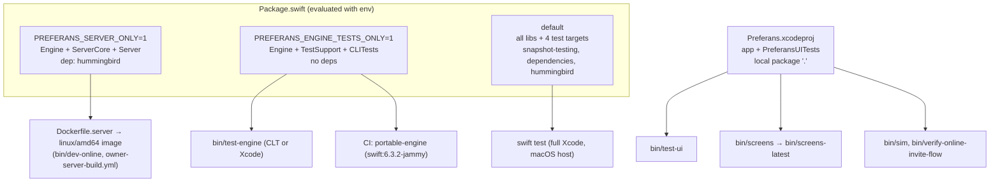
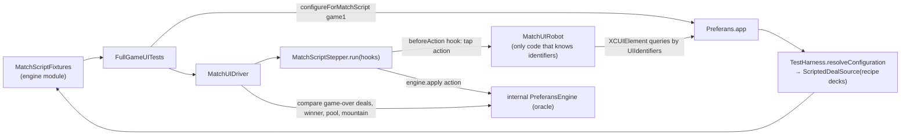
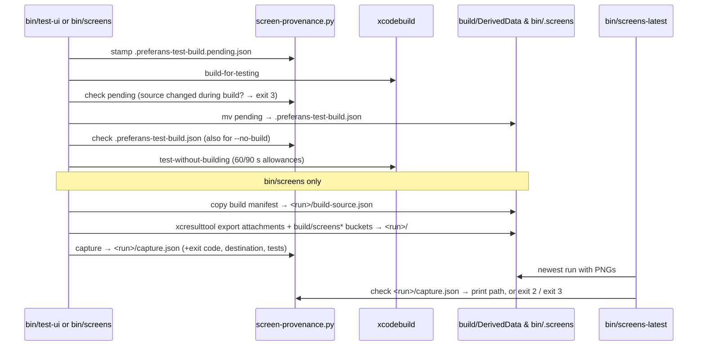
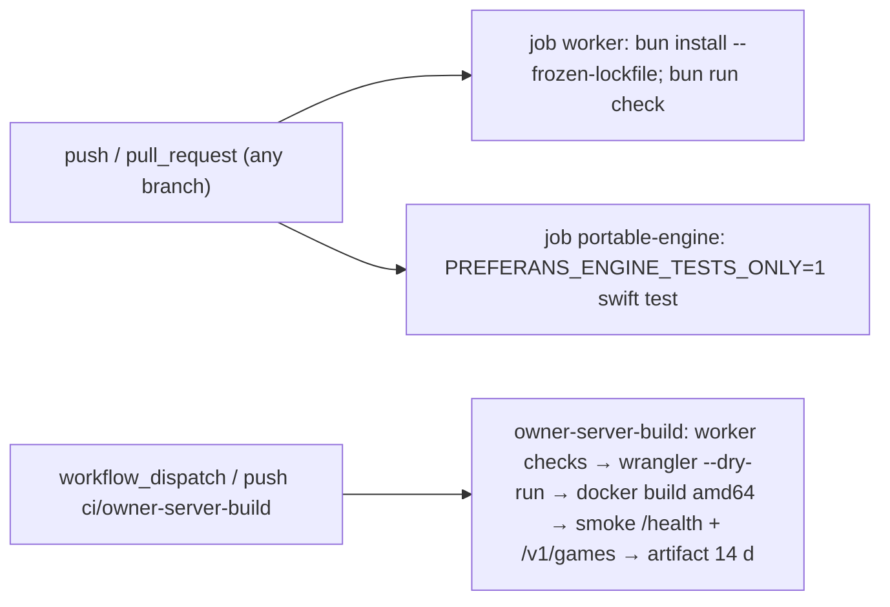
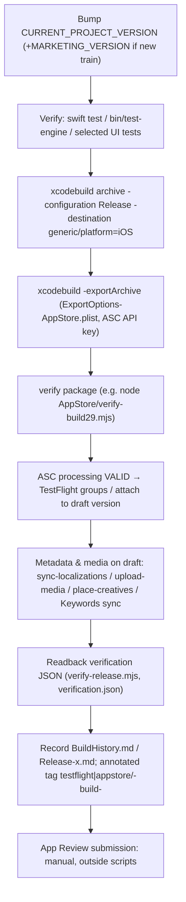

# Implementation Plan: Quality Engineering & Release Tooling (as-built)

**Branch**: `store/1.0.3-localized-keywords` @ `cd78828` · **Spec**: [spec.md](./spec.md) · **Research**: [research.md](./research.md) · **Quickstart**: [quickstart.md](./quickstart.md)

## Summary

The quality and release system is a set of thin, explicit tools around three facts of the codebase:

1. The rules engine (`Sources/PreferansEngine`) is pure Swift and portable, so it gets a dependency-free SwiftPM lane that runs on Command Line Tools and Linux CI.
2. The SwiftUI app is driven through a shared contract (`UIIdentifiers`, `UITestFlags`, `MatchScript`) that lives **in the engine module**, so the app, unit tests and UI tests compile against the same identifiers, flags and fixtures.
3. Simulator outputs (test build products, screenshots, store media) are expensive and easy to confuse with stale copies, so they are bound to a content hash of their inputs.

Release work is performed by `xcodebuild` plus small Node scripts against the App Store Connect API, each guarded to edit drafts only and leaving JSON evidence in `AppStore/`.

## Technical Context

| Item | As-built value | Source |
|---|---|---|
| **Language/Version** | Swift 6.0 language mode (`swift-tools-version: 6.0`, `SWIFT_VERSION = 6.0`); Linux toolchain `swift:6.3.2-jammy`; Bash; Python 3 (stdlib only); Node 24 / Bun (worker, `AppStore/*.mjs`); Ruby (fastlane, not pinned) | `Package.swift`, `project.pbxproj`, `Dockerfile.server`, workflows |
| **Xcode** | Project upgraded with Xcode 26.4 (`LastUpgradeCheck = 2640`, targets created with 26.4.1); build 29 archived with Xcode 27.1 build `27A9275`, SDK `iphoneos27.1`; `xcresulttool export attachments` needs Xcode 16+ | `project.pbxproj`, `AppStore/Release29/package-verification.json`, `bin/screens` |
| **Primary Dependencies** | XCTest, Swift Testing, XCUIAutomation; `swift-snapshot-testing` 1.19.4 (from 1.17.0); `swift-dependencies` 1.17.1 (from 1.5.0); `hummingbird` 2.26.0 (from 2.22.0); 32 pinned packages total | `Package.swift`, `Package.resolved` |
| **Storage** | Files only: `Tests/PreferansEngineTests/__Snapshots__/**.txt`; `build/DerivedData/.preferans-test-build.json`; `bin/.screens/<run>/` (PNG, `build-source.json`, `capture.json`) + `<run>.xcresult`; `build/screens*` buckets; JSON evidence under `AppStore/` | scripts |
| **Testing** | 3 Python, 47 portable Swift Testing, 234 engine-core XCTest, 289 app (265 XCTest + 24 Swift Testing), 9 server-core, 63 XCUITest instances; worker tests in `specs/004` | `Tests/`, `PreferansUITests/` |
| **Target Platform** | App: iOS 17.0+, iPhone + iPad (`TARGETED_DEVICE_FAMILY = 1,2`), Mac Catalyst enabled; package: iOS 16 / macOS 14 / tvOS 16 / watchOS 9; host tests on macOS; engine lane + server on Ubuntu jammy | `project.pbxproj`, `Package.swift` |
| **Simulators** | `iPhone 17 Pro` (`bin/test-ui`, `bin/screens`), `iPhone 17` (`bin/sim`), any 3–4 booted sims (`bin/verify-online-invite-flow`) | `bin/*` |
| **Project Type** | Monorepo: iOS app (Xcode project) + Swift package (engine, app library, server) + Cloudflare Worker (`workers/room-worker`) | repo root |
| **Performance Goals** | UI test allowance 60 s default / 90 s max; full 4-player bot match to pool 6 "well under a minute"; scripted UI match "under the 30-second budget"; engine canonical replay measured in ms | `bin/lib/xcode-sim.sh`, `AGENTS.md`, `UIIdentifiers.swift`, `EngineMatchDriverTests.swift` |
| **Constraints** | No parallel simulator clones; no `sleep`-based waits; no secrets in repo (`*.p8` etc. ignored); CI holds no deploy credentials; ASC edits only on `PREPARE_FOR_SUBMISSION` drafts | `bin/test-ui`, `docs/TESTING.md`, `.gitignore`, `AppStore/*.mjs` |
| **Scale/Scope** | 388 tracked files; test Swift LOC: CLI 440, core 5 779, app 9 591, server 228, support 197, UI 3 317; scripts 804 LOC; 363 commits since 2026-04-24; 29 builds | `git ls-files`, `wc -l` |

## Project Structure

```text
preferans/
├── Package.swift                 # 3 lanes selected by PREFERANS_SERVER_ONLY / PREFERANS_ENGINE_TESTS_ONLY
├── Package.resolved              # committed pins (32 packages); copied into the server Docker build
├── Dockerfile.server             # swift:6.3.2-jammy → release PreferansServer (server lane)
├── .dockerignore                 # excludes Xcode project, UI tests, build/, bin/.screens, worker node_modules
├── .gitignore                    # build/, DerivedData, bin/.screens/, *.p8/*.p12/*.cer/*.mobileprovision, *.ipa…
├── AGENTS.md                     # AI-agent rules: English, screenshot freshness, tight loops, BotPacing
├── README.md                     # overview, legal URLs, Xcode notes, bin/dev-online pointer
├── .github/workflows/
│   ├── multiplayer.yml           # every push/PR: worker `bun run check` + portable engine lane (Linux)
│   └── owner-server-build.yml    # manual / ci/owner-server-build: build+smoke server image, no deploy
├── bin/
│   ├── test-engine               # portable lane; CLT plugin paths; WATCH=1
│   ├── test-ui                   # build-for-testing once, test-without-building on one warm sim
│   ├── screens                   # screenshot suites → bin/.screens/<run>/ + capture.json
│   ├── screens-latest            # newest *source-matching* run, exit 2/3 otherwise
│   ├── sim                       # boot app on simulator with TestHarness flags
│   ├── dev-online                # Docker engine :18081 + wrangler dev worker :8787
│   ├── verify-online-invite-flow # 3–4 simulator invite flow via ONLINE_FLOW log lines
│   └── lib/
│       ├── xcode-sim.sh          # require Xcode (69), destinations, build/test helpers with provenance
│       └── screen-provenance.py  # stamp | check | capture (SHA-256 manifest)
├── Sources/PreferansEngine/      # test contract shipped inside the engine module:
│   ├── UIIdentifiers.swift       #   identifiers, UITestFlags (23 flags), AccessibilityStrings
│   ├── HandRecipe.swift          #   outcome → deck for 3 active seats
│   ├── MatchScript.swift         #   MatchScript / DealScript / DiscardChoice / CardPlayStrategy
│   ├── MatchScriptFixtures.swift #   game1 / game2 / game3 canonical pulkas
│   ├── EngineMatchDriver.swift   #   EngineMatchDriver, MatchScriptStepper (+hooks), MatchScriptError
│   └── DealSource.swift          #   xoshiro256** RNG, Random/Seeded/Scripted deal sources
├── Preferans/Support/
│   ├── TestHarness.swift         # launch-arg parsing, config resolution, DealScenario decks
│   └── BotPacing.swift           # interactive 500ms, normal 1200, slow 2200, testFast 10, instant 0
├── Tests/
│   ├── PreferansEngineTestSupport/EngineTestSupport.swift  # library target shared by test targets
│   ├── PreferansEngineCLITests/  # SwiftPM target PreferansEngineCLITests (portable lane, Swift Testing)
│   ├── PreferansEngineCoreTests/ # SwiftPM target **PreferansEngineTests** (XCTest)
│   ├── PreferansEngineTests/     # SwiftPM target **PreferansAppTests** (XCTest + Swift Testing)
│   │   └── __Snapshots__/{ProjectionSnapshotTests,TableScreenSnapshotTests}/*.txt   # 9 baselines
│   ├── PreferansServerCoreTests/ # SwiftPM target PreferansServerCoreTests
│   └── Tooling/test_screen_provenance.py   # unittest for screen-provenance.py
├── PreferansUITests/             # Xcode UI-test bundle (com.mixandmatch.preferans.uitests)
├── Preferans.xcodeproj/
│   ├── project.pbxproj           # targets Preferans (app) + PreferansUITests; local package "."
│   └── xcshareddata/xcschemes/Preferans.xcscheme   # only shared scheme; testables = PreferansUITests
├── fastlane/                     # legacy deliver lanes + 10 historical en-US screenshots
├── AppStore/                     # release records, ASC scripts, metadata, media, evidence (see below)
└── docs/                         # GitHub Pages legal site + engineering docs (TESTING, SERVER_CI, …)
```

### `AppStore/` layout

```text
AppStore/
├── BuildHistory.md               # per-build provenance 1.0 (18) … 1.0.2 (28)
├── Release-1.0.2.md, Release-1.0.3.md, ReleaseChecklist.md, PrivacyChecklist.md, ReviewNotes.md
├── ExportOptions-AppStore.plist  # app-store-connect, destination upload, automatic signing
├── Metadata.json                 # en-US metadata draft (2026-04, privacy notes updated 2026-07)
├── Metadata-1.0.2-draft.json     # 1.0.2 en-US draft + release prerequisites
├── Localizations/<24 locales>.json   # name, subtitle, promo, description, whatsNew, keywords, URLs (1.0.2 text)
├── Keywords-1.0.3/               # before/after/plan/verification JSON + generate.mjs + sync.mjs (23 locales)
├── Media/1.0.2/                  # iphone 1320×2868, iphone-medium 1206×2622, ipad 2064×2752 (3 each),
│                                 #   app-preview.mp4, creatives/header-{a,b} 5244×2950, provenance.json
├── Screenshots/{iPhone-6.5,iPad-13}/  # historical 1242×2688 / 2064×2752 (identical to fastlane/screenshots)
├── Release29/                    # build 29 package verification, source manifest (142 hashes), ASC readbacks,
│                                 #   export compliance, group access, what-to-test.txt
├── ReleaseEvidence/              # 1.0.2 build 28 readbacks: localizations, media, creatives, PPO experiment
├── UniversalLinks/               # apple-app-site-association + hosting notes
├── Assets/                       # README + icon-source/generate_app_icons.swift (AppKit icon renderer)
└── asc.mjs, sync-localizations.mjs, upload-media.mjs, render-media.mjs, record-preview.mjs,
    place-creatives.mjs, prepare-header-experiment.mjs, verify-release.mjs, verify-build29.mjs
```

### Test inventory (per file)

Counts are `func test…` (XCTest) or `@Test` (Swift Testing) occurrences; parameterized counts in brackets.

**`PreferansEngineCLITests`** (portable lane — 10 functions / 47 cases)

| File | # | Covers |
|---|---|---|
| `EngineGenerativeTests.swift` | 1 [36] | seeded legal-action walks, invariants + Codable round-trip each step |
| `BotDeterminismTests.swift` | 2 | `DealSampler` equal-seed equality; `CardPlayPlanner` purity |
| `BotTestDriverDiagnosticsTests.swift` | 4 | `BotTestDriver` stop-reason diagnostics (step bound, refusal, rejection) |
| `MisereVisibilityTests.swift` | 3 [5] | misère hand reveal after opening lead (3/4 players), bot sampler information boundary |

**`PreferansEngineTests`** in `Tests/PreferansEngineCoreTests` (234)

| File | # | Covers |
|---|---|---|
| `InvariantValidatorTests.swift` | 72 | each `validateInvariants` rule fires on a single violation |
| `ScoringVariantTests.swift` | 31 | Sochi/Leningrad/Rostov scoring variants |
| `PreferansEngineTests.swift` | 29 | core engine phases and transitions |
| `BotTests.swift` | 23 | bot decisions (auction, discard, play) |
| `MatchSettingsTests.swift` | 19 | pool target/closure, raspasy, totus settings |
| `BotInformationTests.swift` | 9 | rollout/sampling never leaks hidden information |
| `DealSourceTests.swift` | 9 | seeded RNG determinism, scripted cycling, concurrency |
| `EngineMatchDriverTests.swift` | 9 | canonical scripts reach game over on the last deal; contract mix; perf metric |
| `PulkaClosingTests.swift` | 9 | pulka closing, American aid, Leningrad balances |
| `HandRecipeTests.swift` | 8 | each recipe produces its named outcome; deck shape |
| `ScoringCalculationTests.swift` | 7 | scoring arithmetic |
| `SettlementInformationTests.swift` | 5 | settlement suggestions respect hidden cards |
| `BotSimulationReportTests.swift` | 2 | seeded bot-vs-bot matches (5, or 50 with `PREF_SIM_FULL=1`), hard correctness assertions |
| `MatchOutcomeTests.swift` | 2 | shared lead vs sole winner |

**`PreferansAppTests`** in `Tests/PreferansEngineTests` (289 = 265 XCTest + 24 Swift Testing)

| File | # | Covers |
|---|---|---|
| `RoomOnlineGameCoordinatorTests.swift` | 36 | online coordinator lifecycle, recovery, bots, sequencing |
| `TableLayoutModelTests.swift` | 29 | seat geometry and layout |
| `LobbyViewModelTests.swift` | 26 | lobby state, validation, table start |
| `GameViewModelTapAdvanceTests.swift` | 19 | tap-to-advance gate and frozen trick display |
| `SettlementTests.swift` | 15 (Swift Testing) | settlement propose/accept/reject, bots, JSON |
| `ProjectionTests.swift` | 14 | per-viewer projection privacy, legal actions; perf metric |
| `OnlineBotSeatTests.swift` | 14 | bot seat roster precedence |
| `ScenarioFlowTests.swift` | 12 | `DealScenario` decks drive expected engine flows |
| `OnlineTransportSecurityTests.swift` | 11 | legacy-server rejection, v2 registration, schema checks |
| `SingleWhistControlTests.swift` | 11 | open single-whist controlling actor |
| `DealSummaryPresentationTests.swift` | 9 | deal summary presentation |
| `RoomInboundMessagePolicyTests.swift` | 9 | inbound wire policy, host authentication |
| `WireCompatibilityTests.swift` | 8 | wire/snapshot round trips, legacy decoding rules |
| `ProjectionSnapshotTests.swift` | 6 (Swift Testing) | structural JSON baselines of `PlayerGameProjection` |
| `EventSourcingTests.swift` | 6 | validated action log, replay, tamper rejection |
| `GameViewModelDealSourceTests.swift` | 6 | view-model deal-source wiring |
| `OnlineGameLibraryTests.swift` | 6 | "Your games" library |
| `PreferansInviteLinkTests.swift` | 5 | invite link parsing |
| `RoomBotMoveSchedulerTests.swift` | 5 | online bot scheduling |
| `RoomDurabilityRetryRunnerTests.swift` | 5 | durable command retry timing (injected sleep) |
| `TestHarnessTests.swift` | 5 | automation detection, loopback URL guard, onboarding/language pinning |
| `LocalizationCatalogTests.swift` | 4 | string catalog completeness for supported languages |
| `OnlineWaitingRoomLayoutTests.swift` | 4 | waiting room layout |
| `ActivityLogFeedTests.swift` | 3 | activity log names/redaction |
| `CardDisplayOrderingTests.swift` | 3 | hand display ordering presets |
| `OnlineWorkerIntegrationTests.swift` | 3 | live worker (skips without `PREFERANS_WORKER_URL`) |
| `RoomHostRecoveryRunnerTests.swift` | 3 | host recovery orchestration |
| `ServerAuthoritativeCoordinatorTests.swift` | 3 | pending move receipts, server authority |
| `TableScreenSnapshotTests.swift` | 3 (Swift Testing) | structural table-screen contract baselines |
| `PublicTableLobbyTests.swift`, `SeatRoleBadgeFeedTests.swift`, `ThemePaletteTests.swift` | 2 each | public table catalog, role badges, theme contrast |
| `AppTestCase.swift`, `AppTestSupport.swift` | — | dependency overrides; `GameViewModelTestDriver` |

**`PreferansServerCoreTests`** (9): `AuthoritativeGameServiceTests.swift` 8 (wire fixture parity, full 3/4-seat matches through the server boundary), `PublicTableRulesTests.swift` 1 (worker public presets match Swift scoring).

**`PreferansUITests`** (59 methods; 63 instances)

| File | # | Validates | In `bin/test-ui` default? |
|---|---|---|---|
| `PreferansUITests.swift` | 11 | lobby controls, onboarding at XXXL text, local deal, 4-player seat, bidding options, all-pass, explicit Play confirmation, 4-player raspasy talon lead, scenario-pinned bidder, iPhone/iPad seat badges | yes |
| `MatchUITests.swift` | 10 | robot smoke on game1 auction; deal summary balances (+ XXXL); match end/rematch/leave (+ XXXL, tied lead); open-defense and misère settlement flows (+ XXXL); ten-trick whist convention | yes |
| `FullGameUITests.swift` | 3 | full replay of game1/game2/game3 through `MatchUIDriver` | yes |
| `AccessibilityContractTests.swift` | 3 | stable automation roots; online controls only in online mode; settings language control + account deletion dialog | yes |
| `ThemeUITests.swift` | 8 | six themes through lobby/settings/gallery/table; live theme switch persists; gallery at largest text | yes |
| `OnlineWaitingRoomUITests.swift` | 3 | in-memory all-bot room → waiting room → start; transactional seat fill; timed trick hold | yes |
| `OnboardingLocalizationUITests.swift` | 2 | Russian and Ukrainian onboarding titles | yes |
| `NativeOnlineUITests.swift` | 4 (+4 via `OwnerOnlineUITests`) | loopback host/guest/public-table flows; owner-server variant opt-in | yes (skip without services) |
| `OnlineScreensScreenshotTests.swift` | 3 | online lobby, waiting room device layouts, live table PNGs | yes |
| `RedesignScreenshotTests.swift` | 12 | design-review captures, App Store preview recording, human-vs-bots and watch-bots playthroughs | **no** (`bin/screens`) |
| `MatchUIRobot.swift`, `MatchUIDriver.swift` | — | robot, recorder, launch-argument builders; driver/oracle | — |

## Architecture

### Lanes and test layers



### UI test architecture (robot / driver / oracle)



### Source provenance pipeline



### CI



No job runs on macOS; no job deploys.

### Release flow (as practiced for builds 24–29)



## Key Flows

### 1. Portable engine lane
`bin/test-engine` → `cd` repo root → `PREFERANS_ENGINE_TESTS_ONLY=1` → (CLT: add Swift Testing plugin/rpath) → `swift test "$@"`. CI runs the equivalent in a Linux container.

### 2. UI test iteration
`bin/test-ui` → `preferans_build_for_testing` (stamp → build → check → promote) → `preferans_test_without_building` (check → `xcodebuild test-without-building` with serial execution and allowances). `--no-build` skips step one but never the check.

### 3. Screenshot capture and consumption
`bin/screens` (clean buckets → prune → build → check → run suites with `TEST_RUNNER_PREFERANS_SCREEN_DIR` → extract → collect buckets → `capture.json`). Consumers (`AGENTS.md`, `AppStore/render-media.mjs`) call `bin/screens-latest` first.

### 4. Scripted match
`MatchScriptFixtures.gameN` → `EngineMatchDriver` (unit, ms) or app launch with `-uiTestMatchScript gameN` + `MatchUIDriver` (UI) or `bin/sim gameN` (manual). The app pre-builds every deal's deck by replaying dealer rotation with a throwaway engine (`TestHarness.scriptedDealSource`).

### 5. Multi-simulator invite verification
`bin/verify-online-invite-flow` builds once into `/tmp/preferans-derived-data`, installs on N sims, streams `online-flow` logs, and waits for `create` → per-client `join` → host and clients `projection … sequence=1 phase=bidding`.

### 6. Store metadata
Edit `AppStore/Localizations/*.json` → `node AppStore/sync-localizations.mjs` (validate) → `ASC_VERSION_ID=… ASC_APP_INFO_ID=… ASC_KEY_PATH=… node AppStore/sync-localizations.mjs --apply` (draft-only, backup once, per-locale progress to `ReleaseEvidence/localizations-applied.json`) → `verify-release.mjs` readback.

### 7. Keywords (1.0.3)
`node AppStore/Keywords-1.0.3/generate.mjs` (select whole terms within 100 chars from `candidates.json` → `plan.json`) → `sync.mjs` (offline validation) → `sync.mjs --apply` (checks draft state, build selection, concurrent edits; writes `apply-progress.json`, `after.json`, `verification.json`) → `--rollback` restores `before.json` values if unchanged since.

## Release history & versioning

| Marketing version | Builds | Dates | Tags / branches | Notes |
|---|---|---|---|---|
| 1.0 | 4–24 | 2026-04 → 2026-07-06 | `testflight/1.0-build-5…18`, `rollback/testflight-1.0-build-4…17` (same commits), `appstore/1.0-build-19`, `appstore/1.0-build-20` | build 19 rejected (launch crash), fixed in 20; 21–24 ATT/onboarding |
| 1.0.1 | 25–27 | 2026-07-27 → 2026-09-12 | `appstore/1.0.1-build-27`; branch `release/1.0.1-build-27` | version raised because ASC closed the 1.0 train |
| 1.0.2 | 28 | 2026-10-15 | `testflight/1.0.2-build-28`; branch `release/1.0.2-build-28` | 24 store locales, new media, PPO draft; later `READY_FOR_SALE` |
| 1.0.3 | 29 | 2026-10-31 | `testflight/1.0.3-build-29`; branch `fix/owner-multiplayer-build29` | owner backend; TestFlight only; keywords on `store/1.0.3-localized-keywords` |

Build numbers never reset across marketing versions. Observed branch prefixes: `release/<ver>-build-<n>`, `store/<topic>`, `fix/<topic>`, `feature/<topic>`, `ci/<topic>`; changes land on `main` through GitHub PRs (e.g. PR #2 `release/1.0.2-build-28`, PR #3 `ci/owner-server-build`). Commit subjects mix Conventional Commits (`fix(scoring):`, `test(qa):`, `feat(multiplayer):`, `ci:`) with imperative sentences.

## Complexity Notes

- **Environment-driven manifest**: one `Package.swift` yields three graphs. This avoids extra manifests but means `swift test --filter X` resolves differently per lane, and the default lane cannot build on Linux.
- **Test contract inside the production module**: `UIIdentifiers`, `UITestFlags`, `HandRecipe`, `MatchScript*`, `EngineMatchDriver` compile into `PreferansEngine` (and therefore the shipping app and server). Runtime gating relies on the `-uiTest` prefix check and `#if DEBUG` for theme/preview flags.
- **Name inversion** between SwiftPM target names and directories (`PreferansEngineTests` ↔ `Tests/PreferansEngineCoreTests`, `PreferansAppTests` ↔ `Tests/PreferansEngineTests`) is historical and easy to trip over with `--filter`.
- **Two release toolchains** coexist: legacy fastlane `deliver` lanes (April 2026 metadata) and the ASC-API Node scripts used from 1.0.2 onward. Only the latter have draft-state guards and evidence.
- **Hard-coded release identifiers**: `verify-release.mjs`, `verify-build29.mjs`, `Keywords-1.0.3/sync.mjs` and `prepare-header-experiment.mjs` assert specific version/build/app IDs; they are per-release scripts, not reusable tools.
- **Provenance scope**: the manifest excludes `workers/`, `Tests/`, `docs/` and `AppStore/`, so worker or unit-test edits do not invalidate screenshots (by design: they cannot change rendered pixels).
